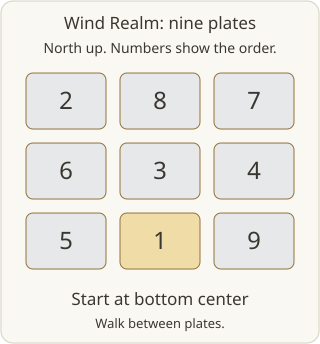
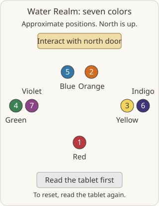
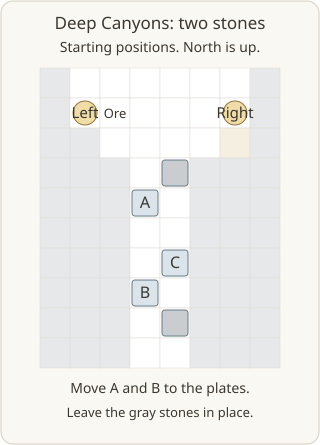
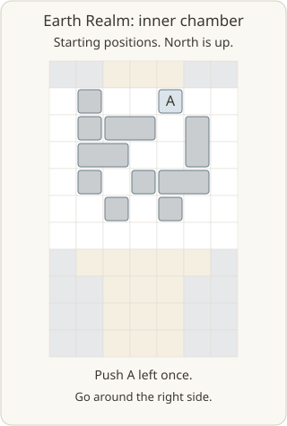
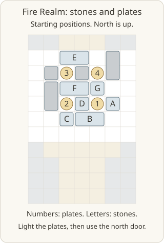

See which realm you can reach at your current story stage, or go straight to [arena entry and rewards](#arena).

## Four elemental realms {#realms}

| Realm | When to visit | What opens the entrance | Reward |
|---|---|---|---|
| [Wind](#wind) | Q4, after rescuing Garet | Four switches in the cave and Bandit Hideout | Gale Core Recipe and five Wind Essence |
| [Water](#water) | Q6, preferably after reuniting the party | Open the east passage and pull both sewer levers | Bubble Core Recipe and five Water Essence |
| [Earth](#earth) | Q14, when you can return via the northern shortcut in Deep Canyons | Light all three pressure plates | Shield Core Recipe and five Earth Essence |
| [Fire](#fire) | Q15, during the cave trip | Three switches and the north door off the east branch | Comet Core Recipe and five Fire Essence |

The realms are optional. Attacks of an Ancient Spirit's own element heal it, even if they're Synth attacks. Bring an attack of a different element. See [core recipes](equipment.qmd#realm-cores) for the materials and spells.

| What's holding you up? | Go to |
|---|---|
| The hideout boss door opens, but not the realm | [The Wind Realm's four switches](#wind-entry) |
| You stepped on the wrong wind plate | [Restart from bottom center](#wind-panels) |
| You can only reach one sewer lever | [Open the east route first](#water-entry) |
| You stepped on all seven colors but the door is shut | [Interact with the north door](#water-colors) |
| You're missing a canyon plate or the inner stones block the way | [Two-stone area](#earth-double), [one-stone area](#earth-single), or [inner chamber](#earth-inner) |
| You've shifted the Fire Realm's stones but can't leave | [Walk onto the four plates](#fire-inner) |

## Wind Realm {#wind}

### 1. Turn on the four switches {#wind-entry}

Rescue Garet in the mountain cave first. Then leave all four of these switches on:

| Switch | Where to look |
|---|---|
| Mountain cave | Enter the cave in the southeast of the mountains. The switch is at the north end of the small east room, separate from the northwest rescue room. |
| Central hideout | Northeast of the center of the area. |
| Upper east hideout | Take the more northerly of the central area's east exits and look northeast. The lower east switch is for the main route. |
| West hideout | Take the southwest door from the central area and look east of the middle of the west area. |

Once all four switches are on, interact with the door in the **northwest corner of the west area**. If a switch is already on, leave it alone: interacting with it again turns it off.

### 2. Step on the nine plates {#wind-panels}

Step on the plates in number order. North is at the top.

| 2 | 8 | 7 |
|---|---|---|
| 6 | 3 | 4 |
| 5 | 1 | 9 |

{width=320 fig-alt="Plates numbered in step order, top to bottom: 2, 8, 7; 6, 3, 4; 5, 1, 9."}

Start at **bottom center**. Walk between plates to avoid stepping out of order. If you make a mistake, start again at bottom center. The north door opens after the ninth correct plate.

### 3. Defeat the Ancient Spirit {#wind-reward}

Speak to the spirit at the north end and choose **Yes**. It absorbs Wind and Synth Wind, so use a different element. The reward is the Gale Core Recipe and five Wind Essence. Leave by the south exit to return to the west area of the hideout. For the main quest, go back to the central area, open [the north boss door](journey.qmd#hideout-gates), and [fight Gerard](journey.qmd#gerard). The Gale Core grants Air Blast.

## Water Realm {#water}

### 1. Open the east passage and pull both levers {#water-entry}

In the **third sewer area**, you come in from the south and glimpse someone ahead. The **fourth area** is just north of it, with a stranger by the northwest door.

1. Use the switch near the northwest corner of the third area to open the east passage.
2. Take the north exit in its northeast corner into the east half of the fourth area. Pull the lever near the southeast edge.
3. Return to the third area. The east lever opened the horizontal gate south of the center. Go through and pull the lever on the far west side.
4. With both levers on, return to the fourth area. Interact with the stone door just east of center on the north side.

### 2. Read the tablet and step on the seven colors {#water-colors}

Read the tablet just inside the entrance to reset the puzzle if you haven't solved it yet. Step on the colors in the order below, walking between plates so you don't activate one early.

| Order | Color | Location |
|---|---|---|
| 1 | Red | South of center, nearest the tablet |
| 2 | Orange | North of center, toward the east |
| 3 | Yellow | The western of the two plates on the east side |
| 4 | Green | The farther-west plate on the west side |
| 5 | Blue | North of center, toward the west |
| 6 | Indigo | Farthest east; darker than blue |
| 7 | Violet | The eastern of the two plates on the west side |

{width=320 fig-alt="Red is just south of center. Orange and blue are north of center, yellow and indigo east, green and violet west."}

Once you've stepped on all seven, face the door in the middle of the north wall and interact. Wrong color? Read the tablet again, then start from red.

### 3. Defeat the Ancient Spirit {#water-reward}

Head north, speak to the spirit, and choose **Yes**. Avoid Water and Synth Water. Win to get the Bubble Core Recipe and five Water Essence. Leave south to return to the fourth sewer area. You can then [rejoin the party](journey.qmd#sewers-reunion) or continue to [Judah and Clyde](journey.qmd#judah). The Bubble Core grants Bubble Blast.

## Earth Realm {#earth}

### 1. Find the three pressure plates {#earth-entry}

Return to Deep Canyons at the start of Q14 after the inn scene opens the route. Prepare Garet, Lex, and Su for the fight.

| Destination | Route |
|---|---|
| Two-stone area | From the first canyon area west of Artellus, take the lower of its west exits, then go south. |
| One-stone area | Leave the two-stone area north. Take the northern shortcut, then the west exit. |
| Realm door | From the one-stone area, leave northeast. Go south at the junction, then east back into the first canyon area. Look for the stone door north and a little west of center. |

The east exit from the northern junction leads toward Ivan’s old battlefield, not the realm door. Take the southern shortcut to get back to the door.

### 2. Move two stones onto the north plates {#earth-double}

Push one tile at a time. **A** is the upper stone in the left column, **B** is the lower one, and **C** is the middle stone in the right column.

| Step | Push | Where to stand |
|---|---|---|
| 1 | B north 1 | South of B |
| 2 | C north 2 | South of C |
| 3 | A north 3 | South of A. Mine the node just east of the left plate before turning. |
| 4 | A west 2 onto the left plate | East of A |
| 5 | B north 5 to the turning point | South of B |
| 6 | B east 3 onto the right plate | West of B |

{width=320 fig-alt="The two targets are north. A and B start in the left column, A above B. C starts midway up the right column."}

If you need to reset the stones, leave through the north exit and come back in. Plates you've already lit stay lit.

### 3. Move the single stone around the south path {#earth-single}

Start at the stone east of center. Push **south 6, east 2, south 3, west 13, north 14** to reach the pressure plate at the top of the western passage. Stand on the opposite side of the stone before changing direction. If needed, leave and re-enter to reset the stone. When all three plates are lit, follow the [return route](#earth-entry) to the realm door.

### 4. Clear the inner chamber {#earth-inner}

{width=320 fig-alt="Go around the right side, then push the single top-row stone near the right one space left to open a path north."}

Inside, walk up the **right side** of the stones. Stand east of the single stone near the right end of the top row and push it **one tile west**. Walk north through the gap and interact with the center door. Leaving south and re-entering resets the stones if needed.

### 5. Defeat the Ancient Spirit {#earth-reward}

Speak to the spirit at the north end and choose **Yes**. Avoid Earth and Synth Earth. Win to get the Shield Core Recipe and five Earth Essence. The core grants **Rock Shield**. Leave by the south exit to get back to the realm door in the canyons. If you're continuing Q14, see [what to do at the inn](journey.qmd#artellus-next). You can also check [when you can hand in the gloves](quests.qmd#cursed-gloves).

## Fire Realm {#fire}

### 1. Activate the three outer switches {#fire-entry}

| Switch | Directions |
|---|---|
| Entrance area | Look northeast after entering the cave from the south. |
| Small cave north of the entrance | Go north from the entrance area. Look near the northeast side, then return south. |
| Deep cave | From the entrance go east into the middle area, then north into the same area as Dark Behemoth. Look northeast. |

Return to the middle area, take the east exit, and interact with the door east of the north center. Leave all three switches on.

### 2. Move the stones and step on all four plates {#fire-inner}

{width=320 fig-alt="Starting stones A through G, with floor plates at lower right, lower left, upper left, and upper right."}

Push each stone **one tile**. Follow the pushes below. Step onto each plate yourself when you reach it.

| Step | Stone | Move and follow up |
|---|---|---|
| 1 | Lower-right single stone A | South; step on the lower-right plate. |
| 2 | Bottom horizontal stone B | South from the lower-right plate. |
| 3 | Lower-left single stone C | West; step on the lower-left plate. |
| 4 | Center single stone D | East to clear the passage north. |
| 5 | Top horizontal stone E | East from its west end; step on the upper-left plate. |
| 6 | Middle horizontal stone F | South from the upper-left plate. |
| 7 | Middle-right single stone G | West; step on the upper-right plate. |

When the four plates are lit, interact with the center door on the north side. Leaving south and re-entering resets the stones. If the north door has not opened yet, step on the plates again; the outer switches stay on.

### 3. Defeat the Ancient Spirit {#fire-reward}

Speak to the spirit in the north and choose **Yes**. Avoid Fire and Synth Fire. Win to receive the Comet Core Recipe and five Fire Essence. The **Comet Core** takes **two Fire Gems** and is distinct from the Meteor Core. Leave south to return to the north end of the eastern branch. Go west into the middle area, west again into the entrance area, then take the south exit out of the cave. Back at Regull Port, you can [hand in the boots quest](quests.qmd#cursed-boots) or [show the captain your Behemoth Claw](journey.qmd#behemoth-voyage).

## Arena: entry, challenges, and medals {#arena}

The Lemuria arena opens after the [audience with the King](journey.qmd#castle-audience). Pay Gold to enter challenges; spend Arena Medals in the shop. Accepting [The King's Request!](quests.qmd#the-kings-request) changes the challenge menu and adds shop stock.

| What are you here for? | Where to go |
|---|---|
| Find the arena or get past the entrance | [Entry and registration](#arena-entry) |
| Explore the old door backstage | [Bronze Jewel Recipe](#arena-passage) |
| Check opponents, fees, or medals | [Ordinary challenges](#arena-normal) · [New challenges](#arena-new) |
| Complete the King’s arena branch | [Special Challenge](#arena-special) |
| Try again after losing | [Recovery and re-entry](#arena-results) |
| Save up for a purchase | [Medal budget](#arena-medals) · [Medal Shop](#arena-shop) |
| Craft what you bought | [Recipes and next steps](#arena-weapons) |

### 1. Enter and sign up {#arena-entry}

From the upper-district lift, leave the street to the west. The arena entrance is near the center of the next street, on its north side. Talk to the official at the center counter. The first time, choose **Yes** to hear the rules, then pick a challenge. If you can cover the fee, you'll go straight in. Choose **On second thought...** to back out. You can choose the highest available challenge right away.

### Behind the old arena door {#arena-passage}

Take the left passage from the lobby, follow it west, and interact with the old door. Look for a light just west of where you arrive in the sewer to pick up the **Bronze Jewel Recipe**. To return, interact with the door northeast of the pickup and go east down the backstage corridor. Once you have the materials, make the Bronze Jewel under **Synthesize → Craft Weapon**.

### 2. Ordinary challenges {#arena-normal}

Win all three rounds to earn the listed medals.

| Challenge | Entry fee | Medals | Three rounds, in order |
|---|---:|---:|---|
| Challenge 1 | 200 Gold | 10 | Thief ×3; Pinrat, Blood Wasp, Traplant, Garantula; Darkspore Mossi, Blood Wasp, Traplant |
| Challenge 2 | 300 Gold | 25 | Fiper, Skeleton Soldier, Phantom Crow; Aquabi ×2, Cottontail, Shadowurm; Fiper, Vengeful Spirit, Ploba, Rockbi |
| Challenge 3 | 450 Gold | 50 | Pyrobi, Aquabi, Aerobi, Rockbi; Minotaur, Roc Bird, Aquabi, Pyrobi; Dark Pinrat ×2 |

In Challenge 2, Aquabi and Rockbi absorb their own elements. Challenge 3 adds Pyrobi and Aerobi. Use [barriers, protection, and absorption](equipment.qmd#battle-basics) to plan your attacks. With all three rounds won, Challenges 1, 2 and 3 cost 20, 12 and 9 Gold per medal. Pick one you can finish reliably.

### 3. New challenges {#arena-new}

Once you accept The King's Request! in Regull Port, these options replace the old three challenges.

| Challenge | Entry fee | Medals | Encounters in order |
|---|---:|---:|---|
| New Challenge 1 | 400 Gold | 50 | Cursed Tree, Phantom Crow, Trapperlant; Snapper, Cave Dweller, Phantom Crow; Trapperlant, Cave Dweller, Snapper, Phantom Crow |
| New Challenge 2 | 600 Gold | 150 | Aerobeast, Skullaroo, Armamole; Pyrobeast, Ice Golem, Skullaroo, Aerobeast; Octoking, Ice Golem, Skullaroo |
| Special Challenge | 900 Gold | 400 | One battle against Behemoth, Chimera, and Sea Demon |

The first two still run for three rounds. Snapper in New Challenge 1 absorbs water and has a barrier. In New Challenge 2, the wind and fire beasts absorb their own elements, and Octoking absorbs water.

### 4. Special Challenge: Behemoth, Chimera, and Sea Demon {#arena-special}

Choose **Special Challenge - Fee 900G** at the center counter. All three enemies fight at once. Each has a **1,000-point barrier**: Behemoth has water protection, Chimera earth protection, and Sea Demon wind and light protection. That protection also covers Synth attacks of the same element. Switch elements to break each barrier. Watch for Sea Demon's regeneration and blindness, and bring a way to cure paralysis. Eyedrops only cure blindness. Take out whichever enemy you can beat fastest to cut down on incoming attacks. Once a barrier breaks, check whether the protection is gone before switching back.

Win and finish the conversation back in the lobby to collect **400 Arena Medals**. This completes the arena branch. Finish the [portal branch](quests.qmd#portal-branch) too, then return to the same soldier in southeastern Regull Port for **50,000 Gold**. The arena attendant hands out medals; collect the Gold from the soldier. For a Behemoth Claw or Horn, hunt in the [cave](journey.qmd#behemoth-proof) instead.

Example: a level-55 party wins the Special Challenge

This party had 54 SP each and no ultimate weapons. They took down Sea Demon first, used cores to share the healing, and attacked with individual AP abilities and Su's Elemental Shift. They won in 26 turns with no knockouts, using three Remedies for paralysis. At 450 Gold each, that's 1,350 Gold to replace, or 2,250 with the entry fee. They used help with directional inputs.

### 5. Recovery, losing, and re-entry {#arena-results}

- The party recovers at entry, not between rounds. Entering clears meal buffs, but you keep any AP the meal gave you up front.
- The official pays medals after a completed challenge. You don't earn XP, Gold or the materials these enemies might drop outside the arena.
- Losing returns you to the lobby without this run's medals. Entry fees and used supplies stay spent; the next paid entry restores the party again.
- Talk to the official to enter again. A repeat Special Challenge still pays medals after its quest branch is complete. Medals already earned stay in your inventory until you spend them.

### 6. Plan your medal purchases {#arena-medals}

The table shows what you'd pay in entry fees if you start with zero medals and win every time:

| Purchase | Medals needed | Wins | Entry fees | Medals left |
|---|---:|---|---:|---:|
| Loyal Link Recipe | 750 | Special ×2 | 1,800 Gold | 50 |
| Adamantite ×1 | 900 | Special ×2 + New 2 ×1 | 2,400 Gold | 50 |
| Adamantite ×2 | 1,800 | Special ×5 | 4,500 Gold | 200 |
| Recipe and Adamantite ×2 | 2,550 | Special ×6 + New 2 ×1 | 6,000 Gold | 0 |

Three Special wins buy one Adamantite for 2,700 Gold in fees (300 medals left). Seven Special wins cover the recipe and both Adamantite for 6,300 Gold (250 left). That costs 300 more than the mixed routes but takes two fewer battles. If Special is too difficult, five New Challenge 2 wins cost 3,000 Gold for 750 medals; six cost 3,600 for 900. The quest still requires a Special win.

### 7. Medal Shop {#arena-shop}

Talk to the merchant to the right of the center counter. Accepting The King's Request! adds the second group of items immediately. You only need to buy each recipe once. Count how many weapons need Adamantite before buying it. Two Protection Cores of the same level don't stack on a character.

| When | Item | Medals |
|---|---|---:|
| From opening | Silver Armor (two Magic Core slots) | 5 |
| From opening | Feathered Robe (one Magic Core slot) | 15 |
| From opening | Arena Robe (two Magic Core slots) | 20 |
| From opening | Champion Belt | 25 |
| From opening | Faery Charm | 25 |
| From opening | Lvl.1 Protection Core (200 BP) | 150 |
| After accepting the quest | Adamantite | 900 |
| After accepting the quest | Loyal Link Recipe | 750 |
| After accepting the quest | Alluring Hat Recipe | 200 |
| After accepting the quest | Steadfast Boots Recipe | 200 |
| After accepting the quest | Protectors Bracelet Recipe | 200 |
| After accepting the quest | Lvl.3 Protection Core (450 BP) | 500 |

### 8. After you shop {#arena-weapons}

| Goal | What to buy at the arena | What you still need |
|---|---|---|
| [Alpha’s Bond](equipment.qmd#alpha-bond) | One Adamantite, 900 medals | The Lost Ruins recipe, Fire Gem ×5, Light Essence ×20, Mythril Crystal ×1 |
| [Omega’s Wish](equipment.qmd#omegas-wish) | One Adamantite, 900 medals | The Union Link reward, Earth Gem ×5, Light Essence ×20, Mythril Crystal ×1 |
| [Loyal Link](equipment.qmd#loyal-link) | Recipe, 750 medals | Wind Gem ×5, Red Halo ×10, Mythril Crystal ×1, Dark Matter ×1 |
| [Wishing Star](equipment.qmd#wishing-star) | Nothing | The first portal victory gives the recipe; add Water Gem ×5, Red Halo ×10, Mythril Crystal ×1, Orichalcum ×1 |
| [The King’s Request!](quests.qmd#the-kings-request) | Nothing | Win the Special Challenge and the portal battle; return to the original soldier |

For the [third Snowbell scene](memories.qmd#third-scene), win Union Link and hand in The King’s Request!, then rest in the village.
