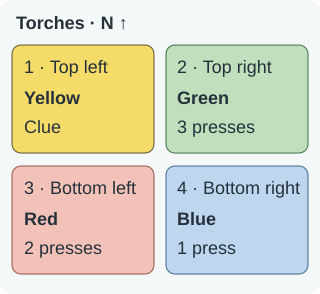
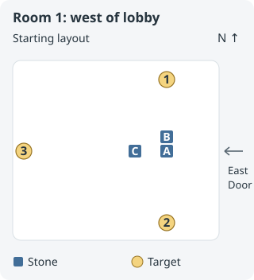
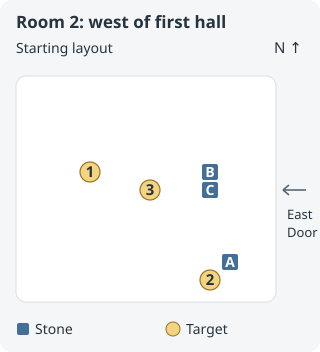
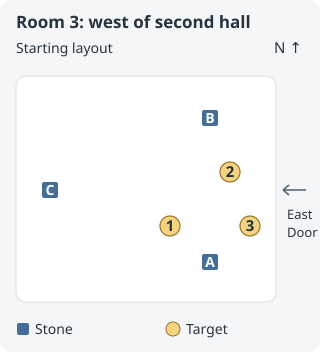
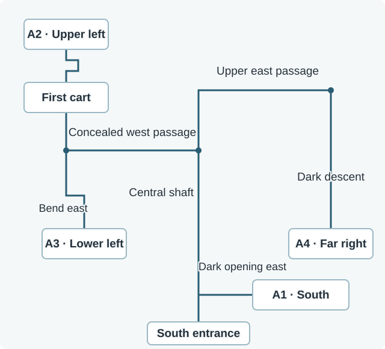
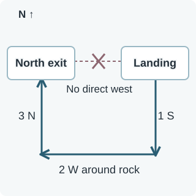
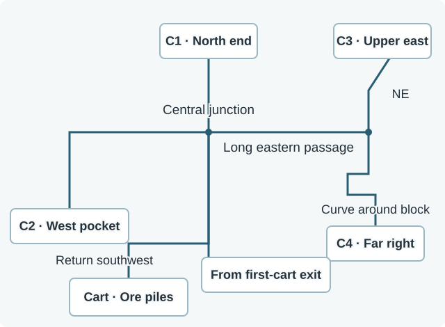
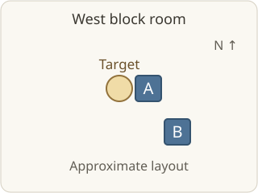
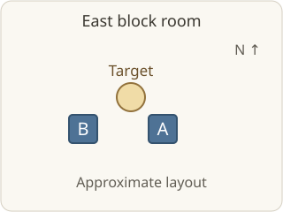
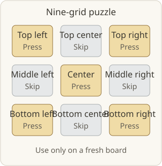

Start with your current location or the quest in your journal.

```{=html}
<nav class="journey-stage-picker" aria-label="Select a story stage">
<details class="journey-stage-group" id="journey-group-start" name="etheria-journey-group" open>
<summary>Opening and new home <span>Q1–10 · Elm Village to Lemuria</span></summary>
<div class="journey-stage-grid">
<a class="journey-stage-card" href="#forest"><span class="journey-stage-number">01</span><span><strong>Forest and Elm Village</strong><small>Q1–2</small></span></a>
<a class="journey-stage-card" href="#dhalium"><span class="journey-stage-number">02</span><span><strong>Dhalium and the farm</strong><small>Q3–4</small></span></a>
<a class="journey-stage-card" href="#lemuria"><span class="journey-stage-number">03</span><span><strong>Windmill Village and Lemuria</strong><small>Q5–6</small></span></a>
<a class="journey-stage-card" href="#home"><span class="journey-stage-number">04</span><span><strong>Our New Home</strong><small>Q7–10</small></span></a>
</div><div class="journey-stage-panels"></div>
</details>
<details class="journey-stage-group" id="journey-group-travel" name="etheria-journey-group">
<summary>Across the mainland <span>Q11–14 · Fort Aridale to Regull Port</span></summary>
<div class="journey-stage-grid">
<a class="journey-stage-card" href="#redsea"><span class="journey-stage-number">05</span><span><strong>Fort Aridale and Redsea Ruins</strong><small>Q11</small></span></a>
<a class="journey-stage-card" href="#femura"><span class="journey-stage-number">06</span><span><strong>Balora and the mine</strong><small>Q12</small></span></a>
<a class="journey-stage-card" href="#artellus"><span class="journey-stage-number">07</span><span><strong>Artellus and Deep Canyons</strong><small>Q13</small></span></a>
<a class="journey-stage-card" href="#emerald"><span class="journey-stage-number">08</span><span><strong>Emerald Forest to Regull Port</strong><small>Q14</small></span></a>
</div><div class="journey-stage-panels"></div>
</details>
<details class="journey-stage-group" id="journey-group-finale" name="etheria-journey-group">
<summary>Voyage and finale <span>Q15–17 · Infested Cave to Fortress of Souls</span></summary>
<div class="journey-stage-grid">
<a class="journey-stage-card" href="#ocean"><span class="journey-stage-number">09</span><span><strong>Cave and voyage</strong><small>Q15</small></span></a>
<a class="journey-stage-card" href="#arcius"><span class="journey-stage-number">10</span><span><strong>Arcius and Snowbell</strong><small>Q16</small></span></a>
<a class="journey-stage-card" href="#finale"><span class="journey-stage-number">11</span><span><strong>Fortress of Souls and ending</strong><small>Q17</small></span></a>
</div><div class="journey-stage-panels"></div>
</details>
</nav>
```

## The forest, Elm Village and Dhalium Town {#forest}

### Where am I? {#forest-progress}

| Where you are | Where to go next |
|---|---|
| Found the wounded dog | [Get the Eltio Salve Recipe](#wounded-dog) |
| Your money is missing | [Follow the thief to the Forest Cave](#track-thief) |
| The thief is beaten | [Return to Elm Inn](#elm-return) |
| It's morning at Elm Inn | [Pick up clothes at Elm Item Store](#elm-item-store) |
| The path east is blocked | [Take the cave route through Fara Mountain](#fara-detour) |
| You woke up alone in the Forgotten Ruins | [Find Garet before leaving](#ruins-rest) |
| You've reached Dhalium, but the quest is still open | [Visit the merchant and finish the scene outside](#dhalium-handoff) |

[]{#elm-first-night}

### Help the wounded dog {#wounded-dog}

Follow the forest exits east until you reach the dog. After the fight, take the north opening into a smaller clearing and inspect the orb on the northwest side for the **Eltio Salve Recipe**. Go back south and interact with the dog. The scene makes and applies the salve for you. Once it ends, take the east exit to the world map, then head south to **Elm Village**.

### Follow the thief {#track-thief}

In Elm Village, visit **Elm Inn**, in the southeast part of town, and talk to the innkeeper at the counter. The room conversation reveals that your money is missing. The innkeeper gives you a potion before you leave.

1. Take the village's south exit to the world map, then head north to the forest entrance.
2. Begin at the clearing where you found the dog. Go west through the next two forest areas and enter the cave on the northwest side of the second.
3. Approach the thief. The first turn includes a tutorial.
4. After winning, finish the conversation. Your companion follows you back to Elm Village.

### The thief: when Ability unlocks {#thief-battle}

The first-turn tutorial unlocks **Ability**, teaches **Double Slash** and gives you AP to use it during the fight.

### Spend the night at Elm Inn {#elm-return}

Retrace your steps east through the forest. Leave by the east exit and go south to Elm Village. Talk to the innkeeper again, then watch the meal, bedroom and morning scenes. **Removing The Contract** appears in your journal once you are back in the inn lobby.

### Optional: The Messenger {#elm-messenger}

In Elm Village, visit the house northwest of the inn to collect a letter for [The Messenger](quests.qmd#messenger). The first delivery is in Dhalium Town.

[]{#fara-dhalium}

### Get clothes at Elm Item Store {#elm-item-store}

Go west from Elm Inn to **Elm Item Store**. Stand at the counter just down and left of the shopkeeper and talk to him. Watch the scene outside the shop afterward: **Garet** introduces himself and joins the party. Leave Elm Village by the south exit and go east or northeast to **Fara Mountain**.

### Take the north cave through Fara Mountain {#fara-detour}

Follow the path east until you meet the man at the broken road. Finish the conversation, then go back to the west half of the mountain and take the cave entrance at its northern end.

1. In the first cave, take the exit on the east side, toward the south.
2. In the second cave, use the east exit near the north end. The northwest opening is a side passage.
3. In the next cave, head toward the east side of the central area for the rematch.

### Rematch in the cave {#fara-battle}

At the break in the fight, the tutorial unlocks **Synth** and gives you two **Water Essence**. If you already have **Wind Essence**, try **Water Essence → Wind Essence**. Each use spends one of each. Win the second part, finish the conversation and take the northeast exit to **Forgotten Ruins**.

### Camp in the Forgotten Ruins {#ruins-rest}

Inspect the orb just east of the first ruins entrance to get **Beginner Core Recipes** and **Magishard Recipes** and unlock **Equip Core** in the menu. Choose **Yes** to see the [core tutorial](equipment.qmd#core-install). To continue, take the southeast exit into the next area and inspect the campsite on the northeast side. The first night here is part of the story and uses no Camping Kit. After the meal, rest and dream scenes, leave camp and head southwest to find **Garet**. Finish the night and morning scenes. When Garet rejoins, cooking unlocks and you receive the **Camping Kit Recipe**, **Grilled Meat Recipe** and **Piko Juice Recipe**. Take the south exit. On the world map, go east or southeast to **Dhalium Town**.

### Meet the Slave Merchant in Dhalium Town {#dhalium-handoff}

From the south entrance, go north toward the **Slave Merchant** in the northwest part of town. Enter and watch the conversation. Step back onto the street and finish the scene there. **Lex** joins, **Removing The Contract** finishes, and **Exploring Dhalium** appears in the journal.

## Dhalium Town, Sunkurst Farm and Garet {#dhalium}

### Where am I? {#dhalium-progress}

| Where you are | Where to go next |
|---|---|
| Lex just joined and the mayor has no request | [Speak to residents and the family at the inn](#dhalium-info) |
| You rescued the mayor’s son, but Finding Garet hasn't appeared | [Read the note outside the eastern farmhouse](#farm-clue) |
| You want to claim the storage rewards or use the stove | [Return to the mayor](#dhalium-rewards) |
| You need to find Garet | [Go northwest to Gale Mountains](#find-garet) |
| Garet is back but the hideout doors are shut | [Check the switches](#hideout-gates) |
| Gerard has transformed | [Use Synth](#gerard) |

### 1. Ask around town, then visit the mayor {#dhalium-info}

1. Talk to the resident complaining about bandits near the item shop and houses in the south of town.
2. Enter the inn on the east side and speak to the father, mother and child. Ask about the farm. Speaking to the father can start [The Perfect Recipe 2](quests.qmd#perfect-recipe-2) before your first visit to the farm.
3. Go to the mayor's house in the northeast. When you have heard enough about the bandits, the mayor asks you to find his son **Earl**.

If the mayor has nothing new to say, finish the scene outside the Slave Merchant and check those four conversations again.

### 2. Rescue Earl and read the farmhouse note {#farm-clue}

Leave town and head north, slightly east, on the world map. At the farm, inspect Earl in the north-central area. After the conversation, inspect the note on the ground to the right of the eastern farmhouse door. Lex picks up a trail, **Exploring Dhalium** ends and **Finding Garet** enters your journal. You can now [follow it](#find-garet) or [return to the mayor](#dhalium-rewards).

### Optional: storage rewards and a stove {#dhalium-rewards}

1. After reading the note outside the farmhouse, go back to the mayor's house and tell him Earl is safe. He gives you the key to the storage room. Get it on this visit if you can: the mayor can switch topics later when you return for the couple in the slums.
2. At the house on the east side of town, use the key on the locked interior door. Pick up **450 Gold** just inside on the right. Then take the small stairs in the northwest and check both sides of the basement for a **Long Cape** and an **Elixir**.
3. To use the stove, speak to the woman in the kitchen at the mayor's house after Earl’s rescue.

### 3. Follow the trail to Gale Mountains {#find-garet}

From the farm, go northwest on the world map to **Gale Mountains**. Once Lex loses the scent, take the southeast cave entrance for Garet. The exit farther north on the east side leads to the bandit hideout after the rescue.

### 4. Rescue Garet and flip the cave switch {#garet-rescue}

In the southeast cave, enter the northwest room and win the fight. Continue until Garet rejoins and the journal asks you to defeat Gerard. Return to the passage, enter the east room, and activate the switch in the center of its north end. Leave it on when you return to the mountains.

### 5. Open the hideout gates {#hideout-gates}

Take the mountain's eastern exit farther north and enter the hideout by the northeast entrance of the next trail. Flip the switch just east of the center of the entrance area and take the north door to the central room.

| Switch | How to reach it |
|---|---|
| Cave's east room | Use the switch at its north end while rescuing Garet. |
| Central room | Check the northeast side of the middle area. |
| Upper east section | Take the northern of the central room's two east exits; the switch is in the northeast. |
| Lower east section | Take the southern east exit; the switch is on the middle-east side. |
| West section | Take the southwest door. Flip the switch in the middle-east part of the room, then return through the northeast door. |

The central room's west door needs the central switch and the **upper** east switch. The west section's return door needs its own switch and the cave switch. For the far-north boss door, leave the cave, both east and west switches on. Head north in the cave beyond that door to meet Gerard.

The northwest door in the west section leads to the [Wind Realm](exploration.qmd#wind); its switch combination replaces the lower east switch with the central one.

### 6. Fight Gerard {#gerard}

After he transforms and recovers HP, use **Synth**: **Wind Essence → Fire Essence** gives a wind attack that is particularly useful here. Ordinary wind magic works differently. Each use consumes one of each material.

After the fight, finish the scene. Garet receives a Soul Stone, and the journal sends you toward the Kingdom.

### 7. Check the journal and head east {#dhalium-next}

The next objective points to the forest camp to the east. If you picked up [The Perfect Recipe 2](quests.qmd#perfect-recipe-2), you can return to the Dhalium inn, speak to the father, then visit the mother at the farmhouse for the reward.

## Windmill Village, Lemuria and the castle {#lemuria}

### Where am I? {#lemuria-progress}

| Where you are | Where to go next |
|---|---|
| The journal points to the forest camp | [Camp before crossing Lumbly Bridge](#road-to-kingdom) |
| The guard blocks the lift | [Ask the quartermaster for passes](#upper-access) |
| You are controlling Garet and Su | [Help four households in the slums](#slums-four-visits) |
| You are controlling the protagonist and Lex again | [Go to the tavern for the witness lead](#clyde-sewers-castle) |
| You have the Blue House Key | [Speak to Clyde in the castle lobby](#lemuria-next) |

### 1. Camp, then cross Lumbly Bridge {#road-to-kingdom}

Exit the hideout to Gale Mountains and finish Lex's conversation about the bridge on the eastern side. On the world map, go east to the forest camp west of **Lumbly Bridge**. Inspect the rest spot just south of the center. Finish the evening and morning scenes, then continue east to the bridge. Approach the place where someone is calling for help. The first fight stops during the scene; finish the second and wait until **Su** joins. Walk east through both bridge areas.

### 2. Stop at Windmill Village {#windmill-stop}

Windmill Village is in the northwest part of the world map on this side of the bridge. The east item shop has [The Perfect Recipe 3](quests.qmd#perfect-recipe-3), which asks for four pieces of poultry. If you are carrying the letter for this village, speak to the Feraldian east of the inn entrance. Go east and slightly south from the village to Lemuria. Enter the Lower District and watch the arrival scene.

### 3. Get two passes for the lift {#upper-access}

The slums are west of the Lower District, the market is east and the lift is northeast. Approach the guard on the northwest side of the lift lobby. Let the party's discussion finish, then go to the soldiers' building on the west side of the Lower District. Speak to the quartermaster in the north part of the building for two temporary passes. The expensive Royal Pass mentioned elsewhere is not needed here. Finish the conversation outside and return to the lift. The protagonist and Lex go up; Garet and Su stay below.

### 4. Find the captain's quarters {#captain-quarters}

After taking the lift, move east to the next part of the Upper District, then enter the captain's quarters on its east side. Meet Fredrik and Terry. The scene returns you to the Lower District as Garet and Su.

### 5. Help the four households and report back {#slums-four-visits}

Enter the slums from the west side of the Lower District. Speak to the Feraldian outside the house in the middle to start helping residents. Visit these four in any order:

- The hungry man outdoors near the first house on the west.
- The boy inside that western house.
- The boy caring for his mother in the house east of center.
- The thirsty boy in the southeast house.

Return to the Feraldian outside the middle house. Garet has the food and water for this scene already. After you report back, the scene switches to the protagonist and Lex upstairs.

### 6. Find the witness, then enter the sewers {#clyde-sewers-castle}

Talk to the drunk soldier in the northern part of the Lower District tavern. Then speak to the Feraldian **inside** the central house in the slums. When the journal tells you to look in the sewers, inspect the drain in the southwest corner of the slums. The witness can be reached during the day.

### 7. Follow the sewers toward the northwest door {#sewers-entry-route}

| Area | Route |
|---|---|
| First | Take the rightmost northeast exit. |
| Second | Flip the southwest switch, then use the door east of the north side. |
| Third | Follow the figure you see near the southern entrance. Of the two north exits, take the western one. |
| Fourth | Approach the door in the northwest to trigger the scene. |

### 8. Use Su to free Garet {#su-prison}

Inspect Garet's cell door to switch to Su. Walk east, talk to the guard and defeat him for a key. Return to the same cell and interact to let Garet out. Once both are together, inspect the opening in the northwest and jump down.

### 9. Rejoin the party and open the deeper route {#sewers-reunion}

In the large sewer area, take the exit on the southwest side to the previous area. Flip the switch north of the nearby door. After the party reunites, take the northwest exit back into the large area. Flip the northwest switch for the south-central door and the southeast switch for the northeast door. Take the exit east of center on the north side, then the next room's north exit. The encounter starts as you go north down the long passage; save and check supplies before approaching.

### 10. Defeat Judah {#judah}

Judah starts with a **1,000 BP barrier** and can summon **Vengeful Spirit** and **Skeleton Soldier**. Check the targets as they appear and keep a healer ready. [Su Barrier](equipment.qmd#barrier-cores) protects one ally. After the fight and the scene with wounded Clyde, the party returns to the captain’s quarters. You receive the Lemuria medal, Lex gets the [Guardian Soulstone](equipment.qmd#equipment-cores), and your next stop is the castle.

### 11. See the King {#castle-audience}

Return to the Upper District around the lift and take the castle entrance to the north. In the lobby, ask the soldier in the east infirmary about Clyde. Then talk to the guard at the middle of the north side to show the medal and enter the throne room. Finish the audience to receive **3,000 Gold** and the **Blue House Key**.

### 12. Speak to Clyde again in the lobby {#lemuria-next}

Stay in the castle lobby and speak to **Clyde Cresswell**. Finish the conversation about resting and visiting residents in the Lower District. The journal then starts **Our New Home**. If Quest Assist points to the house before that entry appears, track the main quest and talk to Clyde first.

## Our New Home and the three household requests {#home}

[]{#our-new-home}

Once Clyde has sent you to the house, work on these two threads in either order: help the three households and finish Terry’s trial with Lex. Both lead to a conversation upstairs with Garet.

### Where am I? {#where-am-i}

- [Need to find the house or Lex?](#visit-new-home)
- [Still missing a household request?](#help-omega-households)
- [Torches already moved? Set these colors.](#lex-torches)
- [Done with the altar? Speak to Terry.](#trial-after-torches)
- [At the fort without the new objective? Find Alpin Lago.](#fort-aridale-handoff)

### 1. Find the house and talk to Lex {#visit-new-home}

Take the lift to the Upper District and go east. The house is southwest in that district, west of the captain’s quarters. Use the **Blue House Key**. Lex is downstairs by the table near the kitchen. Speak to him, then find **Fredrik** by his desk in the captain’s quarters. He sends you to **Guardian Grounds**, in an old cave among the trees southwest of the kingdom. The kitchen in the house is already available.

### Optional: speak to Su for an Elixir {#home-su-gift}

Speak to **Su** in the middle of the ground floor. He gives you one **Elixir**, which fully restores one party member’s HP and MP.

### 2. Help the three households {#help-omega-households}

Each request has its own journal entry. The man outside on the west side asks for Bread; the boy in the first western house asks for Fried Meat; the resident in the eastern house asks you to find his partner in Dhalium.

### 3. Food Shortage: bring five Bread {#food-shortage}

[]{#bread}

Speak to the hungry man outdoors on the west side of the slums. Bring him five finished **Bread**. If you need to cook them, use one **Clean Water** and one **Flour** per loaf. Choose to hand all five to the man and finish after his thanks.

### 4. The Hungry Kids: bring one Fried Meat {#hungry-kids}

[]{#fried-meat}

Talk to the boy in the first house on the west side. Bring back **one Fried Meat**, not Grilled Meat. Watch the children’s meal to finish the journal entry.

### 5. Shop and cook both meals {#home-cooking}

The recipe merchant near the south-central part of the market sells **Bread Recipe** for **161 Gold** and **Fried Meat Recipe** for **267 Gold**. The ingredient merchant is in the west part of the same district.

| What to make | Ingredients |
|---|---|
| Five Bread | Clean Water ×5, Flour ×5 |
| One Fried Meat | Rock Salt ×1, Pepper Powder ×1, Moka Herb ×1, Gali Root ×1, Gali Oil ×3, Flour ×2, Poultry Meat ×2 |

Buying both recipes and every ingredient costs **1,943 Gold**. Buy only what you are missing. Use **Cook** at the kitchen in the new house. Gali Root, Poultry Meat and Monster Meat can also be bought in the market for the recipe requests in Lemuria, Windmill Village and Dhalium.

### 6. The Bond Of Two {#bond-of-two}

Talk to the resident in the east house in the slums. Go back to Dhalium and speak to the man in the garden west of the mayor’s house. Ask the mayor to release him from his contract. Speak to the man in the garden again, then return to the same house in Lemuria and watch the reunion.

### 7. Enter Guardian Grounds with Lex {#complete-terrys-trial}

After talking to Lex at the house and Fredrik in the captain’s quarters, go to the old cave southwest of Lemuria and speak to Terry. Step on the floor mechanism north of him. There are two successive sets of battles: clear both sides of the first set and go north through its gate, then clear both sides of the second set and take its north door to the torches.

### 8. Set the torches by position {#lex-torches}

{width=320 fig-alt="Upper left stays yellow. Set upper right to green, lower left to red, and lower right to blue."}

The upper-left torch stays **yellow**. The other torches cycle yellow → blue → red → green → yellow.

| Position | Target color | Taps from yellow |
|---|---|---:|
| Upper right | Green | 3 |
| Lower left | Red | 2 |
| Lower right | Blue | 1 |

If you already moved them, use the target colors rather than the tap counts.

### 9. Finish the altar, then speak to Terry {#trial-after-torches}

[]{#talk-to-terry}

Go north through the middle gate after setting the torches. Clear the later encounters and finish the scene at the altar. The protagonist and Lex learn **Rapid Rush**. Return to the entrance and speak to Terry; the journal points you back to the new home.

### 10. Return home and speak to Garet {#return-home}

Finish all three household journal entries and the conversation with Terry before returning. At the house, go upstairs and speak to Garet. If you haven't seen the initial upstairs conversation, finish it, then talk to him again. Finish the scene to get the lead for **Fort Aridale**.

### 11. Collect Clyde’s note at Fort Aridale {#fort-aridale-handoff}

[]{#home-fort-handoff}

After the upstairs scene with Garet, go to **Fort Aridale** and talk to **Alpin Lago** to collect **Clyde Note**. This finishes **Our New Home** and starts **Tracing The Steps**. If you reached the fort before the home scene, finish that scene and return.

## Fort Aridale and the Redsea Ruins {#redsea}

[]{#tracing-the-steps}

### Where am I? {#redsea-progress}

- [The journal still says Our New Home](#fort-aridale-handoff)
- [Find the ruins across the desert](#redsea-desert-route)
- [Find and solve the three block rooms](#pressure-rooms)
- [The fight is over but the quest is still open](#redsea-altar)

### 1. Prepare at Fort Aridale {#fort-preparation}

Get Clyde's note before leaving. Stock healing supplies for the fights in the ruins. The Feraldian in the northern part of the fort who complains about his harness offers [The Cursed Harness](quests.qmd#cursed-harness).

### 2. Cross the Redsea Desert {#redsea-desert-route}

Leave Fort Aridale by its south exit. From the entrance corridor onward, count a step each time you leave an area. Take these exits:

**South → South → East → East → South → South → West → West.**

Look for the stone entrance just north of the center of the final area. If the desert loops back and you lose your place, return toward the fort's narrow north corridor and restart the count.

### 3. Optional: the Cursed Harness {#redsea-sidequests}

With the request active, leave the area outside the ruins by its west exit. Fight the spirit near the center of the next area. Return to the original requester at the fort to collect the harness and complete the quest. From the area outside the ruins, the route back is **east, east, north, north, west, west, north, north, north**.

### 4. Help Clyde inside the ruins {#redsea-clyde}

Take the west passage from the entrance room. Approach Clyde in the central hall and defeat the two Darkspore enemies. After the conversation, find the three block rooms to open the central north door.

### 5. Locate the three block rooms {#pressure-rooms}

| Room | Entrance |
|---|---|
| [First](#redsea-room-one) | West door in the central hall. |
| [Second](#redsea-room-two) | West door in the first corridor south of the hall. |
| [Third](#redsea-room-three) | West door in the second corridor south of the hall. |

Stand at the middle of a block’s side, face it and interact once. Wait until the slide stops before changing sides. All three targets must be held down together. A flash confirms completion. If the blocks are out of place, leave the unfinished room by the east exit and re-enter to reset them; solved rooms stay solved.

### 6. First block room {#redsea-room-one}

{width=320 fig-alt="B starts above A in the middle; C is west of both. The three targets are north, south, and west."}

#### Six pushes from the starting layout {#redsea-one-reference}

Identify A as the lower of the two middle blocks, B as the upper middle block, and C as the block to their west. Push in this order. Parentheses give slide distance, not the number of key presses.

**A left (1) → A down (2) → A right (1) → A down (3) → B up (4) → C left (7).**

A finishes at the south target, B at the north and C at the west. Exit east to the hall, then take its south exit.

### 7. Second block room {#redsea-room-two}

{width=320 fig-alt="B starts above C in the middle; A is farther southeast. Targets are upper west, middle west, and south."}

#### Eight pushes from the starting layout {#redsea-two-reference}

B and C are the upper and lower blocks in the middle; A is farther southeast.

**A up (1) → A left (1) → C left (3) → A up (3) → C up (1) → A left (3) → B down (6) → C left (3).**

C briefly covers the middle west target before moving off it. A finishes at that spot, B at the southern target and C at the upper west target. Exit east and continue south.

### 8. Third block room {#redsea-room-three}

{width=320 fig-alt="A starts south, B north, and C west. Targets are lower left, upper right of center, and lower right."}

#### Fifteen pushes from the starting layout {#redsea-three-reference}

A starts in the south, B at the north, C at the west. The target low on the left is 1, the upper target just right of center is 2, and the lower right target is 3.

**B right (1) → B down (3) → B left (1) → B down (4) → A right (1) → A up (3) → A left (2) → A down (1) → A left (1) → C right (8) → C down (2) → C right (2) → B up (5) → B right (1) → B down (1).**

B briefly covers target 2 before moving away. The final positions are A on 1, B on 2 and C on 3. Exit east and follow both corridors north.

### 9. Open the central north door {#redsea-inner-door}

After all three rooms flash, interact with the central north door in the main hall. Heal and check your supplies before going farther north.

### 10. Inspect the altar after the fight {#redsea-altar}

Approach **Lucis** and defeat the three Darkspore enemies. Their fire, water and earth protection differ; use attacks that are not protected to break the barriers. After the scenes, go to the north end and **interact with the altar**. Finish the conversation with Clyde to start **The Femura Territory**.

### 11. Leave the desert for Balora {#redsea-next}

[]{#redsea-femura-handoff}

Go south from the altar to the hall, east to the entrance room and south to the desert. Take the desert area's south exit and continue south through the corridor. On the world map, head southwest into Green Valley. On the first trip Su leaves the party. Take the valley's north exit, go to the Abandoned House and speak to Su by the tree at the north end. Return to Green Valley and continue west to the world map, then go to [Balora Town](#femura).

## Balora Town, Paradise Isle and the Femura mine {#femura}

[]{#the-femura-territory}

Follow the artifact lead through Balora and Paradise Isle, then cross the abandoned mine. **Two sets of four Wheels repair two different carts.** Finish this quest in the mine, then return to Balora to start the next one.


### Where am I? {#femura-progress}

- **Balora door sealed?** [Inspect it and speak twice to the worker](#paradise-lead).
- **Need Alroy or the Paradise mayors?** [Follow the plaza conversation east](#paradise-mayor).
- **Festival done, door still sealed?** [Return to the plaza for the Keystone reward](#festival-keystone).
- **Only one to three of the first four Wheels?** [Check the landmarks A1–A4](#four-wheels-cart) to find the one you missed.
- **First cart broken, even with four Wheels?** [Inspect → repair → ride](#first-cart-actions).
- **Rode the first cart, can't leave?** Follow the [south → west → north detour](#far-side-exit).
- **Second cart broken / cart not working?** [Collect four NEW Wheels, then repair the ore-pile cart](#second-cart).
- **Need the second cart's west exit or stone arch?** Follow [D1–D4](#west-landing-arch).
- **Quest 12 Complete, next quest absent?** [Return to Balora Town](#balora-handoff); no NPC conversation is required.

### Find the Paradise Isle lead {#paradise-lead}

In Balora, follow the artifact investigation to the sealed mine door and inspect it. Find the **white-haired Feraldian worker** beside the **purple-roofed house** on the town's western side, near the blue crystal and wooden bridge. He'll ask for Bread. Talk to him **again** to learn where the mayor went. The conversation takes up to five Bread from your bag, but you don't need to bake another batch to get the lead. Inspecting the door alone won't open it.

*Purple Tree* is a separate request for three Purple Tree Bark, rewarding a Lvl.2 Protection Core. If *The Messenger* has reached Balora, it also has a local recipient. Neither request opens the mine.

### Speak to the Paradise Isle mayors and Alroy {#paradise-mayor}

Leave Balora through the south exit, then head **south and a little east** on the world map to **Paradise Isle**. Approach the **two mayors arguing in the central plaza**, beside the market stall and red forecourt. After their conversation, follow **Alroy Balora east** to the outdoor tables and stairs and speak to him for the Sea Hunting Festival lead. The Paradise *Messenger* recipient follows its Balora delivery.

### Finish the festival and obtain the Keystone {#festival-keystone}

At the central-plaza festival host, speak once to register Garet, then again and choose **Yes**. Garet enters the beach alone. Defeat the Octopi on the west and east sides in either order, then approach the center Octopi. That encounter leads to the Octoking and the festival's closing scene.

Leave through the beach's **northern exit**, and speak to the mayors again in the central plaza. Collect the **Keystone** from the mayors before returning to the sealed door in Balora.

After the festival, the separate request *The perfect recipe 6* asks for twenty Octopi Meat and rewards the Octo Dumplings recipe. It is not part of the Keystone route.

### Return to Balora and enter the mine {#mine-entry}

With the Keystone, interact with the sealed Balora door and enter the abandoned mine. Follow the tracks to the **first broken mine cart** and inspect it: this introduces the first four-Wheel task.

A blue Slib in a nearby Femura cave belongs to *Finding Slibs*. Its later friends and reward are separate from the mine route.

### Find four Wheels and repair the first cart {#four-wheels-cart}

You can pick up the Wheels in any order. If you need all four, start in the south-central corridor and follow **A1 → A2 (upper left) → A3 (lower left) → A4 (far right)**.

**Already have some?** Revisit any landmarks you’re unsure about. The Wheels look identical in your inventory. You can collect all four before returning to the cart.

<figure class="guide-figure guide-topology" style="--guide-mobile-ratio: 320 / 580">
<picture>
<source media="(max-width: 600px)" srcset="assets/first-wheels-en-mobile.svg" width="320" height="580">

</picture>
<figcaption>Mine layout, not to scale.</figcaption>
</figure>

- [ ] **A1 · South-central:** From the south entrance-side corridor, take the dark opening **east** to the Wheel. Return to the **central shaft**, climb to the concealed **west passage**, and follow the left shaft to the **first cart**.
- [ ] **A2 · Upper-left:** From the central shaft, cross the concealed **west passage**, follow the bent **left shaft past the first cart**, and reach the upper chamber. After collecting it, retrace the left shaft to the **first cart**.
- [ ] **A3 · Lower-left:** Enter the left shaft via the **west passage** from the central shaft. Descend, shifting **east** where the straight-looking line stops, to the lower chamber. After collecting it, reverse those bends and climb back to the **first cart**.
- [ ] **A4 · Far-right:** From the central mine, take the **upper east passage**, then descend the dark **far-right shaft**. Reverse the descent and upper passage, then cross the concealed **west passage** and follow the left shaft to the **first cart**.

#### First cart broken: inspect, repair, ride {#first-cart-actions}

[]{#first-cart}

Inspect the cart first. With four Wheels, interact again to repair it. Repair uses all four. Interact once more to ride across.

### Leave the first cart landing {#far-side-exit}

[]{#first-cart-exit}

From the landing, go **south → west around the rock → north along the northern rail corridor** to the next mine area. If the top exit does not respond, step back below it, align with the corridor and walk north across the threshold.

<figure class="guide-figure guide-turn">

<figcaption>Go south, west around the rock, then north to the rails.</figcaption>
</figure>

### Collect the deeper-mine Wheels and repair the second cart {#second-cart}

The deeper mine has **four more Wheels and another broken cart**. The first repair consumed the earlier four. Use this second set for the **cart beside the ore piles and rails**.

If you need all four, look in **C1 → C2 → C3 → C4** before heading to the cart beside the ore piles. Already have some? Check the landmarks you have not visited yet.

<figure class="guide-figure guide-topology" style="--guide-mobile-ratio: 320 / 570">
<picture>
<source media="(max-width: 600px)" srcset="assets/second-wheels-en-mobile.svg" width="320" height="570">

</picture>
<figcaption>Connections in the deeper mine. The ore-pile cart is southwest of the central junction.</figcaption>
</figure>

- [ ] **C1 · Central north:** Follow the central rail passage **north** from the entrance to its upper-end Wheel. Retrace to the central junction, then follow the return passage **southwest** toward the **ore-pile cart**.
- [ ] **C2 · Western lower pocket:** From the central junction, take the **western branch** and descend into its lower pocket. Reverse that branch to the junction, then return **southwest** to the **ore-pile cart**.
- [ ] **C3 · Eastern upper end:** Take the long passage **east**, then **northeast** to the upper-end Wheel. Reverse the eastern passage to the junction and return **southwest** to the **ore-pile cart**.
- [ ] **C4 · Far-right:** Take the long eastern passage, descend its **eastern branch**, and curve around the obstructed stretch to the far-right Wheel. Reverse that curved descent and eastern passage, then return **southwest** to the **ore-pile cart**.

Continue with [D1–D4: second cart → west landing → stone arch](#west-landing-arch).

### Ride west and reach the stone arch {#west-landing-arch}

1. **D1 · Ore-pile cart:** With the four **new** Wheels, interact with the second cart to **repair** it. The repair consumes these four Wheels. Interact again to **ride west**.
2. **D2 · West landing:** From the landing, follow the passage **south**, then **west** to the edge exit. This is the second cart's exit route; the first cart's south–west–north detour is earlier.
3. **D3 · Final lower corridor:** In the last mine area, follow the long **lower corridor west**, then turn **north** toward the stone arch.
4. **D4 · Stone arch:** **Walk into the arched chamber** to trigger the artifact scene and confrontation.

#### Darkspore Drey at Femura {#scripted-drey}

<details>
<summary>Battle rule at the mine confrontation (encounter spoiler)</summary>

In this first **Darkspore Drey** fight, keep the party alive until the scene starts on **turn eight**. Defeat Darkspore Drey normally when you fight him again later.

</details>

When the journal marks *The Femura Territory* **Complete**, retrace the chamber's **south passage** and lower corridor **east** to leave, then reverse the cart crossings toward Balora. [The town return is still needed for Q13](#balora-handoff).

### Return to Balora after the journal completes {#balora-handoff}

Return to **Balora Town**. The follow-up starts as soon as you enter town. Let the scene finish and look for *The Journey Continues* in your journal.

## Artellus Town and the canyons {#artellus}

### Where am I? {#artellus-progress}

- [Find the worker and ask three residents](#artellus-arrival)
- [The inn scene has gone quiet: find Garet](#artellus-inn-night)
- [Find Ivan in the canyons](#canyons-route)
- [The town exit still points you to the inn](#artellus-next)

### 1. Find the worker in Artellus {#artellus-arrival}

After the scene in Balora starts **The Journey Continues**, head west on the world map to **Artellus Town**. Speak to the Feraldian worker by the southwest exit. The earthquake has blocked canyon travel; talk to residents while the road is being cleared.

### 2. Ask three people around town {#artellus-three-locals}

Talk to the Feraldian midway along the west side, the man southwest of the item shop, and the Feraldian on the east street south of the shops. Finish the party’s conversation about the mayor.

### 3. Meet Ivan at the mayor’s house {#artellus-ivan}

Enter the house at the center of the north end of town. Speak to **Ivan Argoth** toward the northeast inside. Follow his advice to stay at the inn.

### 4. Stay at the inn and find Garet {#artellus-inn-night}

The inn stands among the shops on the south side. Pay **200 Gold** and choose **Yes** after Ivan’s conversation. After the bedroom scenes, leave the inn at night and head north to find Garet east of the center of town. Talk to him. Let the morning scene finish before heading outside again.

### 5. Help the townspeople at the southwest exit {#artellus-town-rescue}

Approach the attack near the southwest exit and defeat the Darkspore enemies. Finish the conversations with Mayor Curtis, including the one that starts automatically inside his house. Once you hear that Ivan was taken into the canyons, use the town’s west exit.

### 6. Finish town errands before the confrontation {#artellus-before-canyons}

If you want to hand in [The Cursed Gloves](quests.qmd#cursed-gloves) now, beat the spirit and return to the requester before approaching Ivan. If the requester is already talking only about the story, finish the [lab rescue](#lab-rescue-return) and come back afterward.

### 7. Take the northeast exit to Ivan {#canyons-route}

Enter the canyons from the west exit of town. From the first large area, take the exit east of center on the north side. Entering the next area starts the confrontation.

### 8. Optional western branches {#canyons-detours}

For the glove spirit, take the more southerly of the first area’s two west exits, then go west three more times. On the last of these crossings take the northwestern exit and find the spirit on the west side of the small area. The [Earth Realm](exploration.qmd#earth) uses a separate set of switches and blocks; you can return by the northern shortcut after the inn handoff.

### 9. Fight the Chimera and the Darkspore enemies {#artellus-chimera}

Prepare healing and status cures before entering. Earth and Synth earth are effective against the Chimera; the other two enemies have different protections against earth and water, including their Synth versions. Use an unprotected element or another attack first. The party returns to the mayor’s house automatically afterward.

### 10. Finish the mayor’s scene {#town-canyons-handoff}

Continue until the story points to the forest and Emerald Garden. The protagonist is temporarily unavailable for battle; plan for Garet, Lex and Su.

### 11. Interact with the inn door before leaving {#artellus-next}

Go back to the inn in the south of town and **interact with its entrance**. Finish the scene where Garet collects the protagonist and the party reunites. Then take the west exit into the canyons, the north exit east of center, and the next area’s north exit to the world map. The forest is northeast.

## Emerald Forest, the lab and Regull Port {#emerald}

### Where am I? {#emerald-progress}

- [It looks like the forest is looping](#forest-east-loop)
- [Find the seven lights](#forest-seven-lights)
- [Need the four directions](#forest-directions)
- [Find a ship at Regull Port](#regull-arrival)

### 1. Read the bird statue {#forest-stages}

Enter the forest from the world map after the inn handoff. Find the central clearing and read the bird statue before trying its routes. Count crossings between areas, not steps between trees.

### 2. Cross the east corridor five times {#forest-east-loop}

Leave the statue clearing by its east exit. From the corridor, take the east exit **five times**. The corridor keeps returning you to its west end. When the **Glass Eye** appears, interact with it and win. Return west to the statue and read it again.

### 3. Follow the seven lights {#forest-seven-lights}

Read the red-eyed statue. Walk directly onto the first six lights. For the seventh, face it, interact and win.

| Light | Location |
|---|---|
| 1 | Southwest of the statue clearing. |
| 2 | Midway along the west side of the northern woods; use the clearing’s north exit. |
| 3 | Northeast of the statue clearing; use the woods’ east exit. |
| 4 | East end of the east corridor. |
| 5 | Midway along the east side of the northern woods; return west to the clearing, then go north. |
| 6 | Northwest of the statue clearing; leave the woods to the east. |
| 7 | North part of the woods, just east of center; interact to fight. |

Leave the woods by the east exit and read the statue again.

### 4. Take the exits north, north, east, west {#forest-directions}

Read the directions at the statue first. Take the clearing’s north exit, the northern woods’ north exit, the clearing’s east exit, then the corridor’s west exit. Interact with the eye just south of the statue and defeat it, then read the statue again. If you get lost, re-read the clue and restart just these four crossings.

### 5. Defeat the Eye Of Judgement {#eye-battles}

Take the clearing’s north exit and the northern woods’ north exit to reach the new clearing. Heal before approaching the **Eye Of Judgement**. While **Reflect** is active, avoid fire, water, earth and wind. After winning, step into the emerald light behind the eye.

### 6. Enter Jiru’s lab {#lab-port}

Finish the first conversation in Emerald Garden, then enter the lab toward the north of the northwest side. Speak to **Jiru** and choose **Yes** when ready. Garet goes in alone.

### 7. Follow the five figures {#lab-memories}

Approach the protagonist at the center first. Then interact with the figures in order: northwest; southwest, before the far south end; southeast near the south side; northeast near the east side; southwest, farther south than the second. If the next one does not appear, finish the previous scene.

### 8. Finish the rescue back at the center {#lab-rescue-return}

After the fifth figure, return to the protagonist in the center and interact. Let the scenes play through to the lab and wait until the party is together and the objective is to find a way to Arcius.

### 9. Optional stops after the lab {#emerald-detours}

The hollow stump in the west-central part of the garden has a weapon lead and a separate Orichalcum request. The glove requester in Artellus will now talk about the [gloves](quests.qmd#cursed-gloves) again.

### 10. Go to the northwest dock in Regull Port {#regull-arrival}

From the garden, take the south light back to the eye’s clearing. Go south to the northern woods, east to the statue clearing, then west to the world map. **Regull Port** is southwest. At the port, approach the large ship at the northwest dock first. Wait until the party decides to question residents.

### 11. Speak to these four residents {#port-conversations}

| Who | Where |
|---|---|
| **Archi Locks** | Middle of the west street, south of the dock. |
| **Arrin Spears** | Southwest of the tavern. |
| **Polly Leana** | Southeast of the tavern, south of the east shop. |
| **Warren Hark** | In the southeast, farther south than Polly. |

Talk to all four in any order. The dock scene must happen before these conversations count.

### 12. Optional stops in Regull Port {#regull-detours}

The last delivery of [The Messenger](quests.qmd#messenger-finish) is in the northeast after the lab rescue and previous deliveries. Find the green Slib in the southeast and return to the Abandoned House for its recipe. If you turned in the gloves, look southwest for [The Cursed Boots](quests.qmd#cursed-boots).

### 13. Talk to Captain Gordon in the tavern {#emerald-next}

Enter the tavern east of the town center. Look for **Captain Gordon** near the north side of its main room. Finish his explanation after talking to all four residents. The journal now sends you to the cave for proof.

## The cave and the voyage {#ocean}

### Where am I? {#ocean-progress}

- [The ship won’t depart; speak to the captain inside](#emerald-next)
- [Win a Behemoth fight but no Claw dropped?](#behemoth-proof)
- [Have the Claw? Return to the tavern.](#behemoth-voyage)

### 1. Prepare in Regull Port {#ocean-preparation}

Check that you have the captain’s request. Bring supplies to heal, revive and clear Blind. For the [boots request](quests.qmd#cursed-boots), turn in the gloves first and speak to the requester in the southwest part of the port.

### 2. Find the cave north of the port {#infested-entry}

Leave Regull Port by the south exit. Head north and slightly east on the world map. The first part of the cave has a regular Behemoth.

### 3. Get a Behemoth Claw {#behemoth-proof}

Fight regular Behemoths until one drops a **Behemoth Claw**. A **Behemoth Horn** is another possible drop.

### 4. Choose an optional branch {#infested-branches}

The deeper north section holds the Dark Behemoth and the spirit for the boots request. The Fire Realm has a separate route. The first area's north exit leads to a smaller cave that contains one Fire Realm switch. The entrance area’s east exit leads to the middle area. From there, go north for the Dark Behemoth, boots spirit and another switch, or east for the Fire Realm door. To leave the cave from the deep area, go south, west, then south.

### 5. Fight the Dark Behemoth for Orichalcum {#dark-behemoth}

The Dark Behemoth is northeast in the deeper area, beyond the boots spirit. Bring revival, group healing and cures for Sleep and Confusion. Light and Synth light are effective. **Chant** warns of **Meteor**, a multi-hit party attack; check the turn order so Guard is still active when it lands. A teammate can restore Su’s MP while he heals or attacks. Victory yields **one Orichalcum, one Behemoth Horn and one Behemoth Claw**. The Orichalcum request and Wishing Star each consume their own piece. To fight it again, exit south into the middle area, then return through that area’s north passage. Heal and restock between attempts; switching maps won’t heal the party. To replenish ore instead, see [how mining nodes refresh](equipment.qmd#mythril-refining).

### 6. Find the boots spirit {#infested-boots}

From the starting area go east once, then north into the deeper portion. The spirit is toward the southwest there. Win and return to the quest giver in the southwest of Regull Port for the **Punishing Boots**. On the middle of the west side of the deep area, north of the spirit, mine the Mythril node to obtain ore and the recipes for the ingot and crystal. You can mine it without fighting the Dark Behemoth.

### 7. Find the Fire Realm entrance {#infested-fire}

Activate the switches in the northeast of the entrance area, toward the northeast of the little cave reached by its north exit, and in the northeast of the deeper area. From the middle area, go east and interact with the door near the northeast of that branch. Leave switches that are already active alone. See the [Fire Realm route](exploration.qmd#fire).

### 8. Finish cave requests in town {#ocean-revisits}

Check your Claw before returning to the captain. If you fought the boots spirit, go back to the original requester. Save the Horn for the Artellus crafting request.

### 9. Show Captain Gordon the Claw {#behemoth-voyage}

Return to Captain Gordon **inside the tavern**. Even though the log mentions both items, you only need a **Behemoth Claw**. It stays in your inventory after he checks it.

### 10. Board from the northwest dock {#ocean-departure}

Heal, restock, and then talk to Gordon beside the large ship at the northwest dock. **Yes.** starts the voyage and leads to a fight. Choose **I need more time.** to keep exploring first.

### 11. Defeat the Sea Demon {#sea-demon}

Break its starting barrier with attacks other than wind, light or their Synth equivalents. If **Regenerate** is undoing your damage, check your weapon, SP and core setup. Heal or revive while the enemy is submerged. **Ink Blast** can blind the party; use Eyedrops or an equivalent cure.

### 12. Disembark at Arcius {#ocean-arrival}

Finish the arrival conversation, then leave the deck through the southwest exit. Captain Gordon can take you back if you choose **Return to Regull Port**.

## Arcius and the Lost City {#arcius}

### Where am I? {#arcius-progress}

- [Just landed? Rescue the father and child.](#arcius-snow-rescue)
- [You rescued the villager but need the ruins lead](#villagers-ruins)
- [The central city gate is closed](#arcius-city-panels)
- [Inside the ruins? Open the western and eastern routes.](#arcius-ruins-hall)
- [The sky changed after returning to Snowbell](#arcius-story-return)

### 1. Rescue the father and child {#arcius-snow-rescue}

From the ship, take the southwest exit to the world map. Go southeast to the central snowfield and defeat the enemies attacking the father and child. Finish their conversation, leave the snowfield north, and go north and slightly east to **Snowbell Village**.

### 2. Speak to the father in Snowbell Village {#snowbell-father}

Talk to the family in the house near the northwest side. After the treatment scene, hear the request to search for the villagers. The empty house to its right is available for rest. Inspect the resting spot on the north side and choose **Get some rest**.

### 3. Search the camps {#snowbell-camps}

Leave Snowbell by the south exit. At the camp northwest of the village, speak to the wounded man in the center. For the other rescues, find the mother and child at the camp south of the ship landing, and the injured woman just east of center at the far southeastern camp. Finish each rescue conversation before leaving the camp to the south.

### 4. Return to the eastern house {#villagers-ruins}

In Snowbell, the man from the northwest camp waits on the west side **inside the house southeast of the empty house**. Speak to him to learn about the ruins to the east. This opens the Lost City on the world map.

### 5. Activate both mechanisms in Lost City Arcius {#arcius-city-panels}

Use the far eastern entrance on the world map southeast of Snowbell. The southeastern building contains the missing friend near its northwest corner. For the main route, step onto these two mechanisms:

1. Inside the **northwestern building**, go to the right.
2. Inside the **farther north building just east of center**, go to the left.

Use the large central door after both are activated.

### 6. Optional: the four knight trials {#arcius-knights}

After the relic rescue, return through the central door and the hall’s north door. Step onto the floor mechanism at the far north of the main chamber. Back in the city, a passage at the north of either northern building now leads to the Lost Ruins. Read the central tablet. Complete the four solo battles from left to right: Alpha, Beta, Gamma, Delta. Your party rejoins outside each room; heal between fights. After the fourth, inspect the orb at the north end for the **Alpha’s Bond Recipe**.

### 7. Find the two switches for the north door {#arcius-ruins-hall}

The main hall’s north door takes one switch on each side. Step on the floor mechanisms to make the blocks movable. In each room, slide the B block onto the gold target, then use the switch beyond the opened gate.

### 8. Open the west route {#arcius-west-lever}

1. Take the hall’s west exit and step on the mechanism in the northwest of the large room.
2. Use that room’s more northerly east exit. Step on the second mechanism in the northeast, then return west.
3. Take the more southerly east exit into the block room. Use the [west sequence](#q16-west-reference).
4. Continue east through the opened gate and activate the switch west of center on the north side. Retrace your steps to the hall.

### 9. Open the east route {#arcius-east-lever}

From the hall, go east through the block room, then east again. Step on the floor mechanism in the southwest of the switch room. Return west to push the blocks, then go east again through the opened gate. Activate the switch west of center on the north side, and return west twice to the hall.

### 10. Push the two sets of blocks {#dual-block-rooms}

Stand at the center of the appropriate side, face the block, interact once and wait for the slide to stop. Parentheses give slide distance. To reset an unfinished room, leave and re-enter.

| Block | Activation mechanism |
|---|---|
| West A | Southwest of the main hall. |
| West B | Northwest of the large room west of the hall. |
| East A | Southwest of the far east switch room. |
| East B | Northeast of the room reached by the more northerly east exit from the large western room. |

#### West room: ten pushes from the original layout {#q16-west-reference}

{width=320 fig-alt="B starts southeast of the gold target. A starts east of the target."}

B starts southeast of the target; A starts nearby to its east. **A down (3) → A left (4) → A up (6) → A right (6) → A down (4) → B left (6) → B up (6) → B right (6) → B down (3) → B left (4).**

#### East room: four pushes from the original layout {#q16-east-reference}

{width=320 fig-alt="A and B start on the same row, with A to the right of B. The gold target is northeast of B."}

A and B start on the same row, with A to the right of B. The gold target is northeast of B. **A right (3) → B right (7) → B up (2) → B left (4).** A stops B at the right position on its second move. Return to the switch room once B is on the gold target.

### 11. Open the hall’s north door {#arcius-inner-door}

After activating both far-room switches, interact with the north door from the main hall. Heal now. Moving past the middle of the chamber starts the relic scene and returns you to the city for a battle.

### 12. Defeat Darkspore Drey {#later-drey}

This encounter requires a victory. Light and Synth light work well; dark is less effective. Afterward, you return to the house in Snowbell. The **Corrupted Blade** absorbs dark but drains HP while equipped.

### 13. Finish the scene outside Snowbell {#arcius-story-return}

Follow the conversation out of the house and finish the scene with the castle in the sky. Once the party suggests finding Gordon, the journal advances to the final phase.

### 14. Before sailing {#arcius-late-tasks}

The house to the right of the empty house now offers [Union Link](quests.qmd#union-link). A soldier southeast of the center of Regull Port offers [The King’s Request!](quests.qmd#the-kings-request). Both are available after the sky scene. If you rescued the mother and child, check the chest in the northeast part of their southwest house for the **Water Bangle**. If you rescued the woman in the southeast camp, talk to her by the grave east of Snowbell for the **Hydro Core Recipe**. The newly open southeast house also has a **Water Gem** in a chest east of the north side. The father’s house, left of the empty house, sells [ores and elemental essences](equipment.qmd#snowbell-materials) after the rescue request. To unlock [the third scene](memories.qmd#third-scene), win Union Link, finish and turn in both branches of The King’s Request!, then rest at the empty house in Snowbell.

## Fortress of Souls and the ending {#finale}

### Where am I? {#finale-progress}

- [Find the Volcanic Lands](#volcanic-sailing)
- [The nine switches are blocking the east room](#fortress-nine-grid)
- [The second hall still has a locked north door](#fortress-inner-floor)
- [Prepare for both final fights](#fortress-last-save)
- [Save after the credits](#finale-credits-save)

### 1. Finish any return trips before departing {#finale-revisits}

If you want the Snowbell scene, finish the [two late quests and rest](#arcius-late-tasks) before departing. Keep a separate save before the final stretch.

### 2. Sail to the Volcanic Lands {#volcanic-sailing}

Speak to **Captain Gordon** on the deck at Arcius or at the northwest dock in Regull Port. At Arcius, you may need to finish his new destination conversation and ask again. Choose **Sail to Volcanic Lands**. Leave the deck southwest and head southeast on the world map toward the ravine by the floating castle.

### 3. Find the portal below the castle {#volcanic-approach}

From the starting area take an east exit. Take the next area’s south exit, then the east exit, then the eastern exit nearer the north side. In the final area, walk east toward the castle and finish the party conversation. Interact with the portal that appears to the east and choose **Yes**.

### 4. Collect the orbs on the way to the first hall {#castle-ending}

After meeting Lucis, inspect the orb north of the center of the entrance hall. Go north and defeat both Darkspore Drey enemies. In the following corridor, collect one orb in the southeast and another in the northwest to open both central doors, then continue north.

### 5. Turn on the nine switches in the east room {#fortress-nine-grid}

{width=320 fig-alt="From a fresh grid, press each of the four corners and the center once."}

A switch flips itself and the adjacent switches up, down, left and right. Starting from untouched, press **upper left, upper right, center, lower left, lower right**, once each. Leaving the room does not reset the board. If you remember earlier presses, repeat them to undo them. Go north after the door opens and collect the orb before returning south to the hall.

### 6. Take the northeast orb and head west {#fortress-second-hall}

From the first hall, enter the northeast room and collect the orb at its north end. Then take the west exit of the hall into the long corridor and continue north. The northeastern orb opens the corridor’s middle door.

### 7. Two optional rooms {#fortress-detours}

The orb in the small northwest room off the west corridor opens the north room of the first hall, where the chest holds the **Dark Pendant**. The northwest room of the first hall is separate: it shuts behind you, and you must defeat the enemies at its north portal to reopen it.

### 8. Take three orbs and step on the northeast panel {#fortress-four-branches}

From the second hall, go to the northwest, southwest and southeast side rooms. Collect their orbs at their far ends to open the three doors on the central route. In the northeast side room, step on the floor mechanism at the eastern end. It opens a door you passed in the west corridor.

### 9. Return south to the room off the west corridor {#fortress-inner-floor}

From the second hall, leave south and go down the corridor to the west door toward its southern end. Inside, use the outside passages to collect the **south, north and east orbs**; you may also collect the west one. Go north from the central south passage and **step onto the central floor switch**. Return to the second hall and interact with the farthest north door.

### 10. Save before the two fights {#fortress-last-save}

A save crystal is to the right in the long corridor, and a campfire is nearby on the left. Rest with a **Camping Kit** or heal with what you have, then check equipment and save. Bring enough supplies for both fights. The second starts immediately, with the HP, MP, AP and items you have left. For group healing, use **Synth** with a High Potion and Purified Water to heal surviving allies. Proceed through the north exit and advance past the next room’s entrance to start the sequence.

### 11. Fight Mortimus and his two allies {#fortress-mortimus}

Use light or Synth light if you have it. **Mortimus** redirects damage to the other enemies while they are alive and can revive them. Take them down, use the opening to attack Mortimus, and keep healing available for the next fight.

### 12. Fight the Catalyst Demon {#catalyst}

The Catalyst Demon drains HP with physical attacks and can heal through **Regenerate**. It can add **5,000 BP** to a barrier that is still up and restore elemental protection. Use an unprotected element and wait for the protection icon to clear before switching back. If your healer is silenced, use **Echo Drops** or **Remedy** to restore their spells, including spells granted by healing cores. Near the end, the dialogue revives fallen allies and adds only **1 HP per character**, with no MP, AP, or item refill. Follow the directional prompts and finish the scene through the victory screen.

<details id="final-chain-sample">
<summary>Example: supplies used across both final battles</summary>

This level-60 party had 59 SP each and 12 equipped cores. They started at 0 AP, with no ultimate weapons or ability from Snowbell's third scene. They beat Mortimus in 28 turns. Their 72-turn Catalyst Demon win was a retry from the end of the first battle, with the same HP, MP, AP and items.

| Supplies used | First battle | Second battle | Total |
|---|---:|---:|---:|
| High Potion + Purified Water | 7 of each | 13 of each | 20 of each |
| High Mana Potion, including Synth ingredients | 2 | 16 | 18 |
| Revival Water | 0 | 1 | 1 |
| Clear Balm / Echo Drops / Eyedrops | 1 / 1 / 1 | 0 / 1 / 0 | 1 / 2 / 1 |
| Remedy | 0 | 2 | 2 |
| Elemental Essences | 0 | 3 of each of six elements | 18 |

Su went down in the second fight, and Lex brought him back with Revival Water. All four finished alive. The run used help with directional inputs.

Replacing these supplies would cost about **19,254 Gold**. [Rest and save before entering](#fortress-last-save).

</details>

### 13. Save after the ending {#finale-credits-save}

Watch the credits and epilogue to receive the **Memory Stone** if you do not already have it. Choose **Yes** at the save prompt. Select a slot and use **Save**; use a different slot to keep your pre-fight save.

### 14. Continue after the ending {#finale-after-clear}

Load the save from **Continue**. At the crystal you can [replay scenes with the Memory Stone](memories.qmd#ending). Going north starts the final encounter again. To leave, heal first if necessary, since saving and replaying scenes do not replenish your resources.

1. From the crystal corridor, go south through the second hall and through the south exit of the west corridor to the first hall.
2. Go south from the first hall, then south through the corridor where you collected two orbs. Inspect the portal on the south side of the entrance hall.
3. At the ravine, take the lower-left path around the rock pillars to the west exit. Then take the exits **west, north, west, west** to the world map.
4. On the world map, head northwest to the ship. Ask Captain Gordon to **Sail to Regull Port** or **Sail to Arcius**.

There is a save crystal in the Regull Port tavern. If **Save** is disabled in the menu, interact with the crystal to save.

## Journal, controls and task hints {#basics}

When a destination is open but the journal still shows the previous quest, check for a conversation or scene at the place you just left. 

### Quest Assist shortcuts {.unlisted #quest-assist}

On a map where you can move freely, **H** opens or closes the hint panel. Use **Tab** with it open to cycle through available targets; **N** toggles navigation. To choose an accepted quest directly, use **Quest → Available → Track this quest**. A gold ring marks where to stand for a block push; face the white arrow, interact once, and let the block stop.
