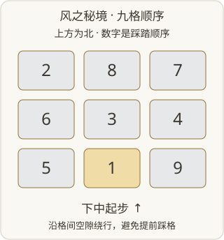
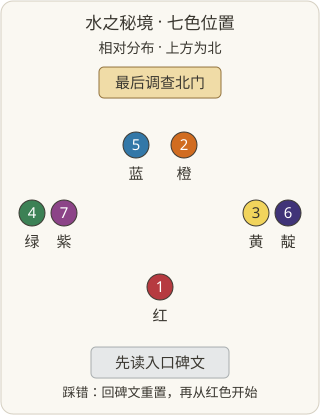
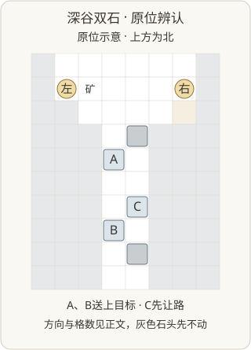
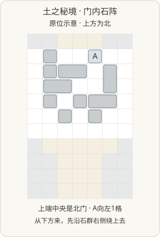
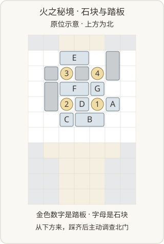

想拿核心配方，就从下表选你现在够得着的秘境。要打竞技场或买装备，直接跳到[报名与兑换](#arena)。

## 四处秘境：按主线进度选择 {#realms}

四个秘境各走各的，跳过也能继续主线。做[《女王驾到》](gm-differences.qmd#gm-queen)时，只需要其中的风之古灵。

| 秘境 | 什么时候安排 | 进入前要做什么 | 远古之灵的奖励 |
| --- | --- | --- | --- |
| [风之秘境](#wind) | Q4救回加雷特、探索盗贼藏身处时。 | 保持四处相关开关开启，从藏身处西区的西北门进入。 | 狂风核心配方、风之精华×5。 |
| [水之秘境](#water) | Q6进入下水道后；建议四人重新汇合再挑战。 | 第三片区域开通东侧通道，第四片东侧拉杆与第三片西侧拉杆同时开启。 | 泡泡核心配方、水之精华×5。 |
| [土之秘境](#earth) | Q13深谷可见入口；下面按Q14开头、北侧捷径已开放的回访路线写。 | 双石区域两处目标、单石区域一处目标全部点亮。 | 护盾核心配方、土之精华×5。 |
| [火之秘境](#fire) | Q15被污染的洞穴，可与靴子、山铜探索同趟安排。 | 洞窟三处开关保持激活，再去东支路的北门。 | 彗星核心配方、火之精华×5。 |

**配方还要制作成核心。** 四张配方的材料、安装位置和技能用途集中在[秘境核心的制作与使用](equipment.qmd#realm-cores)。各远古之灵会吸收自己对应的普通属性和战斗合成属性，进场前准备其他属性的攻击与恢复手段。

| 现在卡在哪里？ | 直接查这里 |
| --- | --- |
| 盗贼藏身处首领门已开，风秘境门却没开 | [风秘境的四处开关](#wind-entry)。 |
| 风秘境九块踏板踩乱了 | [从下中重新按九步走](#wind-panels)。 |
| 下水道只有一把秘境拉杆能到 | [先东侧、后西侧的连接](#water-entry)。 |
| 七种颜色踩完了，北门仍挡路 | [面向北门主动调查](#water-colors)。 |
| 深谷三处目标找不齐，或门内仍有石块挡路 | [双石区](#earth-double)、[单石区](#earth-single)、[门内通路](#earth-inner)。 |
| 火秘境只推了石块，门还是不开 | [四处踏板要由角色亲自踩亮](#fire-inner)。 |

## 风之秘境（被遗忘的国度）：开关与九格踏板 {#wind}

先[救出加雷特](journey.qmd#garet-rescue)，再从山地东侧偏北的路进盗贼藏身处；南侧平台是另一条路。风秘境和主线首领的门用的开关不全相同。

### 1. 保持四处开关开启，再去西区西北门 {#wind-entry}

| 开关 | 从哪里找 | 容易混淆的地方 |
| --- | --- | --- |
| 山地洞穴东侧小房间 | 从大风山脉东南洞口进入，再进洞穴东侧小房间；开关在北端中央。 | 救加雷特在西北房间，这处开关在另一间。 |
| 藏身处中央区 | 进入中央区后，找中部偏东北的开关。 | 它计入秘境门，不能因为最北首领门没用到它就略过。 |
| 藏身处东区上半部 | 走中央区较北的东出口，到东北部开关处。 | 东区下半部是另一处主线机关，不能代替这一处。 |
| 藏身处西区 | 经中央区西南侧的门进去，找中东部开关。 | 开好后，先去本区西北角的秘境门，不用先返回中央。 |

四处保持开启，调查**西区西北角的门**进入秘境。多次拨动会把开关关回去；门未开时按上表核对。

### 2. 九格踏板：下中起步，按编号各踩一次 {#wind-panels}

进入后向北，到三行三列的踏板区。下面的数字是**踩踏顺序**，上方为北。

{.img-fluid width=320 fig-alt="踏板从北到南三排：2、8、7；6、3、4；5、1、9。"}

按 **下中 → 左上 → 正中 → 右中 → 左下 → 左中 → 右上 → 上中 → 右下** 走。踏板靠**踩上去**触发。沿踏板之间的空隙绕行。

踩错会把顺序退回起点。回到**下中**，重新按完整九步走。第九步成功后，**北侧门自动打开**，继续向北即可。

### 3. 打完风之古灵，再看淋淋在不在 {#wind-reward}

走到最北端找**远古之魂**（风之古灵）开战。它吸收风和合成风，换别的属性打。

打赢后拿**狂风核心配方、风之精华×5**。接过[《女王驾到》](gm-differences.qmd#gm-queen)的话，先到北端存档点附近找淋淋，连聊三次领地才帽、推进日志，再走南口。

继续Q4时，回中央区，按[主线机关](journey.qmd#hideout-gates)检查最北首领门，再去[杰瑞德](journey.qmd#gerard)处。秘境完成不会代替这段主线。

## 水之秘境：下水道双拉杆与七色机关 {#water}

入口在[Q6下水道](journey.qmd#clyde-sewers-castle)的支路。可以在探索下水道时寻找机关；若眼前正切换队伍或越狱，先按[四人汇合步骤](journey.qmd#sewers-reunion)处理，再回来挑战。

### 1. 先开东侧通道与拉杆，再回西侧 {#water-entry}

这里用两片区域作地标：**第三片**是从南侧进入、会看见人影的那片下水道；**第四片**是其北边、西北门前会遇到陌生人的区域。

1. 在**第三片区域西北角附近**找开关，开启通往东侧的闸门。它是连接道路的开关，不是秘境所需两把拉杆之一。
2. 走第三片区域**东北侧的北出口**，到第四片区域东半部。找**东南侧、靠最东边的拉杆**，开启后保留状态。
3. 返回第三片区域。刚才的东侧拉杆也打开了本区**中南部横向闸门**，现在去**最西侧中下部的拉杆**，把它也打开。
4. 两把拉杆都保持开启后，回第四片区域，调查**北部偏东的石门**，进入水之秘境。

已拉开的开关保持开启。去不了西侧拉杆时，先回第四片东半部拉开东侧拉杆。

### 2. 读入口碑文，再按七色顺序踩踏板 {#water-colors}

从秘境南端进入，先调查**入口前方中央的碑文**，读完“七种颜色的顺序”提示；这也会重置尚未解开的踏板。接着按 **红 → 橙 → 黄 → 绿 → 蓝 → 靛 → 紫**，每种各踩一次。

{.img-fluid width=320 fig-alt="红在中央偏南，橙和蓝在中央偏北，黄与靛在东，绿与紫在西。"}

| 顺序 | 颜色 | 相对位置 |
| --- | --- | --- |
| 1 | 红 | 中央偏南，离入口碑文最近。 |
| 2 | 橙 | 中央偏北、偏东。 |
| 3 | 黄 | 东侧，两块踏板中靠西的一块。 |
| 4 | 绿 | 西侧，两块踏板中更靠西的一块。 |
| 5 | 蓝 | 中央偏北、偏西。 |
| 6 | 靛 | 东侧最远的一块；颜色比蓝色更深。 |
| 7 | 紫 | 西侧两块中靠东的一块。 |

沿空隙绕开还没轮到的颜色；踩过的格子这轮不再计数。**踩齐后走到北端正中的门前，面向门调查**，再进去。

**踩错的重来方式：** 回入口处重新读碑文，再从**红色**完整重走七步，最后再调查北门。

### 3. 水之远古之灵与返回路线 {#water-reward}

穿过北门，向北找远古之灵，交谈选择 **“是”（Yes）**。它会吸收**水、合成水**，改用其他属性；获胜取得**泡泡核心配方、水之精华×5**。

从秘境**南端出口**离开，会回到第四片下水道的秘境门前。继续[Q6下水道与汇合路线](journey.qmd#sewers-reunion)，或按当前进度前往[犹大与克莱德](journey.qmd#judah)；七色机关不属于Q6的必做条件。

泡泡核心提供单体水属性魔法**泡泡爆破**，取得配方后去[核心制作表](equipment.qmd#realm-cores)备料。

## 土之秘境：三处压板与门内石阵 {#earth}

这条路线与[Q13深谷主路](journey.qmd#canyons-detours)分开。**下面推荐在Q14开头回访：先完成旅馆门口接主角的对话，再回深谷，利用已开放的北侧捷径。** 此时仍由加雷特、莱克斯和苏负责战斗，按这三人的装备与恢复手段准备。Q13找伊万时，可以先记下秘境门，继续北方主线。

### 1. 找到双石、单石两片区域 {#earth-entry}

从阿特勒斯镇西口进入的**初始深谷区域**出发：

| 目标 | 进入路线 | 要做什么 |
| --- | --- | --- |
| 双石区域 | 走初始区域**西侧较南出口**，到下一片后走**南出口**。 | 两块目标石分别送到北面的左右压板。 |
| 单石区域 | 从双石区域北出口回前一片岔路，走**北侧捷径**到北边的岔路，再走**西出口**。 | 把中部偏东的目标石，经南边绕到西北压板。 |
| 秘境门 | 三处都亮后，从单石区域**东北出口**回北边岔路，走**南出口**回南边岔路，再从**东出口**回初始深谷。 | 调查初始深谷**中部偏西、靠北的门**。 |

不要从北边岔路的东出口一路走向伊万旧战场：那条北道与秘境门所在的南道隔着山壁。按上表经南侧捷径回到门前，能少绕一趟主线地区。

### 2. 双石区域：先左目标，再右目标 {#earth-double}

面向石头按调查键，**每次推动一格**，等停稳再推。图中A、B是两块目标石，C是右列中间的辅助石；其他石头先保留原位。

{.img-fluid width=320 fig-alt="A在左列、B在A下方，C在右列中间；目标是北面左右两个压板。"}

从原位开始，按下面顺序处理；方向指的是**石头移动的方向**，换方向时先绕到相反一侧。

| 顺序 | 推哪块、推向哪里 | 站位与结果 |
| --- | --- | --- |
| 1 | B向上1格。 | 站B南侧，先把下方通路让出来。 |
| 2 | C向上2格。 | 绕到C南侧，腾出右列中段。 |
| 3 | A向上3格。 | 从A南侧推到北面较宽处。到上方后，先采走左目标右边挡路的矿点。 |
| 4 | A向左2格。 | 绕到A东侧推，送上左压板；成功后压板亮起，这块目标石不再需要移动。 |
| 5 | B向上5格。 | 从B南侧沿左列向上推，到刚才A转向的位置。 |
| 6 | B向右3格。 | 绕到B西侧，送上右压板。确认两个目标都亮，再离开。 |

若已经推乱，可从区域北出口退出再进，未完成的石头会回原位；**已经点亮的压板会保留**。只剩一个目标时，按未完成的目标继续，不把已完成的那块也算作还欠一次。

### 3. 单石区域：经南边长路送到西北目标 {#earth-single}

这里的目标石在**中部偏东**，压板在**最西侧通道北端**。两者隔着地形，不能把石头直接向西北推过去。其他石头和宝箱先不动。

从目标石的原位开始，分五段移动：

| 段落 | 石头怎么移动 | 推之前站在哪里 |
| --- | --- | --- |
| 1 | 向下6格。 | 石头北面。 |
| 2 | 向右2格。 | 石头西面。 |
| 3 | 向下3格。 | 石头北面。 |
| 4 | 向左13格，沿南边横道到西侧竖道。 | 石头东面。 |
| 5 | 向上14格，送到西北压板。 | 石头南面。 |

每一格都面向石头调查，走到转角再换站位。中途有敌人挡路时，先处理遭遇再继续；若石头被推到别的位置，退图复位后重来。确认这处压板也亮起，再按[返回路线](#earth-entry)去秘境门。

### 4. 门内石阵：右侧绕行，把顶排单块左移 {#earth-inner}

三处压板全部点亮后，调查秘境门进入。门内还有一组石块；目标是到达北侧中央的门。

{.img-fluid width=320 fig-alt="沿右边绕，到最上排把偏右的单块A向左推一格，再向北。"}

1. 从入口沿石群**右侧**绕上去，找到**最上排靠右的单块A**。
2. 站在A**东侧**，面向左调查一次，把它**向左推1格**。其他长条和单块保持原位即可。
3. 从A原来的空位向北绕到**北侧中央门前**，面向门调查，打开后继续向北。

若门内石头已被改动，南出口退出再进可恢复石头原位；已打开的北门不必再做一次。

### 5. 土之远古之灵、配方与主线交接 {#earth-reward}

与北端远古之灵交谈，选择 **“是”（Yes）**挑战。它会吸收**土、合成土**，改用其他属性；获胜取得**护盾核心配方、土之精华×5**。成品提供**岩石护盾**，用于给队友施加防护，制作要求见[核心制作表](equipment.qmd#realm-cores)。

从秘境南出口回初始深谷的门前，再按[Q14出发路线](journey.qmd#artellus-next)前往翡翠森林。秘境的护盾核心配方和诅咒手套是两项不同奖励；若还有[手套回交](quests.qmd#cursed-gloves)，先看请求者什么时候能交谈，再决定何时回镇。

## 火之秘境：三处开关、四块踏板与北门 {#fire}

这条路线接在[Q15被污染的洞穴](journey.qmd#infested-fire)，可与[靴子挑战](journey.qmd#infested-boots)、[黑暗贝希摩斯](journey.qmd#dark-behemoth)同趟探索。秘境不检查是否已经接到靴子请求，也不属于船长的航行证明。

### 1. 洞窟外层三处开关，保持全部激活 {#fire-entry}

| 开关 | 在哪里找 | 怎样连接 |
| --- | --- | --- |
| 第一处 | **入口区东北部**。 | 从洞窟南端进入，在第一片区域向东北寻找。 |
| 第二处 | **入口区北面的小洞窟，北部偏东**。 | 入口区走北出口，找到后从南出口返回入口区。 |
| 第三处 | **北方深处东北部**。 | 入口区走东出口到中部区，再走北出口；与黑暗贝希摩斯所在的深处是同一片。 |

三个都激活后，回中部区，走**东出口**进入东支路，调查**北部偏东的门**。再次调查已开的开关会关闭它；已激活的保持原样。

### 2. 门内七次推石，角色亲自踩亮四处踏板 {#fire-inner}

进门后，石阵中央有四处踏板。**推石只负责让路，四块踏板都要由角色走上去。** 图中字母对应下面的石块，金色①–④是四处踏板。

{.img-fluid width=320 fig-alt="初始石阵标有A至G；踏板在右下、左下、左上、右上四处。"}

从原始布局开始，一次调查推一格，按表停下来踩踏板，不要连着把全部石块先推完：

| 顺序 | 推哪块、怎么推 | 然后去做什么 |
| --- | --- | --- |
| 1 | **右下单块A**向下1格。 | 走上**右下踏板①**。 |
| 2 | **底部横条B**向下1格。 | 从刚踩亮的右下踏板一侧，把下方横条往南推开。 |
| 3 | **左下单块C**向左1格。 | 走上**左下踏板②**。 |
| 4 | **中央单块D**向右1格。 | 把中央往北的绕行空间让出来。 |
| 5 | **最上方横条E**向右1格。 | 从横条西端向东推，再走上**左上踏板③**。 |
| 6 | **中部横条F**向下1格。 | 从刚踩亮的左上踏板一侧向南推。 |
| 7 | **右中单块G**向左1格。 | 走上**右上踏板④**，确认四处都亮。 |

四处都亮后，到**北侧中央通道前，面向门主动调查**，再向北去远古之灵；只踩踏板还不会自动开门。

**推乱时怎样重来：** 从南出口退出，再从洞窟门进入，石块恢复原位。北门尚未打开时，四处踏板也要重新踩一遍；洞窟外的三处开关不用重开。北门已经打开后，返回也无需重做踏板。

### 3. 火之远古之灵与彗星核心配方 {#fire-reward}

与北端远古之灵交谈，选择 **“是”（Yes）**开战。它会吸收**火、合成火**，换其他属性；获胜取得**彗星核心配方、火之精华×5**。

彗星核心用**火焰宝石×2**合成，装上后能用火属性群攻「彗星」。山铜任务给的流星核心是另一件。

从南出口离开，回到洞窟东支路北端。经东支路西出口回中部区，再向西回入口区、从南出口离开；去港口交靴子或继续[酒馆验收与航行](journey.qmd#behemoth-voyage)。取得这张配方不会自动交付靴子任务，也不会替船长验收。

## 竞技场（斗技场）：报名与奖牌商店 {#arena}

见过国王就能进斗技场。先用金币报名，赢了再用奖牌换东西；接下[国王的请求](quests.qmd#the-kings-request)，报名档次和货架都会换。

| 现在想查什么？ | 对应步骤 |
| --- | --- |
| 门口不放行，或不知道从哪里进去 | [开放时机与报名位置](#arena-entry)。 |
| 想找竞技场后台的旧门与配方 | [后台通道的青铜宝珠配方](#arena-passage)。 |
| 菜单还是挑战1／2／3 | [普通挑战的三轮与奖励](#arena-normal)。 |
| 菜单变成新挑战1／2 | [接国王任务后的普通挑战](#arena-new)。 |
| 要完成国王任务的竞技场分支 | [特别挑战：900金币、三只首领同场](#arena-special)。 |
| 打过一轮却没拿奖牌，或败北后想重来 | [结算、恢复与重新报名](#arena-results)。 |
| 想攒750／900奖牌，或一次换齐两份精金和配方 | [奖牌与报名费规划](#arena-medals)。 |
| 想看普通商品、扩展商品和各自价格 | [完整奖牌商店](#arena-shop)。 |
| 兑换后怎样接到终极武器 | [武器与任务交接](#arena-weapons)。 |

### 1. 入口与报名：上城区西侧，大厅中央 {#arena-entry}

1. 先完成[Q6觐见国王](journey.qmd#castle-audience)，看完领取房屋钥匙、返回大厅的剧情。进入上城区但尚未觐见时，竞技场入口仍会被拦。
2. 从**上层升降机出口**回到街区，走街区**西侧出口**，进入西边一片上城区。竞技场入口在这片街区**中央附近、街道北侧的建筑前**。
3. 进入大厅后，到**中央柜台**找登记员。首次普通报名会先询问是否参加，选择 **“是”（Yes）**听规则；之后直接选择挑战。已接国王任务时，会直接显示更新后的报名表。
4. 选择挑战并支付金币，队伍会自动进入场地。金币不足不会扣费或入场；想退出菜单可选 **“转念一想……”（On second thought...）**。

挑战编号是这次报名选的档次。**挑战3可以直接报名，特别挑战也不用先赢三场普通战。** 是否出现新菜单只看国王任务是否已经接取。

### 可选探索：后台旧门与青铜宝珠配方 {#arena-passage}

竞技场开放后，可以先走这条支路；**不需要报名、支付金币或赢一场挑战**。

1. 在竞技场大厅走**左侧通道**，进入后台走廊。
2. 沿走廊向西，到**西端的旧门**前主动调查，看完门被打开的短剧情。
3. 门打开后走进去，会来到下水道的一侧。调查**落点旁、偏西的发光点**，取得**青铜宝珠配方**。

取得的是武器配方，制作青铜宝珠仍需另备材料，在**合成→制作武器**中制作。要回大厅时，主动调查拾取点**东北侧的门**，回到后台走廊，再向东找大厅出口。

### 2. 普通挑战：接国王任务前的三档 {#arena-normal}

每档都是**连续三轮**，三轮全胜后才发该档奖牌。

| 报名选项 | 每次费用 | 全胜奖牌 | 三轮敌人，按出场顺序 |
| --- | --- | --- | --- |
| 挑战1（Challenge 1） | 200金币 | 10枚 | ①窃贼×3；②刺鼠、血蜂、陷阱草、加兰蛛；③暗孢莫西、血蜂、陷阱草。 |
| 挑战2（Challenge 2） | 300金币 | 25枚 | ①毒蛇、骷髅士兵、幽灵乌鸦；②水灵体×2、棉尾兔、暗影蠕虫；③毒蛇、复仇之灵、普罗巴、土灵体。 |
| 挑战3（Challenge 3） | 450金币 | 50枚 | ①火灵体、水灵体、风灵体、土灵体；②牛头人、鹏鸟、水灵体、火灵体；③黑暗刺鼠×2。 |

挑战2、3会遇到屏障、属性保护或吸收。水灵体吸收水、土灵体吸收土，挑战3还加入吸收火与风的灵体；不要对四种元素灵体一律使用同一种会被其中目标吸收的普通元素魔法。按[屏障、属性保护与吸收](equipment.qmd#battle-basics)分别处理。

从报名费换奖牌的比例看，三档分别为每枚 **20／12／9金币**，但只有全胜才能拿到奖励。先选能稳定打完三轮的一档。

### 3. 新普通挑战：接取国王任务后替换原菜单 {#arena-new}

在雷鸥港接下国王的请求后，原来的三档菜单会换成 **新挑战1、新挑战2、特别挑战**。这两档新普通挑战仍各有三轮，敌人和费用都与旧挑战不同。

| 报名选项 | 每次费用 | 全胜奖牌 | 三轮敌人，按出场顺序 |
| --- | --- | --- | --- |
| 新挑战1（New Challenge 1） | 400金币 | 50枚 | ①诅咒树、幽灵乌鸦、捕猎草；②游陆鲨、洞穴潜居者、幽灵乌鸦；③捕猎草、洞穴潜居者、游陆鲨、幽灵乌鸦。 |
| 新挑战2（New Challenge 2） | 600金币 | 150枚 | ①风灵兽、斯库拉鲁、甲鼹；②火灵兽、冰霜魔像、斯库拉鲁、风灵兽；③章鱼王、冰霜魔像、斯库拉鲁。 |

新挑战1的游陆鲨会吸收水并带屏障；新挑战2的风灵兽、火灵兽、章鱼王分别吸收风、火、水。三轮连战，留些 MP 给后面的敌人。

特别挑战打不过时，可以用这两档继续积攒奖牌。它们能用于购物，但**不能代替国王任务要求的特别挑战胜利**。

### 4. 特别挑战：三只首领同场，胜利给400奖牌 {#arena-special}

1. 确认已经在雷鸥港接下[国王的请求](quests.qmd#the-kings-request)。仅推进到阿修斯或来到竞技场，不会打开这一档。
2. 到中央登记员处，选择**「特别挑战-费用900金币」**（旧译特殊挑战）。
3. 场上会同时出现 **贝希摩斯、奇美拉、海魔**。这是**一场三敌战**。
4. 获胜后看完返回大厅、登记员发奖的对话，取得 **400枚竞技场奖牌**，竞技场分支才算完成。

这三只使用竞技场配置，各有1000点屏障。贝希摩斯有水／合成水保护，奇美拉有土／合成土保护，海魔有风／合成风及光／合成光保护；部分基础法术在保护下伤害极低。先用未受保护的攻击拆屏障，保护解除后再重新判断输出，和属性吸收分别处理，详见[战斗入门](equipment.qmd#skill-sources)。海魔还会再生并可能造成致盲，三敌战中也会遇到麻痹；滴眼液只能解除致盲，另留能解除麻痹的道具或万能药，并准备治疗、复活。

先集中处理能较快击倒的目标，减少同时承受的行动；留意海魔的恢复。必须击败三名敌人，才能结算本次奖牌。三只竞技场敌人也不掉洞窟里的爪、角等材料，船长证明和材料请求仍去原来的[被污染的洞穴](journey.qmd#behemoth-proof)处理。

英文原版（Official FINAL）战例：55级队伍的特别挑战

这是原版记录，并非全汉化版的最低装备要求。四人各分54 SP，戴本阶段装备、没用终极武器。用[核心：修复（愈合核心）](equipment.qmd#common-cores)分担治疗，先打海魔，**26回合获胜**；共用三份万能药，都是解除麻痹，退场后取得400枚奖牌。

这场报名花了900金币。按雪铃村每份450金币算，补回用掉的万能药要1350，两项共2250金币。这组打法用了方向输入辅助；自己的耗药量可能不同。

若另一条[传送门分支](quests.qmd#portal-branch)已经完成，回大厅看完任务提示后，就可以返回**雷鸥港南部偏东的原士兵**交付。最终的**50000金币**在士兵那里领取，不在竞技场发奖处；若传送门还没做，先完成另一分支。

### 5. 结算、恢复与重新报名 {#arena-results}

- **每次正式入场会先全队恢复。** 普通挑战的三轮之间没有再次全体恢复的步骤，HP、MP和消耗品按连续作战安排。
- **入场恢复也会清除食物附加状态。** 战前吃下的即时AP保留，持续增益不会带进比赛；HP／MP不足时可直接利用正式入场的恢复，先备齐比赛中要用的药物。
- **竞技场不提供经验或战斗金币。** 奖牌由完成整次挑战后的登记员发放；这里也不是刷同名野外敌人材料的地点。
- **途中败北会返回大厅，拿不到本次奖牌。** 已交报名费不退；前两轮打赢也不按轮发部分奖牌。
- **已用药物不会因返回大厅而退回。** 出场不提供全队满血回魔；重报前先补随身物品，下次正式入场才再次全体恢复。
- **需要重试或追加奖牌，就回中央柜台重新报名。** 每次重新付费，完成后再次领奖；特别挑战胜利后也可以再报，不会因为国王任务这一分支已完成就停止发奖。
- **已有奖牌会保留，兑换才按标价扣除。** 想调整装备、补道具时，在大厅处理好再报名；不要把比赛中断或当前回合结束当作已经结算。

### 6. 奖牌差额与需要的场次 {#arena-medals}

接国王任务后，新挑战1、新挑战2、特别挑战的报名费分别为 **400／600／900金币**，全胜奖牌为 **50／150／400枚**。特别挑战的单枚奖牌报名费最低，但恰好补到某个兑换目标时，混合较低档可能少付一些金币。

下面都从**零奖牌、已接国王任务**开始计算，按每次全胜，只计算报名费，不计道具、失败与耗时。已有奖牌或相关商品时，直接扣掉对应缺口。

| 想兑换什么 | 奖牌目标 | 一种省报名费的组合 | 报名费合计 | 兑换后余量 |
| --- | --- | --- | --- | --- |
| 忠诚连接配方 | 750枚 | 特别挑战×2，得到800枚。 | 1800金币 | 50枚。 |
| 精金×1 | 900枚 | 特别挑战×2＋新挑战2×1，得到950枚。 | 2400金币 | 50枚。 |
| 精金×2 | 1800枚 | 特别挑战×5，得到2000枚。 | 4500金币 | 200枚。 |
| 忠诚连接配方＋精金×2 | 2550枚 | 特别挑战×6＋新挑战2×1，得到2550枚。 | 6000金币 | 0枚。 |

**想少打轮数时，也可以全报特别挑战。** 一份精金打三次特殊，花2700金币、兑换后余300枚；配方加两份精金打七次特殊，花6300金币、兑换后余250枚。与上表相比多花300金币，但分别少打两场战斗，因为一次新挑战2包含三轮。

特别挑战不稳定时，忠诚连接配方也可用**新挑战2×5**，花3000金币换得750枚；一份精金用**新挑战2×6**，花3600金币换得900枚。这样可以买东西，但国王任务仍欠特别挑战分支。

若先花奖牌买防具或核心，之后的武器预算要按剩余余额重算。报名花金币，兑换花奖牌。国王任务的50000金币要交付后才到手，先按现有余额安排。

### 7. 奖牌商店：大厅右侧，普通与扩展商品 {#arena-shop}

找**中央登记员右侧的奖牌商人**交谈。以下全部用竞技场奖牌兑换，**不另收金币**；金币是报名时支付。购买后检查物品类型：装备、核心成品可以接着安排安装或穿戴，配方还要准备材料合成。

**竞技场开放后就有的商品：**

| 商品 | 每份价格 | 买到什么、适合怎样查看 |
| --- | --- | --- |
| 白银护具 | 5枚 | 护甲成品，带2个法术核心槽。 |
| 羽饰长袍 | 15枚 | 长袍成品，带1个法术核心槽。 |
| 竞技场长袍 | 20枚 | 长袍成品，带2个法术核心槽。 |
| 冠军腰带 | 25枚 | 饰品成品，偏HP与攻击；没有核心槽。 |
| 妖精护符 | 25枚 | 饰品成品，偏MP与魔攻；没有核心槽。 |
| 一级防护核心 | 150枚 | 核心成品，装入匹配槽后提供200BP的基础屏障。 |

**接下国王的请求后新增的商品：** 原来六项仍保留，不需要先赢特别挑战或先完成任务。

| 商品 | 每份价格 | 买到什么、接下来做什么 |
| --- | --- | --- |
| 精金 | 900枚 | 材料成品；阿尔法之诺、欧米伽之愿各消耗一份。 |
| 忠诚连接配方 | 750枚 | 武器配方；再备疾风宝石、红色光环、秘银水晶与暗之精华。 |
| 魅惑帽配方 | 200枚 | 装备配方；合成后取得魅惑帽。 |
| 坚毅长靴配方 | 200枚 | 装备配方；合成后取得坚毅长靴。 |
| 守护者手镯配方 | 200枚 | 配方；制作时要钻石锭×1、秘银锭×2、秘银水晶×1。 |
| 三级防护核心 | 500枚 | 核心成品，装入匹配槽后提供450BP的基础屏障。 |

配方已持有时无需重复兑换；精金按当前要做的武器数量购买。防护核心的同阶被动不会因为重复安装而简单翻倍，先按角色与槽位安排。相关装备、核心与配方的使用见[竞技场兑换物的用途](equipment.qmd#arena-gear)。

### 8. 换完之后：武器制作和国王任务分别收尾 {#arena-weapons}

| 当前目标 | 竞技场负责哪一部分 | 离开后还要做什么 |
| --- | --- | --- |
| [阿尔法之诺](equipment.qmd#alpha-bond) | 用900枚奖牌买精金×1。 | 先有失落遗迹的武器配方，再备火焰宝石×5、光之精华×20、秘银水晶×1。 |
| [欧米伽之愿](equipment.qmd#omegas-wish) | 用900枚奖牌买另一份精金。 | 先完成联盟链接拿配方，再备大地宝石×5、光之精华×20、秘银水晶×1。 |
| [忠诚连接](equipment.qmd#loyal-link) | 用750枚奖牌兑换配方；它不消耗精金。 | 备疾风宝石×5、红色光环×10、秘银水晶×1、暗之精华×1，再制作武器。 |
| [祈愿星](equipment.qmd#wishing-star) | 不需要竞技场商品。 | 首次传送门战给配方，再备海洋宝石×5、红色光环×10、秘银水晶×1、山铜×1。 |
| [国王的请求](quests.qmd#the-kings-request) | 特别挑战胜利只完成其中一个分支。 | 传送门也完成后，回原士兵交付领50000金币。购物或制作武器都不能代替这次回交。 |

换到配方以后，[去装备页查材料](equipment.qmd#ultimate)。如果想看雪铃村额外剧情，赢联盟链接、回交国王任务后回村休息即可，武器可以以后再做。
