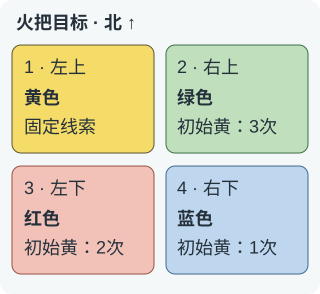
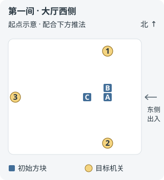
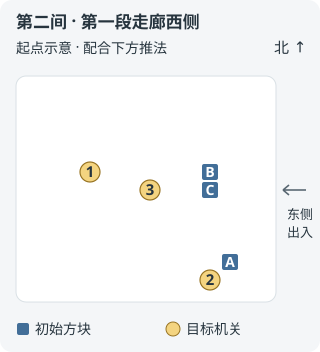
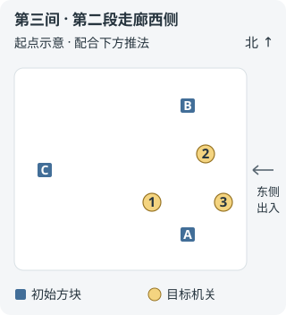
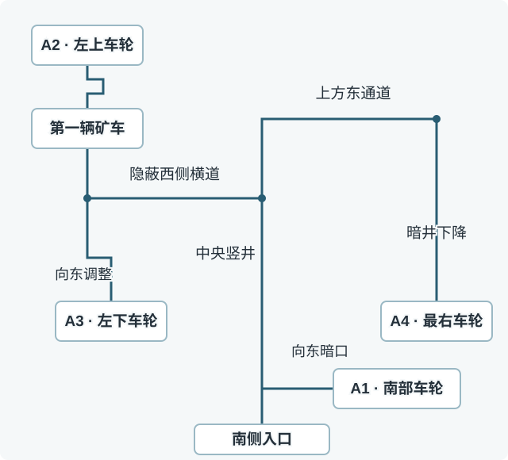
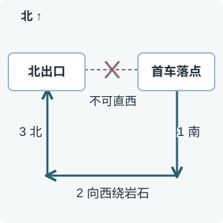
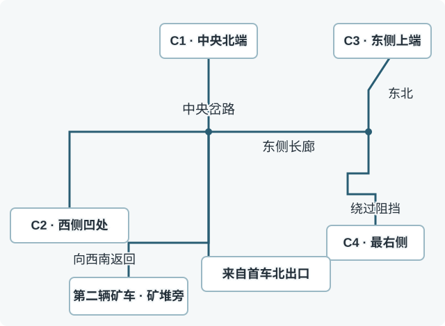
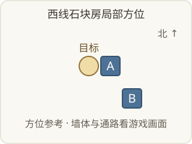
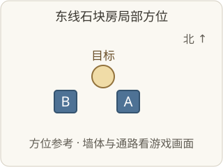
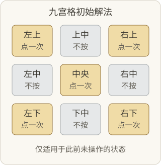

看看任务日志和你所在的地方，从下面选一段。每段开头的「我到哪一步了？」可以直接跳到你卡住的地方。本文按全汉化版写。

::: {.preview-note}
[查开篇](#forest) · [查费穆拉矿井](#femura) · [查终章](#finale) · [找顺路支线](quests.qmd#by-stage) · [按当前进度备装备](equipment.qmd#equipment-route)
:::

```{=html}
<nav class="journey-stage-picker" aria-label="按旅程阶段查阅">
<details class="journey-stage-group" id="journey-group-start" name="etheria-journey-group" open>
<summary>启程与新家 <span>Q1–10 · 榆树村至利莫里亚</span></summary>
<div class="journey-stage-grid">
<a class="journey-stage-card" href="#forest"><span class="journey-stage-number">01</span><span><strong>森林与榆树村</strong><small>Q1–2 · 启程</small></span></a>
<a class="journey-stage-card" href="#dhalium"><span class="journey-stage-number">02</span><span><strong>达利姆镇与农场</strong><small>Q3–4 · 寻找加雷特</small></span></a>
<a class="journey-stage-card" href="#lemuria"><span class="journey-stage-number">03</span><span><strong>风车村与王国</strong><small>Q5–6 · 王国调查</small></span></a>
<a class="journey-stage-card" href="#home"><span class="journey-stage-number">04</span><span><strong>新家与住户任务</strong><small>Q7–10 · 并行请求</small></span></a>
</div><div class="journey-stage-panels"></div>
</details>
<details class="journey-stage-group" id="journey-group-travel" name="etheria-journey-group">
<summary>大陆旅程 <span>Q11–14 · 堡垒、矿井与雷鸥港</span></summary>
<div class="journey-stage-grid">
<a class="journey-stage-card" href="#redsea"><span class="journey-stage-number">05</span><span><strong>堡垒与红海遗迹</strong><small>Q11 · 千里寻迹</small></span></a>
<a class="journey-stage-card" href="#femura"><span class="journey-stage-number">06</span><span><strong>巴洛拉与矿井</strong><small>Q12 · 费穆拉领地</small></span></a>
<a class="journey-stage-card" href="#artellus"><span class="journey-stage-number">07</span><span><strong>阿特勒斯与深谷</strong><small>Q13 · 继续旅程</small></span></a>
<a class="journey-stage-card" href="#emerald"><span class="journey-stage-number">08</span><span><strong>翡翠森林至港口</strong><small>Q14 · 古代之人</small></span></a>
</div><div class="journey-stage-panels"></div>
</details>
<details class="journey-stage-group" id="journey-group-finale" name="etheria-journey-group">
<summary>远行与终章 <span>Q15–17 · 魔物洞窟至灵魂堡垒</span></summary>
<div class="journey-stage-grid">
<a class="journey-stage-card" href="#ocean"><span class="journey-stage-number">09</span><span><strong>洞窟与海上航行</strong><small>Q15 · 出海准备</small></span></a>
<a class="journey-stage-card" href="#arcius"><span class="journey-stage-number">10</span><span><strong>阿修斯与雪铃村</strong><small>Q16 · 晚期目标</small></span></a>
<a class="journey-stage-card" href="#finale"><span class="journey-stage-number">11</span><span><strong>灵魂堡垒与结局</strong><small>Q17 · 终章</small></span></a>
</div><div class="journey-stage-panels"></div>
</details>
</nav>
```

## 森林、榆树村与前往达利姆镇 {#forest}

**未知的森林（Q1）** 从救狗开始；**解除契约（Q2）** 经法拉山前往达利姆镇。进镇后看完奴隶商店外的对话才接到下一项任务。

开篇木剑加2攻击，毒刺鼠比原版耐打。手上缺回复就先用开篇拿到的药膏或治疗药；想换装再看[开篇装备](equipment.qmd#equipment-route)。

### 我到哪一步了？ {#forest-progress}

| 眼前状态 | 接下来查看 |
|---|---|
| 一开场找不到狗，或不知怎么救它 | [向东探索与取得药方](#wounded-dog) |
| 已经帮助狗，刚到榆树村；或发现钱被偷了 | [榆树旅馆 → 森林洞穴](#track-thief) |
| 已追到森林洞穴，战斗里没有能力 | [窃贼的战斗内教学](#thief-battle) |
| 窃贼已打完，不知道去哪；或已回榆树村 | [返回榆树村、用餐与首夜](#elm-return) |
| 旅馆早晨剧情已结束，准备出发 | [先去榆树物品店](#elm-item-store) |
| 从榆树村出发，法拉山东路被堵 | [北侧洞穴改道](#fara-detour) |
| 已走出法拉山洞，在遗迹里找不到后续出口 | [休息、寻找加雷特与离开遗迹](#ruins-rest) |
| 已到达利姆镇，但主线没继续 | [奴隶商人与离店后的交接](#dhalium-handoff) |

[]{#elm-first-night}

### 1. 向东探索，帮助受伤的狗 {#wounded-dog}

开篇进入未知森林后，先沿各片森林的东侧出口向东走，寻找离开森林的路。走到有狗的区域时，会发生怪物袭击的剧情和战斗；结束后，当前目标变为帮助受伤的狗。

1. 从狗所在的这片森林往北走，通过北侧开口进入一小片森林。
2. 进入后向西北侧找可调查的球体，调查它取得 **艾尔迪奥药膏配方**。看到药方的取得提示后，才返回狗所在区域。
3. 从这片小森林的南侧出口返回，再调查受伤的狗。主角会按药方处理艾尔迪奥草叶并给它上药。
4. 看完治疗后的剧情，继续向东，从森林东端出口进入世界地图。再向南走到 **榆树村**。

拿到药方后，回去调查受伤的狗。看完上药的剧情，就能从森林东端离开。

### 2. 在榆树旅馆发现失窃，再追到森林洞穴 {#track-thief}

首次进入榆树村会有人撞上主角。接着去村子南侧偏东的 **榆树旅馆**，调查柜台处的旅馆主人。租房对话中主角才发现钱不见了；旅馆主人会给一瓶 **弱效治疗药水**，任务目标改为追盗贼。不用先攒房费。

1. 离开旅馆，从榆树村南侧出口回世界地图。
2. 向北回到先前离开森林的入口。从有狗的森林向西走，穿过一片中间森林，再进入下一片森林，寻找 **森林洞穴** 入口。
3. 在该片森林的西北侧进入洞穴。往洞内走，接近洞里的窃贼，触发对峙与战斗。
4. 赢过窃贼后看完剧情：钱被追回，费拉迪安会跟随主角回榆树村。此时还需要继续返回旅馆，不能把这一场胜利当作 Q1 的最终交接。

### 窃贼：能力在战斗中才开放 {#thief-battle}

这场森林洞穴战斗的第一回合包含教学。起初没有能力（Ability）指令是这一段的剧情进度；教学会提示 **已开放“能力”指令**、取得 **双重斩击（Double Slash）**，并补充 AP。

看到教学提示后，可以在能力中选择双重斩击并继续战斗，直到胜利。

### 3. 回榆树村，完成用餐与首夜 {#elm-return}

1. 从森林洞穴原入口离开；在森林间向东原路返回有狗的区域，再从东端出森林。回世界地图后向南进入榆树村。
2. 回村时会发生随行费拉迪安想吃东西的对话。去 **榆树旅馆** 再次调查柜台处的旅馆主人。
3. 看完订双人餐、用餐和交谈的连续剧情；随后会自动进入客房。
4. 继续看完客房、梦境和早晨的剧情。主角会回到旅馆大厅，下一目标是先去物品店，再经法拉山到达利姆镇尝试解除契约。

打赢窃贼后回旅馆，把用餐和首夜的剧情看完。日志出现 **解除契约（Q2）**，这段才结束。

### 当地可选提醒：信使 {#elm-messenger}

在榆树村时，可以到旅馆西北侧的民居里找 **瑞利斯·哈特** 对话，接下 **信使（Q49）** 并取得信件；第一站是达利姆镇。接取人物、沿途各站和最后交付见[信使流程](quests.qmd#messenger)。

### 顺路去北边找淋淋 {#elm-queen}

刚到榆树村想做**《女王驾到》（Q66）**，就去村北找淋淋。第一次聊给地才鞋×2，再聊两次才登记任务。想赶主线就先去旅馆；[后面三站](gm-differences.qmd#gm-queen)可以随旅程再做。

[]{#fara-dhalium}

### 4. 先去榆树物品店，回街上完成出发交接 {#elm-item-store}

1. 早晨剧情结束后，离开榆树旅馆，去旅馆西侧、同在村子南侧的 **榆树物品店**。
2. 走到柜台前、店主左下方的交互位置，按调查键与 **榆树村店主** 对话。主角会询问适合同行费拉迪安的衣物，店主将留下的装备免费交给主角；不用靠购买普通商品来代替这段对话。
3. 离开商店回到街上，看完送衣物、同行者报上 **加雷特** 名字并正式入队的剧情。任务目标随后转向法拉山。
4. 从榆树村南侧离村，在世界地图向东／东北到 **法拉山**，由西侧入口进入。

出店看完对话，日志就会指向法拉山，加雷特也会正式入队。只进过商店的话，先回柜台找店主。

### 5. 东路被堵：先问麦克，再去北侧洞口 {#fara-detour}

在法拉山向东走，到东侧受阻处找 **麦克·阿洛斯** 对话。道路的悬崖已经遭到破坏，加雷特会提出改走北侧洞穴；看完这段对话，目标才转为穿过洞穴。

从受阻处回到山道西半部，再往北走，进入西半部北端的洞口。

1. **第一片法拉山洞**：从西南侧进入，往东侧偏南的出口走，进入下一片洞室。
2. **第二片洞室**：从西侧进入，往东北方向走，通过东侧靠北的出口继续；西北侧是支路。
3. **后一片法拉山洞**：从西南侧进入，往中部偏东走，会再次遇到先前的窃贼，触发下面的两段战斗。战斗和后续对话结束后，再往东北侧出口走，进入 **遗忘遗迹**。

### 6. 洞内再次遭遇窃贼：两段战斗要接着完成 {#fara-battle}

这里的窃贼已发生变化。前半段战斗会按剧情中断，接着出现普通攻击难以奏效、需要魔法的对话；等对话结束，准备改用魔法继续打。

对话会开放 **战斗合成（Synth）**，并给予 **2 个水之精华**，随后进入后半段战斗。战斗合成是将两种材料组合成战斗效果的指令。

选择第一种材料后，再选它支持的第二种材料。**已有风之精华时，水之精华 → 风之精华**是一组可用的水属性合成；每次会消耗两种材料各一份。先按背包里已有的相容材料选择，不用在这里另找魔法核心。

继续后半段战斗直到胜利，看完加雷特对主角使用魔法的反应以及离开洞穴的对话，再去东北侧出口。这里不要求提前制作魔法核心。

### 7. 遗忘遗迹：取得教学、过夜，再找加雷特 {#ruins-rest}

1. 出洞后，第一片遗迹入口附近向东有可调查的球体，可以取得 **初学者核心设计图** 和 **魔法碎片配方集**，并开放 **装备核心（Equip Core）**。游戏会询问是否阅读装备核心的教学，可以选“是”（Yes）查看；现在可以带着配方继续走。想试用核心时看[核心安装与技能检查](equipment.qmd#core-install)。
2. 继续往这片遗迹东南侧走，通过那一带的出口，进入下一片遗迹。到达后会有疲惫、寻找休息地点的对话。
3. 往第二片遗迹的东北侧营地点走，主动调查营地位置，开始做饭、休息和梦境的连续剧情。第一次在这里过夜由剧情完成，不要求先手工制作露营套装或烹饪一道料理。
4. 醒来后主角会发现加雷特不在身边。离开营地，往西南侧找站在那里的 **加雷特** 并与他对话，看完夜间及次晨的后续剧情。
5. 剧情结束后加雷特重新入队，游戏提示烹饪已开放，并给出 **露营套装配方、烤肉食谱、皮克果汁食谱**。此时才往遗迹南侧出口离开，回到世界地图。
6. 在世界地图向东／东南前往 **达利姆镇**。

若在遗迹南侧无法继续，先确认是否调查过营地点，以及是否在醒来后找到加雷特并完成对话；刚进入遗迹、取得核心配方或刚从梦里醒来都还不足以开放这次离开。

### 8. 达利姆镇：进奴隶商人，再完成离店后的剧情 {#dhalium-handoff}

1. 首次进入达利姆镇时，看完加雷特提议找奴隶商人的对话。任务目标会转为拜访商人，Q2 此时仍未完成。
2. 从城镇南侧入口向北走，到镇内西北一带的 **奴隶商人** 商店并进入。入店会自动开始店主的契约对话，继续看完即可。
3. 商人无法解除当前契约，随后 **莱克斯** 被交给主角。看完店内连续剧情后，从门口离店，回到达利姆镇的街上。
4. 看完街上的主线交接：加雷特离开，莱克斯加入队伍，**解除契约完成**，并出现 **探索达利姆镇（Q3）**。

离开奴隶商店、看完对话后，日志会出现 Q3。加雷特离开队伍；接下来和莱克斯在镇里打听线索。

::: {.related}
**下一段：** [达利姆镇、森库斯特农场与加雷特](#dhalium)。出镇去农场前，先留意[完美食谱2的早期接取](quests.qmd#perfect-recipe-2)。
:::

## 达利姆镇、森库斯特农场与加雷特 {#dhalium}

本段承接奴隶商店外的剧情：加雷特离开、莱克斯入队，日志出现 **“探索达利姆镇”（Q3）**。先在镇里打听，再去农场救人、找到追踪线索；接着完成 **“寻找加雷特”（Q4）**，直到杰瑞德遭遇结束、日志转入“前往王都”。

### 我到哪一步了？ {#dhalium-progress}

| 眼前的情况 | 从这里继续 |
| --- | --- |
| 莱克斯刚入队，镇长还不肯托付事情 | [先在镇南和旅馆打听消息](#dhalium-info)。 |
| 镇长让找儿子，日志指向森库斯特农场 | [出镇北上，到农场找厄尔](#farm-clue)。 |
| 农场的人已经救了，仍没接到“寻找加雷特” | [调查东侧农舍门外的纸条](#farm-clue)。 |
| 已救厄尔并读完纸条，想回镇领奖或使用炉灶 | [回报镇长，再查储藏室和厨房](#dhalium-rewards)。 |
| 日志已经是“寻找加雷特”，不知往哪里追 | [去西北方的大风山脉](#find-garet)。 |
| 到了山地或藏身处，还没有救出加雷特 | [找山地东南侧洞口，进洞后的西北房间](#garet-rescue)。 |
| 加雷特已回队，门却还关着 | [按区域核对五处内部开关](#hideout-gates)。 |
| 已经面对杰瑞德，变身后难以造成伤害 | [查看两阶段战斗与战斗合成](#gerard)。 |
| 杰瑞德已经击败 | [确认下一项主线，再安排食谱回访](#dhalium-next)。 |

### 1. 镇南与旅馆：先打听，再找镇长 {#dhalium-info}

这一阶段先在镇内收集强盗和农场的消息。可以按下面的顺序各聊一次：

1. 到**镇南的民居、物品店一带**，找抱怨强盗惹事的居民交谈。
2. 进入**镇东的旅馆**，与马特·卡里布交谈，听他讲一家人从北面农场逃来的事。这段对话也会接下[完美食谱2](quests.qmd#perfect-recipe-2)。
3. 与旅馆里的**雪拉·卡里布**交谈，继续了解农场的事。
4. 再与旅馆里的**孩子**交谈。

然后去**镇北偏东的镇长家**，找镇长继续对话。消息收集够了，他会说明农场遭强盗占据，请你寻找儿子 **厄尔**。看完委托，Q3目标会转到农场，此时再离镇。

如果镇长仍只说一般话，先确认自己已看完奴隶商店外的剧情，再补上旅馆一家人与镇南居民的对话。

::: {.related}
**出镇前的支线安排：** 完美食谱2要在**首次到农场之前**向旅馆的马特接取。镇西南民居的[完美食谱1](quests.qmd#perfect-recipe-1)和[信使的达利姆一站](quests.qmd#messenger-dhalium)也可顺路处理；食谱1所需的肉可以稍后补交，不会挡住这段主线。
:::

### 2. 森库斯特农场：救厄尔，再调查纸条 {#farm-clue}

1. 离开达利姆镇，在大地图上**向北、略偏东**前往森库斯特农场。
2. 到农场**北部中央**，调查倒下的厄尔。救治与谈话由连续剧情完成。厄尔会提到被带走的人，队伍也开始担心加雷特的下落。
3. 对话结束后，去**东侧农舍门外偏右**调查地上的纸条。莱克斯能从这份线索辨认强盗的气味，并提出循味追踪。
4. 确认日志完成“探索达利姆镇”，并新增 **“寻找加雷特”**，再离开农场。

**农场西口还出不去？** 回东边农舍外读完纸条，等日志变成「寻找加雷特」，西口才放行。

日志还会列出回报镇长的**可选目标**。可以先按下一节回镇领奖、开放厨房，再继续寻找加雷特；想直接追人时，从农场离开后去[大风山脉](#find-garet)。

### 可选回访：储藏室三处奖励与镇长家的厨房 {#dhalium-rewards}

1. **先读完农舍外的纸条再返镇。** 纸条后的对话打开农场出口，之后可返回达利姆镇。
2. 到**镇北偏东的镇长家**，与镇长交谈，回报厄尔已经获救，取得**储藏室钥匙**。
3. 去**镇东侧民居**，调查屋内锁着的门。持有钥匙即可通过；门后右侧的拾取点给**450金币**。
4. 从门后的**西北侧小楼梯**下到地下室，分别调查**东侧与西侧**的拾取点，领取**长披风（Long Cape）**和**灵药（Elixir）**。两件各取一次，金币与地下室物品是三处独立奖励。
5. 回到镇长家的**厨房**，与**帕特丽丝·克罗尔特**交谈。她会允许你使用炉灶；以后可持食谱与食材在这里烹饪。灵药则是直接使用的消耗品，可完全恢复一名同伴的HP与MP。

**建议本次先领钥匙。** 后来为贫民窟的恋人办理解约时，镇长会改谈那项请求。已经有钥匙的玩家可直接去镇东民居；厨房由救出厄尔后的谈话开放，另行交谈即可。

这趟回访不要求先击败杰瑞德。整理好补给后，回大地图向西北去大风山脉，接着寻找加雷特。

### 3. 大风山脉：气味中断后改为自己搜寻 {#find-garet}

从农场离开后，在大地图上往**西北方**找 **大风山脉（Gale Mountains）** 的入口。进入山地会自动发生一段对话：附近气味太重，莱克斯无法再精确追踪，Q4目标随即转为找人。

接下来用山地这一片区域作中转，记住两个入口：

| 山地上的入口 | 通向哪里 | 现在去做什么 |
| --- | --- | --- |
| **东南侧洞口** | 一片洞穴，里面再分出两个小房间 | 西北房间救加雷特；东侧房间打开一处主线机关。 |
| **东侧偏北的出口** | 下一片山道，再接盗贼藏身处 | 救人后回来走这边，处理藏身处其余机关和首领。 |

先走东南洞穴救人、开洞里的开关，再回山地走东侧偏北的主路。贴着南边的平台路也会进藏身处，但不是这条主路，去错时退回山地分岔。

### 4. 洞穴里救出加雷特，顺手开东侧机关 {#garet-rescue}

1. 从大风山脉**东南侧洞口**进入洞穴。
2. 往洞穴**西北侧的小房间**走，进入后自动触发营救剧情和战斗。击败房内敌人，再看完救援后的连续对话。
3. 看到加雷特重新加入队伍的提示后，确认日志目标变为**击败杰瑞德**。接下来仍有一段路，不要把“找到人”当作Q4已经完成。
4. 返回外面的洞穴，去**东侧的小房间**，调查房间**北端中央**的开关，打开后保留这个状态。
5. 沿原路退出洞穴，回到大风山脉。

如果你已先在藏身处转过一圈，也可以回山地东南洞口补救人和这处开关。

### 5. 盗贼藏身处：逐区开关，最后走中央北门 {#hideout-gates}

从大风山脉**东侧偏北的出口**进入下一片山道，往**东北侧入口**走到盗贼藏身处。先调查入口区域**中部偏东的开关**，再去**北侧的门**，进入中央区。

中央区的**西侧门**、**最北面的首领门**和支路里的秘境入口由不同组合控制。按下表顺序查，打开后保留，不要反复拨回：

| 顺序 | 开关位置与走法 | 这一处的作用 |
| --- | --- | --- |
| ① 洞穴东侧小房间 | 上一节已走过：从山地东南洞口进去，进东侧小房间，调查北端中央开关。 | 计入首领门，并与西区开关配合打通西区返回中央的门。 |
| ② 中央区 | 进入藏身处中央区后，找**中部偏东北的开关**。 | 配合东区机关打开中央区西门；这一处本身不计入最北首领门的四处机关。 |
| ③ 东区上半部 | 从中央区**东侧靠北的出口**进东区，调查东区**东北部的开关**，再回中央区。 | 同时推进西门和首领门。 |
| ④ 东区下半部 | 从中央区**东侧靠南的出口**进东区，调查这一带**中东部的开关**，再回中央区。 | 计入首领门。不要只走上面的东侧出口就离开。 |
| ⑤ 西区 | 通过中央区**西南侧的门**进西区，调查西区**中东部的开关**，再从西区**东北侧的门**返回中央区。 | 补齐首领门需要的四处机关；此前洞穴小房间的开关也要保持开启。 |

五处都按上面处理后，回到中央区，去**最北面的门**进入盗贼洞穴。进洞后往北走，接近杰瑞德便会进入连续剧情与首领战；靠近前先保存，并检查恢复物品与战斗合成材料。

**门仍打不开时这样查：**

- **入口北门**：回看入口区域中部偏东的独立开关。
- **中央区西门**：先核对中央开关和东区上半部开关；东区下半部也有另一处，两个出口都要留意。
- **西区回中央的门**：核对洞穴东侧小房间、西区中东部的两处开关。
- **中央区最北首领门**：核对洞穴小房间、东区上半部、东区下半部、西区这四处，不能用中央区的那一处代替。

::: {.related}
西区西北门另通向[风之秘境](exploration.qmd#wind)。秘境需要洞穴小房间、中央区、东区上半部、西区四处开关保持开启，与最北首领门的组合不同；门内九格踏板和狂风核心配方见[完整解法](exploration.qmd#wind-panels)。眼前先回中央北门，就能接本段主线。
:::

### 6. 腐化杰瑞德：变身后用战斗合成 {#gerard}

看到敌人变成**腐化杰瑞德**，就准备改用主角的**战斗合成**。他会回一部分血，队友说的「另一种魔法」就是这条指令。

- **变身前**：按当前队伍正常战斗，留意HP和恢复物品；看到变身、回血后继续应战。
- **变身后**：使用主角的战斗合成，将两种相容材料组合成攻击。不要把精华当作普通可用道具，也不要把普通魔法菜单和战斗合成混成一个指令。
- **有风之精华和火之精华时**：在战斗合成里依次选择**风之精华 → 火之精华**，可得到风属性攻击，对变身后的杰瑞德尤其有效。每次组合会消耗材料，进首领房前先看背包余量。

普通风魔法和合成风不是一回事。全汉化版里，杰瑞德本身不给金币；别把英文原版的 1,000 金币先算进补给钱。

击败后继续看完洞内的对话和剧情交接。加雷特会取得**解缚灵魂石**；日志完成Q4，并自动接到Q5 **“前往王都”**。

### 7. 本段结束：确认Q5，再安排回访 {#dhalium-next}

日志出现 **“前往王都”** 后，直接去东面的森林营地，再[经风车村前往利莫里亚](#lemuria)，不用回镇长处。

如果出镇前接过完美食谱2，现在可以安排一次回访：先回**达利姆旅馆找马特**，再去**森库斯特农场的农舍找雪拉**领取后续奖励。完整过程见[完美食谱2](quests.qmd#perfect-recipe-2)。这趟回访可以与你自己的补给安排一起做。

[查看本阶段其他支线安排](quests.qmd#stage-dhalium) · [战斗资源与成长基础](equipment.qmd#battle-basics)

## 风车村、利莫里亚与王国调查 {#lemuria}

从 **“前往王都”（Q5）** 接续：先在森林营地过夜，经过伦布利桥，再沿风车村一线前往利莫里亚。入城后开始 **“富饶的王国”（Q6）**，依次处理上层通行、贫民窟援助、证人和下水道，最后在城堡完成交接。

### 我到哪一步了？ {#lemuria-progress}

| 当前日志或眼前情况 | 从这里继续 |
| --- | --- |
| 刚击败杰瑞德，日志让去森林营地 | [先退出藏身处，再去营地过夜](#road-to-kingdom)。 |
| 已过伦布利桥，想先整理风车村的事 | [补给、接食谱3并推进送信](#windmill-stop)。 |
| 到了王国，上层的士兵不放行 | [先让守卫说明限制，再去找军需官](#upper-access)。 |
| 已有两张临时通行证 | [升上上城区，去东侧的队长住所](#captain-quarters)。 |
| 现在控制加雷特和小水，日志让帮助贫民窟居民 | [先接下援助，再完成四处对话并回报](#slums-four-visits)。 |
| 主角和莱克斯重新行动，日志让向士兵打听 | [酒馆士兵 → 贫民窟证人 → 排水口](#clyde-sewers-castle)。 |
| 已进入下水道，正在追陌生人 | [按洞室出口追到西北侧的门](#sewers-entry-route)。 |
| 画面切到牢房，现在只能控制小水 | [击败看守，再带钥匙回加雷特身边](#su-prison)。 |
| 加雷特逃出牢房，却还没与主角汇合 | [先返回上一片下水道，开门汇合](#sewers-reunion)。 |
| 已遇到犹大，或战后不知道去哪 | [首领战 → 队长住所 → 城堡](#judah)。 |
| 进了城堡，却找不到克莱德或见不到国王 | [先去东侧医务室打听，再回中央门口](#castle-audience)。 |
| 已经觐见，拿到金币和房屋钥匙 | [在城堡大厅再与克莱德交谈，接Q7](#lemuria-next)。 |

### 1. 森林营地与伦布利桥：先完成过夜和桥上遭遇 {#road-to-kingdom}

1. 从杰瑞德所在的盗贼洞穴退回藏身处，再回到**大风山脉**。经过山地东侧一带时，看完莱克斯说明向东去桥梁、途中可在森林休息的对话，再退出到大地图。
2. 在大地图上**往东走**，先到伦布利桥西边的**森林营地**。进入后，到营地**中央偏南的休息位置**主动调查，开始做饭和过夜。
3. 看完当晚的对话、途中切换的场景与翌晨剧情。小水会在这一段出现；日志改为**前往伦布利桥**，主角也会取得**冒险者灵魂石**。营地的做饭由剧情完成，按对话继续即可。
4. 离开营地继续往东，进入**伦布利桥（Lumbly Bridge）**。向前接近桥上的求救处，触发战斗与连续剧情。

**桥上有前后两场战斗。** 前一场会按剧情中断，接着小水介入，后一场才继续完成这次遭遇。看完桥上的全部后续，确认小水正式加入队伍、日志目标变为向东前往王国，再继续过桥。

桥分为前后两片相连场景，一直往东走到大地图。风车村在这一侧大地图的**北部偏西**；利莫里亚王国在它的**东南方**。可以先去风车村整理下面的支线，再向王国前进。

### 2. 风车村：接食谱3，把送信带到下一站 {#windmill-stop}

风车村适合在入城前补给。主线仍是向王国前进，当地可以顺路做两件事：

- **食谱3：** 到村内**东侧物品店**找阿丽莎·隆根，接下[完美食谱3](quests.qmd#perfect-recipe-3)。有**禽肉×4**可以直接交；暂时不够，先带着请求进王国，之后可在利莫里亚市场买齐再回交。
- **信使：** 如果日志当前收信地是风车村，与**旅馆门口东侧的费拉迪安奴隶**交谈，再看下一站是否改为利莫里亚贫民窟。此前还没完成达利姆一站时，先按[送信接力表](quests.qmd#messenger-route)核对。

离村后在大地图上**向东、略偏南**到利莫里亚入口，穿过城门进入**下城区**。看完初到王国的对话，Q5完成，日志加入Q6 **“富饶的王国”**。

### 3. 上层通行：先遇守卫，再找军需官 {#upper-access}

先用下城区作定位：**西边通贫民窟，东边通市场，北部偏东是升降机入口**。军需官在下城区西侧的士兵驻所。

1. 到下城区**北部偏东的升降机大厅**，靠近大厅北侧偏西的守卫，触发查验通行证的对话。
2. 看完队伍讨论上层限制的后续，日志会改为**找军需官取得上层通行办法**。
3. 返回下城区，进**西侧的士兵驻所**，找屋内北部的军需官。看完主角与他的交涉，取得**临时通行证×2**。
4. 出门继续看完队伍安排，再回升降机大厅。主角和莱克斯上楼，加雷特与小水留在下层。

**不用为这一步攒十万金币。** 对话提到的昂贵皇家通行证与这里取得的临时通行证不同；沿着守卫 → 军需官的顺序，就能接上当前主线。如果军需官只说日常工作，先回升降机大厅补完被拦和队伍讨论的场景。

::: {.related}
**打算做食谱4？** 下城区中部民居的迪娜·戈萨要[辛辣块茎×10](quests.qmd#perfect-recipe-4)。能在风车村顺路买，就先带上；到王都西摊只补家禽肉和魔物肉。
:::

### 4. 上城区东侧：第一次进入队长住所 {#captain-quarters}

从升降机上楼，进入**上城区**。往东切换到相邻街区，再进这一片**东侧的队长住所**，看完与**弗雷德里克、特瑞**的第一次会面。

这段对话会让主角与莱克斯留下说明情况，画面随后自动切回下层，改由**加雷特和小水**行动。日志先提示探索王国，接下来去下城区西边的贫民窟。

### 5. 贫民窟：四处援助后，还要回门前交谈 {#slums-four-visits}

1. 从下城区西侧进入**贫民窟**，找**中部民居门前的费拉迪安**交谈。他说明这里断粮的处境，并请加雷特帮忙；日志随即转为帮助居民。
2. 完成下表四处援助。每处看完加雷特分给食物或水的对话即可，顺序可以自定。
3. 四处都谈完后，**回到同一位民居门前的费拉迪安**，主动交谈。看完随后发生的事件，画面会转回上城区的主角和莱克斯，继续队长住所内的对话。

| 援助地点 | 找谁、做什么 |
| --- | --- |
| **贫民窟西部室外** | 找靠近西侧第一间民居的饥饿男子交谈。 |
| **西侧第一间民居** | 进门与屋里的男孩交谈，看完兄妹得到食物的对话。 |
| **中部偏东的民居** | 找照看生病母亲的男孩交谈，完成母子得到水和食物的场景。 |
| **东南侧民居** | 与屋内口渴的男孩交谈，完成这次援助。 |

**这里用的是剧情里携带的食物，不要求提前买面包或炸酥肉。** Q7之后还会回到这些住户，但那时才有另一组需要接取、备料或找人的正式请求。现在若仍停在帮助居民，先补上四处对话，再回门前的人处汇报。

### 6. 证人线索：酒馆、贫民窟民居与排水口 {#clyde-sewers-castle}

队长住所的后续结束后，主角与莱克斯重新行动，日志让你向士兵打听当晚发生的事。

1. 下楼回**下城区酒馆**，与**大厅北部喝醉的士兵**交谈。他提到袭击当晚还有一名奴隶看见了事情经过，日志目标转为找证人。
2. 回**贫民窟中部的民居**，也就是先前援助请求者所在位置附近的屋子，找屋内的费拉迪安交谈。
3. 看完有关加雷特、小水和克莱德下落的完整对话，日志目标改为**到下水道找人**。
4. 出屋，去**贫民窟西南角的排水口**，调查入口进入下水道。

“找袭击当晚的证人”说的是他的经历，不需要等到游戏画面变成夜晚。若排水口还进不去，先回屋确认已经看完证人说明下水道位置的对话。

::: {.related}
**信使的王国一站：** 当前目的地已经是利莫里亚时，顺路与**贫民窟东南部的费拉迪安**交谈，将信继续送往阿里代尔堡垒。完整顺序仍查[信使路线](quests.qmd#messenger-route)。
:::

### 7. 下水道前半：追到西北侧的门 {#sewers-entry-route}

下面以**跨过出口、切换场景**为一步。入内后先跟着找人线索前进，支路拾取可以自行安排。

| 当前区域 | 主线前进方向 |
| --- | --- |
| **从贫民窟进入的第一片下水道** | 从西侧入口继续探索，去**东北侧、最右边的出口**进入下一片。 |
| **第二片下水道** | 先去**西南部**打开开关，再去**北侧偏东的门**，通过门后的出口继续。 |
| **第三片下水道** | 从南侧进入后，在入口北边一带会看到有人影经过的剧情。继续追踪，选**北侧两个出口中偏西的一个**前往下一片。 |
| **第四片下水道** | 朝**西北方向**探索，接近西北侧的门前，会遇到那名陌生人并触发连续对话。 |

第四片的对话结束后，画面会切到**加雷特所在的牢房**。这次切换是剧情推进，接着按下一节操作小水。

::: {.related}
这一带还有[水之秘境与七色机关](exploration.qmd#water)的可选支路。秘境的双开关与七色谜题服务于额外探索；本段找人先走上述西北门前的主线。
:::

### 8. 牢房：小水（苏）取钥匙，再回加雷特身边 {#su-prison}

1. 牢房的入场对话结束后，**主动调查加雷特牢房前的门**。他会与小水商量开门，控制角色随后变为小水。
2. 操作小水往**牢房区域东侧**走，找看守士兵交谈，触发战斗。击败后，小水会拿到开门的钥匙。
3. **回到加雷特被关的同一道牢门前，再调查一次**，看完小水拿钥匙开门、两人准备逃走的对话。
4. 两人恢复同行后，往牢房**西北侧的缺口**走，主动调查，跳入相连的下水道。

只打倒看守还没有完成越狱。小水拿到钥匙后，先回牢门救出加雷特，再找西北出口。

### 9. 逃出后先汇合，再开后半段两处机关 {#sewers-reunion}

跳下来后，你在**更深处的一大片下水道西侧**，仍由加雷特与小水行动。先往南探索，走这一片**南侧偏西的出口**，回到上一片下水道；会从上一片的**西北端**出现。

调查附近**门北侧的开关**，打开通路。之后队伍会自动重聚，四人重新同行。开关保持开启，接着从这一片**西北端的出口**往北，再回刚才越狱落入的大片下水道，继续寻找克莱德。

这一片还需要留意两处开关：

| 开关位置 | 打开的通路 |
| --- | --- |
| **西北部的开关** | 打开区域**中部偏南的门**。 |
| **东南角附近的开关** | 打开区域**东北部的门**。 |

两处打开后保留状态，朝**北侧偏东的出口**前进。进入下一片较小的下水道后，继续走**北侧出口**；到达一条狭长通道，往北走就会触发犹大与克莱德的连续剧情。靠近前先保存、整理四人的装备和恢复物品。

**若只能在两人之间来回找出口：** 先回上一片西北侧，检查门北的开关是否已打开、四人是否已经重聚；后半段通路与这次开门相连。

::: {.related}
**水之秘境支路：** 四人会合后，可从下水道双拉杆进入[水之秘境](exploration.qmd#water)，完成七色机关、挑战远古之灵，取得泡泡核心配方。它不属于越狱或寻找克莱德的必做条件；开关连接与踩色后的确认动作见[完整流程](exploration.qmd#water-entry)。
:::

### 10. 腐化犹大：先拆屏障，留AP应对援军 {#judah}

**先留住小水的100 AP。** 腐化犹大基础HP有7500，战中还会有援军。队伍要连续受击时，让小水给全队[上护盾](equipment.qmd#barrier-cores)；已有队员掉血的话，照常让另一人治疗。

- **开场有1000点屏障。** 攻击会先消耗这层保护，不能只看HP是否已经明显下降。屏障与生命值分开观察，保持队伍的恢复。
- **复仇之灵和骷髅士兵出现后，** 先看谁马上出手，再挑要处理的目标。有余力才继续打犹大。

取得胜利后，继续看完克莱德受伤、队伍赶来救援的对话，剧情会**自动带回队长住所**。看完那里的后续，取得**利莫里亚勋章**，莱克斯也会取得**守护灵魂石**；Q6下一目标为去城堡找克莱德。

全汉化版里，犹大本身给 785 经验，不给金币；英文原版两项都是 2,000。留些钱给接下来的补给，实际到手多少看战后结算。

### 11. 城堡：医务室问去向，再觐见国王 {#castle-audience}

1. 离开队长住所，回到**升降机上来时的上城区街区**，走**北侧城堡入口**。
2. 进城堡大厅后，先去**东侧医务室**，与屋里的士兵交谈。他会告诉你克莱德已被国王召见。
3. 回大厅，到**中央北侧的门前**找守卫。主角会出示利莫里亚勋章，获准进入王座厅。
4. 看完国王与克莱德在场的完整对话，领取**3000金币和蓝色房屋钥匙**，剧情随后把队伍带回大厅。

如果中央门前仍只让你等待，先回医务室与士兵打听克莱德。入城、拿到勋章、得知召见去向分别是这段路线的几个步骤。

::: {.related}
**竞技场现已开放：** 这次觐见后，可到上城区西侧参加[普通挑战](exploration.qmd#arena-normal)，用金币报名、赚奖牌换装备；[入口与报名位置](exploration.qmd#arena-entry)可从升降机出口接过去。
:::

::: {.related}
**城堡里的食谱5：** 大厅**西侧厨房**的厨师长可以接[完美食谱5](quests.qmd#perfect-recipe-5)，需要**大蛋×3**。现有大蛋够了就回交；缺少时先接着，后续红海沙漠、阿特勒斯镇仍有取得路线。它不阻挡觐见和Q6交接。
:::

### 12. 本段结束：大厅再找克莱德，接“我们的新家” {#lemuria-next}

**拿到钥匙后，还要与城堡大厅里的克莱德交谈。** 看完他的休息建议，以及请你探望下城区居民的委托，日志才会完成Q6，并加入Q7 **“我们的新家”**。

**如果插件指向新家找小水：** 先看当前是否追踪了「小水的礼物」等目标。若要继续主线，请在任务日志里改为追踪 Q6，再留在大厅找克莱德。

随后进入[新家与三项住户任务](#home)。贫民窟的面包、孩子的炸酥肉和寻找家人的请求，从这个新阶段继续；加雷特先前的四处援助是另一段剧情；这三项要在接到Q7后分别处理。

现在也可把当地支线整理成一次回访：

- **想回风车村：** 先去贫民窟证人住的民居，与费拉迪安再谈，接下[终于回家了](quests.qmd#home-at-last)；回村时把食谱3所需的禽肉一并带上。
- **想先处理城内请求：** 带风车村买的辛辣块茎回下城区交[完美食谱4](quests.qmd#perfect-recipe-4)。城堡食谱5缺蛋时可留到后面。
- **带着信件：** 确认已经完成风车村与王国两站，日志指向下一站阿里代尔堡垒即可，之后随主线前进。

[本阶段支线安排](quests.qmd#stage-lemuria) · [竞技场与奖牌商店](exploration.qmd#arena) · [战斗基础](equipment.qmd#battle-basics)

## 新家与三项住户任务 {#home}

[]{#our-new-home}

在城堡大厅与克莱德谈完后，日志加入 **“我们的新家”（Q7）**。这一段有两条可以穿插进行的工作：**完成贫民窟三项住户请求**，以及**陪莱克斯完成特瑞安排的试炼**。最后回新家与加雷特交谈，才会接上前往阿里代尔堡垒的剧情。

三项住户请求分别是Q8、Q9、Q10，都是本段主线的必做分支。食谱、送信和寻找史莱姆等可选支线，则在下文按回访地点提醒。

### 我到哪一步了？ {#where-am-i}

| 眼前情况 | 从这里继续 |
| --- | --- |
| 拿到蓝色房屋钥匙，日志还没有Q7 | [留在城堡大厅，再与克莱德交谈](#lemuria-next)。 |
| 日志已有Q7，要找新家 | [去上城区东侧街区，找队长住所西边的房子](#visit-new-home)。 |
| 已经入住，想领取小水打扫时找到的物品 | [到一楼找小水领取灵药](#home-su-gift)。 |
| 还没接全三项住户请求，或只完成一两项 | [用住户清单查漏，完成缺少的分支](#help-omega-households)。 |
| 饥饿男子要五个面包 | [食物短缺：接请求、做面包、回交](#food-shortage)。 |
| 兄妹要吃的肉，不知道做哪一种 | [忍饥挨饿的孩子们：准备一个炸酥肉](#hungry-kids)。 |
| 想一次买齐两项食物的材料 | [王国市场采购 → 新家厨房烹饪](#home-cooking)。 |
| 要去达利姆找失散的恋人 | [两人的羁绊：男子 → 镇长 → 男子 → 王国团聚](#bond-of-two)。 |
| 找不到试炼入口，或特瑞没有让开始 | [先在新家找莱克斯，再找弗雷德里克](#visit-new-home)，之后去[守护者之地](#complete-terrys-trial)。 |
| 试炼里门没开，还没到四支火把 | [检查入口地板机关与两组战斗](#complete-terrys-trial)。 |
| 火把已经按乱了 | [按位置恢复目标颜色](#lex-torches)，不用重数最初的点击次数。 |
| 火把门已开，或祭坛已经打完 | [向北完成祭坛，再返回找特瑞](#trial-after-torches)。 |
| 三项住户请求和试炼都完成，却还没让去堡垒 | [回家楼上找加雷特，接完出发剧情](#return-home)。 |
| 已到堡垒，却没有接到下一项主线 | [找阿尔平·拉戈领取克莱德的纸条](#fort-aridale-handoff)。 |

### 1. 先认新家：厨房、莱克斯与楼上的加雷特 {#visit-new-home}

1. 从升降机上楼，到**上城区东侧街区**，进入这一片**偏西南的新家**。它在队长住所的西边，使用先前取得的**蓝色房屋钥匙**进入。
2. 一楼**餐桌旁、靠近厨房台面**的是莱克斯。与他交谈，听完特瑞想与他谈话的消息。
3. 到**同一街区东侧的队长住所**，找书桌旁的弗雷德里克。他会让你带莱克斯去**守护者之地**，位于王国西南方、森林环绕的旧洞穴中。
4. 新家的一楼厨房已经可用。

初次入住时，也可上楼进入**加雷特的房间**，看完他对新家的第一段谈话。之后的出发剧情还要等三项住户请求和特瑞试炼都结束；先聊过这段，最后回家就更容易接上后续。

### 顺路交谈：一楼找小水领取灵药 {#home-su-gift}

拿到蓝色房屋钥匙、进入新家后，到**一楼中部的小水**面前主动交谈。看完他帮忙打扫、找到物品的对话，取得**灵药×1**；它可完全恢复一名同伴的HP与MP。

这是一份独立的一次性赠药，不需要先完成三项住户请求或特瑞试炼。领过后再与小水聊天不会重复获得；继续主线时回到[住户请求](#help-omega-households)或[莱克斯的线索](#visit-new-home)。

### 2. 先接全三项请求，再按自己的路线处理 {#help-omega-households}

去下城区西边的**贫民窟**，分别找下列三家接取。三项可以同时留在日志里，顺序自定；每完成一项，都看该项日志是否标为完成。

| 任务 | 到哪里接 | 做到哪里算完成 |
| --- | --- | --- |
| [食物短缺（Q8）](#food-shortage) | **贫民窟西部室外**的饥饿男子，位于西侧民居前方一带。 | 带五个面包回到他面前，完成交付与感谢对话。 |
| [忍饥挨饿的孩子们（Q9）](#hungry-kids) | **西侧第一间民居**里的兄妹，与男孩交谈。 | 持有一个炸酥肉，回来完成兄妹用餐的对话。 |
| [两人的羁绊（Q10）](#bond-of-two) | **贫民窟东侧、东南角小屋以西的民居**，找费拉迪安交谈。 | 去达利姆处理恋人和镇长的事，再回这间王国民居看团聚、领奖。 |

前一段Q6里，加雷特曾给四处居民分食物；现在是新接的三项日志任务，需要继续准备食物、跨城找人和回交。

可以先在市场买食谱与材料，到新家做饭，交完两项食物请求，再安排达利姆往返；也可以先走试炼。最后回家的汇合点才会检查三项是否都完成。

### 3. 食物短缺：五个面包交给室外的男子 {#food-shortage}

1. 与贫民窟西部室外的饥饿男子交谈，确认日志加入**“食物短缺”**。
2. 准备**面包×5**。已有成品就只补缺口；需要现做时，到市场买**面包食谱**和纯净水、面粉，再用[新家厨房](#home-cooking)制作。每个面包需要**纯净水×1、面粉×1**。
3. 回同一位男子处交谈，选择交出五个面包。
4. 看完他的感谢，确认Q8完成。买到食谱、凑够材料后，还要烹饪成品并回来交付。

### 4. 忍饥挨饿的孩子们：要的是一个炸酥肉 {#hungry-kids}

[]{#fried-meat}

1. 到贫民窟**西侧第一间民居**，与兄妹中的男孩交谈，接下**“忍饥挨饿的孩子们”**。
2. 准备**炸酥肉（Fried Meat，旧译煎肉）×1**。看成品名，烤肉和家禽肉都交不了。
3. 市场买**炸酥肉食谱**和大部分食材，辛辣块茎去风车村买，再到[新家厨房](#home-cooking)做一份。
4. 带着炸酥肉回来与男孩交谈，完成兄妹用餐的场景，确认Q9完成。

### 5. 做不出炸酥肉？先去风车村买辛辣块茎 {#home-cooking}

[]{#bread}

**利莫里亚市场中部偏南**的食谱商卖面包食谱（161金币）和炸酥肉食谱（267金币）。先看背包，已买过那张就不用再买。

**市场西摊买不到辛辣块茎。** 去风车村物品店，一份56金币；只做炸酥肉买1份，再做[完美食谱4](quests.qmd#perfect-recipe-4)就一起买11份。下表其余食材在市场西摊补。

| 材料 | 做面包×5 | 做炸酥肉×1 | 两项都做的合计 |
| --- | ---: | ---: | ---: |
| 纯净水 | 5 | 0 | 5 |
| 面粉 | 5 | 2 | 7 |
| 岩盐 | 0 | 1 | 1 |
| 胡椒粉 | 0 | 1 | 1 |
| 摩卡香草 | 0 | 1 | 1 |
| 辛辣块茎（风车村买） | 0 | 1 | 1 |
| 辛辣油 | 0 | 3 | 3 |
| 家禽肉 | 0 | 2 | 2 |

从零买齐两个主线请求的食谱和食材是**1,954金币**。已有的那份直接扣掉。原版可在市场买加利根，从零是1,943金币。

回新家一楼调查**厨房台面**，做五个面包和一个炸酥肉。面包交室外男子，炸酥肉交民居里的兄妹。

::: {.related}
市场西摊还能顺手补[完美食谱1的魔物肉](quests.qmd#perfect-recipe-1)和[完美食谱3的家禽肉](quests.qmd#perfect-recipe-3)。
:::

### 6. 两人的羁绊：达利姆恋人、镇长与王国团聚 {#bond-of-two}

1. 先在**贫民窟东侧的民居**接下**“两人的羁绊”**。请求者会说恋人被卖到了达利姆镇，并告诉你两人之间的称呼。
2. 回**达利姆镇北部**，找**镇长家西边、花园一带的男子**交谈。看完他认出恋人的消息，并说明契约由镇长掌握的对话。
3. 进**镇长家**，请求镇长解除他的契约。看完镇长处理完、明确告知他已自由离开的对话。
4. 出屋再找**同一位花园男子**，告诉他可以离开。日志目标随之转为回王国团聚。
5. 返回**利莫里亚原先接任务的民居**，与请求者交谈，看完团聚与奖励，确认Q10完成。

**王国民居的最后一趟要回来。** 在达利姆找到人、和镇长谈完，还要接上团聚场景，才算完成这项住户请求。

::: {.related}
**把跨城回访放在这趟一起做：** 出发前可在贫民窟证人的民居接[终于回家了](quests.qmd#home-at-last)；经过风车村时，兼顾这项奖励和食谱3回交。到了达利姆，再按已有材料处理食谱1，或回旅馆、农舍完成[食谱2](quests.qmd#perfect-recipe-2)的后续。
:::

### 7. 守护者之地：两组战斗都在火把之前 {#complete-terrys-trial}

先确认已经完成**新家莱克斯 → 队长住所弗雷德里克**的谈话，再离开王国，在大地图上往**西南方森林中的旧洞穴**找**守护者之地（Guardian Grounds）**。

进入后靠近南侧入口附近的特瑞，触发说明。试炼由**主角与莱克斯**参加，加雷特和小水会在入口等候。开始前给这两人整理装备、恢复物品和可用能力。

接下来从南往北推进：

1. **入口门：** 经过特瑞北面的地板机关，打开第一道门。
2. **第一组战斗：** 处理前方左右两侧的两场战斗，中间的门打开后向北。
3. **第二组战斗：** 再处理下一组左右两场战斗，通过这一组北边的门。
4. **四支火把：** 继续向北到火把方阵，按下一节设置颜色。

两组共四场门前战斗都在火把区域以南。每组都要处理两侧，只有一侧打完时，中间门还不会开。

### 8. 火把：按位置恢复目标颜色 {#lex-torches}

图中**北在上方**。左上是固定的**黄色线索**，另外三支每次调查会按 **黄 → 蓝 → 红 → 绿 → 黄**循环。

<figure>

<figcaption>看位置和颜色名称恢复目标；次数只适用于初始黄色。</figcaption>
</figure>

| 位置 | 目标颜色 | 从初始黄色开始调查几次 |
| --- | --- | ---: |
| 右上 | 绿色 | 3 |
| 左下 | 红色 | 2 |
| 右下 | 蓝色 | 1 |

**已经按乱时，直接把右上调绿、左下调红、右下调蓝。** 继续循环到目标即可；三支操作的先后顺序不限。

颜色正确后，通过方阵**北侧中间的门**，继续向北到祭坛。

### 9. 祭坛结束后，回入口找特瑞 {#trial-after-torches}

到北端祭坛处，靠近并完成最后一场战斗，看完莱克斯的后续。主角与莱克斯会学会**极速冲锋（Rapid Rush）**。

[]{#talk-to-terry}

接着**沿原路往南，回入口找特瑞交谈**。这次谈话完成试炼的交接，加雷特和小水也恢复同行。与特瑞谈完再离开试炼，回王国补齐还没完成的住户请求。

::: {.related}
**本阶段的额外探索：** 想开始[寻找史莱姆](quests.qmd#slibs-start)，可另行探索绿谷与废弃房屋，先完成救红色史莱姆、取得钥匙并读旧笔记的过程。朋友分散在后续地区，按主线继续找即可；这项支线不要求在本次试炼前做完。
:::

### 10. 回家汇合：三家完成、特瑞谈完，再找加雷特 {#return-home}

[]{#home-fort-handoff}

回新家前，确认日志里的**食物短缺、忍饥挨饿的孩子们、两人的羁绊**都已完成，也已经在祭坛后**与特瑞交谈**。

回到上城区的新家，**上楼进入加雷特的房间，主动与他交谈**。若第一次入住的谈话还没看过，先看完，再与他交谈一次；条件齐备后便会进入后续场景。

等回到房间后的对话自动结束。队伍提出南下去阿里代尔堡垒后，再动身。

若仍没有出发线索，按这四处检查：三项住户任务各自是否完成；达利姆之后是否回王国团聚；祭坛后是否找过特瑞；楼上加雷特的初访对话是否已经聊完。

### 11. 阿里代尔堡垒：拿到纸条，才接上Q11 {#fort-aridale-handoff}

从王国所在的大地图**向南**到**阿里代尔堡垒**，找堡垒**中部偏东的阿尔平·拉戈**交谈。看完克莱德和弗雷德里克已进入沙漠的消息，他会交给你**克莱德的纸条**，日志完成Q7，并加入Q11 **“千里寻迹”**。

这份纸条是下一段穿越红海沙漠的方向提示。先确认已经入包，再接[阿里代尔堡垒与红海遗迹](#redsea)的旅程。

如果先前提前到过堡垒却找不到主线交接，先回王国完成楼上加雷特的出发场景，再来找阿尔平。

::: {.related}
**堡垒顺路支线：** 见[堡垒出发前的顺路安排](#fort-preparation)。
:::

## 阿里代尔堡垒与红海遗迹 {#redsea}

[]{#tracing-the-steps}

在阿里代尔堡垒拿到**克莱德的纸条**后，日志加入 **“千里寻迹”（Q11）**。先穿过红海沙漠，在遗迹里帮助克莱德；再完成三间石块机关房，打开中央门，追到北端祭坛。战斗结束后还要调查祭坛，才会接上Q12。

### 我到哪一步了？ {#redsea-progress}

| 眼前情况 | 从这里继续 |
| --- | --- |
| 到了堡垒，日志还是“我们的新家” | [先找阿尔平·拉戈领取纸条](#fort-aridale-handoff)。 |
| 已拿纸条，沙漠里总回到相似的地方 | [按每次换场景数方向](#redsea-desert-route)。 |
| 想顺路完成胸带请求 | [遗迹外再往西一片，挑战后回堡垒交付](#redsea-sidequests)。 |
| 加雷特挡着南边，不让继续走 | [先进本区域中部偏北的遗迹](#redsea-clyde)。 |
| 已帮助克莱德，中央门仍锁着 | [找齐三间西侧石块房](#pressure-rooms)。 |
| 在大厅西边的第一间石块房 | [第一间：北端、南端、西端三个目标](#redsea-room-one)。 |
| 已沿南侧走廊到下一间石块房 | [第二间：西侧两个目标与南端目标](#redsea-room-two)。 |
| 到了最深处的第三间石块房 | [第三间：中部三个目标](#redsea-room-three)。 |
| 有一间推乱了，方块不再响应 | [从该房东侧退出，再进入这间未完成的房间](#pressure-rooms)。 |
| 三间都完成，却还没看到后续 | [沿走廊回中央大厅，调查北门](#redsea-inner-door)。 |
| 祭坛战斗已经结束，Q11还没完成 | [主动调查北端祭坛，接完克莱德的对话](#redsea-altar)。 |
| 日志已转为“费穆拉领地” | [回到沙漠，从遗迹外向南离开，再去巴洛拉镇](#redsea-next)。 |

### 1. 堡垒出发前：纸条、信件与胸带请求 {#fort-preparation}

日志已有“千里寻迹”（Q11），就可以安排补给和支线。日志若仍是“我们的新家”，先[在堡垒领取克莱德的纸条](#fort-aridale-handoff)。

出发前整理队伍的生命、恢复物品与装备。遗迹里先后有两次主线战斗，机关房之间也可能遇敌。

::: {.related}
**堡垒北部的两位费拉迪安分别交谈：** 信使日志已指向堡垒时，找收信人推进到[巴洛拉镇一站](quests.qmd#messenger-fort)；抱怨胸带取不下来的另一位，则接[被诅咒的胸带](quests.qmd#cursed-harness)。
:::

### 2. 红海沙漠：八次换场景，到遗迹外 {#redsea-desert-route}

从**堡垒南侧出口**进入沙漠入口走廊。**从这条走廊开始，每次进入下一片场景计一步**，依次走：

**南 → 南 → 东 → 东 → 南 → 南 → 西 → 西**

可以分成四组记：**南南／东东／南南／西西**。方向指每片场景的出口；沿路绕过岩石、追赶你的敌人时，不额外增加步数。

| 场景切换 | 选择出口 | 到达后的处理 |
| --- | --- | --- |
| 第1–2次 | 南、南 | 穿过入口走廊，再到第二片沙漠。 |
| 第3–4次 | 东、东 | 连续穿过两片向东的区域。 |
| 第5–6次 | 南、南 | 再向南两片。 |
| 第7–8次 | 西、西 | 到达有遗迹入口的区域，找**中部偏北的石造入口**。 |

走错分岔可能回到较早的沙漠，画面相似时，先辨认自己从哪一侧进入。回到**北边通往堡垒的狭长走廊**后，可以从第一步重新数。

到了最后这片区域，南出口暂时会被加雷特拦下，提醒先调查身后的遗迹；此时去找中部偏北的入口。

### 3. 遗迹外的顺路支线：胸带挑战与回堡垒 {#redsea-sidequests}

已在堡垒接下胸带请求时，从**遗迹外这片沙漠的西出口**再走一片，进入较小的区域，找**中央附近的诅咒之灵**战斗。

胜利后，队伍会提醒回去找费拉迪安。**战胜诅咒之灵后，还要回堡垒向原请求者交付**，才能取得惩罚♂胸带并完成任务。

需要现在回交时，先从小区域**向东**回遗迹外；再依次走 **东 → 东 → 北 → 北 → 西 → 西 → 北 → 北 → 北**，最后经过狭长走廊回堡垒。回交、补给后，重新按上节的八次方向到遗迹。也可先记下回交，继续当前主线。

::: {.related}
沙漠鹏鸟可能掉落**大蛋**。还留着王国城堡[完美食谱5](quests.qmd#perfect-recipe-5)时，可把掉落存着，凑齐三枚再安排回交。
:::

### 4. 进入遗迹，先帮助克莱德 {#redsea-clyde}

1. 从遗迹外**中部偏北的入口**进入。第一间入口室里，走**西侧通道**，到中央大厅。
2. 沿大厅前进，靠近克莱德，触发求援与战斗，击败两只暗孢。
3. 看完战后对话。克莱德会指出卢西斯就在门后，日志目标改为**寻找开门的方法**。
4. 大厅**北侧中央门**仍锁着。先去三个机关房，全部完成后再回这扇门。

### 5. 三间石块房：沿南侧走廊逐间找 {#pressure-rooms}

三间房都在各层的**西侧**，可以按下面的路线依次处理：

| 房间 | 从哪里进去 | 完成后怎样接下一间 |
| --- | --- | --- |
| [第一间](#redsea-room-one) | **中央大厅的西门**。 | 从房间东侧退回大厅，再走大厅南出口。 |
| [第二间](#redsea-room-two) | 大厅南边的**第一段走廊，走西门**。 | 从房间东侧回走廊，再继续向南。 |
| [第三间](#redsea-room-three) | 再往南的**第二段走廊，走西门**。 | 东侧退出，然后沿走廊一路向北回大厅。 |

每间房都有**三块可移动方块、三个目标地板机关**。面向方块按调查键，方块会朝你面向的方向连续移动；先让它停稳，再绕到另一侧操作。

**三个目标要同时各有一块方块压住。** 方块没有指定配对，可以自行分配。三个都对齐后，房间会闪光、机关改变状态，这才是本间完成的信号。

**推乱或推到右侧后不再响应时：** 从房间东侧出口离开，再进入这间未完成的房间，重新处理。已完成房间的进度保留。

下面三图用**蓝色方形A／B／C表示初始方块**，**金色圆形1／2／3表示目标机关**。字母始终跟着同一块，移动后也不重新编号。

**下表每行只调查一次。** “滑行几格”用于核对停点。绕到所写的一侧，**对正方块侧边的中间，松开方向键、站稳后再调查**；斜角处即使看着很近，也可能调查不到。等本次滑行动作结束，再换边继续。

中途暂压目标的方块仍可能需要移开，做到最后的完成信号为止。已经改动布局时，先退房再进，按原位重来。若调查没有响应，先核对站位与朝向，稍等动作结束再按一次。

### 6. 第一间：北端、南端和西端 {#redsea-room-one}

这间从中央大厅西门进入，入口在房间右侧。中部两块方块上下相邻，另一块在它们西边。

<figure>

<figcaption>第一间目标：①北端，②南端，③西端。A／B／C不固定对应某个圆点。</figcaption>
</figure>

#### 原位参考：6次调查 {#redsea-one-reference}

| 顺序 | 石块与方向 | 站位、滑行与停点 |
| --- | --- | --- |
| 1 | **A向左**。 | 贴近它的**东侧**，朝左调查**一次**；滑行1格。停稳后再换边。 |
| 2 | **A向下**。 | 贴近它的**北侧**，朝下调查**一次**；滑行2格。停稳后再换边。 |
| 3 | **A向右**。 | 贴近它的**西侧**，朝右调查**一次**；滑行1格。停稳后再换边。 |
| 4 | **A向下**。 | 贴近它的**北侧**，朝下调查**一次**；滑行3格。停在目标②。 |
| 5 | **B向上**。 | 贴近它的**南侧**，朝上调查**一次**；滑行4格。停在目标①。 |
| 6 | **C向左**。 | 贴近它的**东侧**，朝左调查**一次**；滑行7格。停在目标③。确认本间闪光、机关完成。 |

最后对应**A→②南端、B→①北端、C→③西端**。确认完成后，从东侧出口回中央大厅，走大厅南出口，到第一段走廊的西门找第二间。

### 7. 第二间：西侧两个目标，加上南端 {#redsea-room-two}

这间在第一段南侧走廊的西边。中部仍有两块上下相邻的方块，第三块在下方偏东的位置；目标位置与第一间不同。

<figure>

<figcaption>第二间目标：①上排西侧，②南端，③中部西侧。按本间圆点核对。</figcaption>
</figure>

#### 原位参考：8次调查 {#redsea-two-reference}

| 顺序 | 石块与方向 | 站位、滑行与停点 |
| --- | --- | --- |
| 1 | **A向上**。 | 贴近它的**南侧**，朝上调查**一次**；滑行1格。停稳后再换边。 |
| 2 | **A向左**。 | 贴近它的**东侧**，朝左调查**一次**；滑行1格。停稳后再换边。 |
| 3 | **C向左**。 | 贴近它的**东侧**，朝左调查**一次**；滑行3格。暂压目标③，后面还要移动。 |
| 4 | **A向上**。 | 贴近它的**南侧**，朝上调查**一次**；滑行3格。停稳后再换边。 |
| 5 | **C向上**。 | 贴近它的**南侧**，朝上调查**一次**；滑行1格。停稳后再换边。 |
| 6 | **A向左**。 | 贴近它的**东侧**，朝左调查**一次**；滑行3格。停在目标③。 |
| 7 | **B向下**。 | 贴近它的**北侧**，朝下调查**一次**；滑行6格。停在目标②。 |
| 8 | **C向左**。 | 贴近它的**东侧**，朝左调查**一次**；滑行3格。停在目标①。确认本间闪光、机关完成。 |

第3步先让C暂压③，第5步把它上移；最后再把C送到①。最终对应**A→③中部西侧、B→②南端、C→①上排西侧**。看见完成信号后，从东侧退出，回走廊再向南，找第三间西门。

### 8. 第三间：目标集中在中部 {#redsea-room-three}

这间位于最深处走廊的西边。三块初始方块分散在上方、下方和西边；三个目标集中在中部，下面两点左右分开，上面一点略偏右。

<figure>

<figcaption>第三间目标：①下排左，②上方偏右，③下排右。以圆点位置为准。</figcaption>
</figure>

#### 原位参考：15次调查 {#redsea-three-reference}

| 顺序 | 石块与方向 | 站位、滑行与停点 |
| --- | --- | --- |
| 1 | **B向右**。 | 贴近它的**西侧**，朝右调查**一次**；滑行1格。停稳后再换边。 |
| 2 | **B向下**。 | 贴近它的**北侧**，朝下调查**一次**；滑行3格。暂压目标②，后面还要移动。 |
| 3 | **B向左**。 | 贴近它的**东侧**，朝左调查**一次**；滑行1格。停稳后再换边。 |
| 4 | **B向下**。 | 贴近它的**北侧**，朝下调查**一次**；滑行4格。停稳后再换边。 |
| 5 | **A向右**。 | 贴近它的**西侧**，朝右调查**一次**；滑行1格。停稳后再换边。 |
| 6 | **A向上**。 | 贴近它的**南侧**，朝上调查**一次**；滑行3格。停稳后再换边。 |
| 7 | **A向左**。 | 贴近它的**东侧**，朝左调查**一次**；滑行2格。停稳后再换边。 |
| 8 | **A向下**。 | 贴近它的**北侧**，朝下调查**一次**；滑行1格。停稳后再换边。 |
| 9 | **A向左**。 | 贴近它的**东侧**，朝左调查**一次**；滑行1格。停在目标①。 |
| 10 | **C向右**。 | 贴近它的**西侧**，朝右调查**一次**；滑行8格。停稳后再换边。 |
| 11 | **C向下**。 | 贴近它的**北侧**，朝下调查**一次**；滑行2格。停稳后再换边。 |
| 12 | **C向右**。 | 贴近它的**西侧**，朝右调查**一次**；滑行2格。停在目标③。 |
| 13 | **B向上**。 | 贴近它的**南侧**，朝上调查**一次**；滑行5格。停稳后再换边。 |
| 14 | **B向右**。 | 贴近它的**西侧**，朝右调查**一次**；滑行1格。停稳后再换边。 |
| 15 | **B向下**。 | 贴近它的**北侧**，朝下调查**一次**；滑行1格。停在目标②。确认本间闪光、机关完成。 |

B先暂到②，再移开充当挡块；等A、C归位，最后把B送回②。最终对应**A→①下排左、B→②上方偏右、C→③下排右**。看见完成信号后从东侧退出，沿两段走廊连续向北回中央大厅。

### 9. 三间完成后，回中央大厅调查北门 {#redsea-inner-door}

回到**中央大厅北侧正中的门**，主动调查进入。只完成一两间时，这扇门仍会提示锁住；按上面三间的位置查漏，不用反复与克莱德对话来开门。

门后是通往祭坛的房间。向北前进前，恢复队伍，整理异常解除与战斗资源，再靠近前方触发后续。

### 10. 祭坛战斗后，还要调查祭坛 {#redsea-altar}

进入门后房间，向北靠近，触发与**卢西斯（Lucis）**的对峙，随后与三只暗孢战斗。这是需要获胜的主线战斗。

这组敌人的火、水、土属性保护各不相同，对应的合成属性也受保护。**保护仍在时，部分基础元素法术的伤害会被压得很低。** 先用未受保护的攻击消耗屏障，打空后看保护是否解除，再重新选择弱点技能。具体区别见[战斗入门](equipment.qmd#battle-basics)。

战斗结束、后续场景播放完后，**继续到房间北端，主动调查祭坛**。与克莱德看完图案和地图的对话，直到队伍确定前往费穆拉寻找下一件遗物。

确认日志完成“千里寻迹”，并加入 **“费穆拉领地”（Q12）**。只打赢祭坛前的战斗，还没有完成这次交接。

### 11. 离开红海，接上巴洛拉镇与Q12 {#redsea-next}

[]{#redsea-femura-handoff}

1. 从祭坛房间**南出口**回中央大厅。
2. 走大厅**东出口**回入口室，再从入口室**南出口**回到遗迹外的沙漠。
3. 现在走这片沙漠的**南出口**，通过狭长走廊，继续向南离开沙漠。先前加雷特提醒调查遗迹的阻挡已经结束。
4. 在大地图向**西南**进入绿谷，沿谷地向西前进。首次经过时，小水会独自跑开、暂时离队，先去找他。
5. 从这段谷地的**北出口**回大地图，进入**废弃房屋外**，找**北部果树旁的小水**交谈。看完他回队的对话后，再返回绿谷继续向西；加雷特提醒“先找小水”时，就检查这一步。
6. 继续穿过西边的谷地，到下一片大地图，前往**巴洛拉镇**。

到镇后接[第06段：巴洛拉镇、天堂岛与费穆拉矿井](#femura)。Q12先从调查镇里的封门、找西侧工人连续交谈两次开始，再去天堂岛找市长；这时还不需要收集矿车车轮。

::: {.related}
**带着本段支线继续：** 信使下一站在[巴洛拉镇西南部](quests.qmd#messenger-balora)。胸带战斗已打完、尚未回堡垒交付时，记下这次回访，后续阿特勒斯镇的手套请求要等胸带交完。找到小水、让他回队后，若要接[寻找史莱姆](quests.qmd#slibs-start)，再继续救红色史莱姆、取得钥匙、进屋读旧笔记；找回蓝、棕、绿朋友的后续仍按支线页安排。
:::

## 巴洛拉镇、天堂岛与费穆拉矿井 {#femura}

[]{#the-femura-territory}

“费穆拉领地”（The Femura Territory，Q12）从巴洛拉镇的遗物线索出发，前往天堂岛，再穿过废弃矿井。**矿井有两批各四个车轮，分别修理两辆矿车。** 日志会先在矿井内完成；下一项任务要回到巴洛拉镇才开始。


### 我到哪一步了？ {#femura-progress}

- **巴洛拉镇的门仍封着？** [调查门，再和工人交谈两次](#paradise-lead)。
- **找不到天堂岛的市长或奥罗伊？** [先到广场，再跟奥罗伊向东走](#paradise-mayor)。
- **狩猎节打完了，仍没有钥石？** [回中央广场和市长领取奖励](#festival-keystone)。
- **第一辆矿车只有一到三个车轮？** [核对去过的 A1–A4 地标](#four-wheels-cart)，物品数量不能告诉你缺哪一处。
- **第一辆矿车坏了，四个车轮拿齐仍不能用？** [先调查，再修理，最后乘车](#first-cart-actions)。
- **乘过第一辆矿车，却走不出去？** [向南 → 向西 → 向北绕行](#far-side-exit)。
- **第二辆矿车坏了 / 矿车不能用？** [需要另一批新的四个车轮](#second-cart)，修好矿堆旁的矿车。
- **找第二辆矿车后的西出口、石拱？** [按 D1–D4 前往](#west-landing-arch)。
- **Q12 完成，下一项任务还没出现？** [回巴洛拉镇](#balora-handoff)，不用再找人对话。

### 找到天堂岛的线索 {#paradise-lead}

到**巴洛拉镇东北部**调查封住的矿井门。然后去城镇西侧，找**紫色屋顶房子旁的白发费拉迪安工人**，附近有蓝色水晶和木桥。

他会先提出想要五个面包的请求。答应后，**再交谈一次**，看完赠食与询问市长去向的对话，取得天堂岛的线索。这次对话会扣除背包中的面包，最多五个；不要把只问过一次当作已经拿到线索。

[紫树](quests.qmd#purple-tree)是独立支线：交三个紫树树皮，奖励二级防护核心。[信使](quests.qmd#messenger-balora)已送到巴洛拉镇时，顺路处理这里的交接。

### 与天堂岛的两位市长和奥罗伊交谈 {#paradise-mayor}

从巴洛拉镇南出口回大地图，向**南、略偏东**前往天堂岛。

到中央广场找**正在争论的两位市长**，位置在市场摊位和红色前庭旁。对话结束后，跟着 **奥罗伊·巴洛拉向东**，到户外桌子和台阶附近，再和他交谈，取得海上狩猎节的线索。[信使的天堂岛站](quests.qmd#messenger-paradise)承接巴洛拉镇送信。

### 完成狩猎节，领取钥石 {#festival-keystone}

回中央广场找狩猎节主持人。第一次对话为加雷特报名，第二次对话选择 **“是”（Yes）**。加雷特独自进入海滩。先击败西侧和东侧的章鱼，顺序不限；两边都打完，再靠近中央章鱼，进入章鱼王战斗和收尾场景。

**这一场章鱼王有自己的前段节奏。** 前两回合优先普通攻击，第三回合优先使用多段攻击；到它行动前先看加雷特的血量、手头回复品及[行动条](equipment.qmd#turn-order)。这里是加雷特单人参赛，无法等其他队员治疗。

从海滩**北侧出口**离开，回中央广场，**再次和市长交谈**。**钥石在这次领奖对话中获得**，不是海滩战斗结束自动发放。确认拿到钥石后，再回巴洛拉镇的封门。

狩猎节结束后，独立请求[完美食谱6](quests.qmd#perfect-recipe-6) 要求二十个章鱼肉，奖励章鱼煎饺食谱。它不属于钥石或矿井主线。

### 回巴洛拉镇，进入矿井 {#mine-entry}

带着钥石调查巴洛拉镇封门，进入废弃矿井。沿轨道找到**第一辆损坏的矿车**，先调查它，开始第一批四个车轮的修理步骤。

**绿谷北侧相连洞穴**里的蓝色史莱姆属于[寻找史莱姆](quests.qmd#slibs-friends)，需要先在废弃房屋读旧笔记、与红色史莱姆接取任务。找到蓝色后，还要回废弃房屋外向它领取配方；其余朋友在后续地区，与矿井车轮分开处理。

[]{#first-cart}

### 第一批四个车轮：查漏与返回矿车 {#four-wheels-cart}

四个车轮的拾取顺序没有限制。连续收集可按这条参考路线：**A1 南部中央 → A2 左上 → A3 左下 → A4 最右侧**。

**已拿到部分车轮？** 核对四个地标中哪些去过。同名车轮的数量不能告诉你缺哪一处；不确定时，逐条支路检查。A1–A4 是攻略编号。可集齐后再回矿车。

<figure class="guide-figure guide-topology" style="--guide-mobile-ratio: 320 / 580">
<picture>
<source media="(max-width: 600px)" srcset="assets/q12-first-wheels-zh-mobile.svg" width="320" height="580">

</picture>
<figcaption>连接示意，不按比例；弯折只提示需横向调整，不描摹现场地形。</figcaption>
</figure>

- [ ] **A1 · 南部中央：** 从南入口一侧走廊的暗口**向东**，取得车轮。回到**中央竖井**，向上到隐蔽的**西侧横道**，再沿左井回**第一辆矿车**。
- [ ] **A2 · 左上：** 从中央竖井穿过隐蔽的**西侧横道**，沿弯曲的**左井经过第一辆矿车**，到上方房间取得车轮。沿左井原路返回**第一辆矿车**。
- [ ] **A3 · 左下：** 从中央竖井经**西侧横道**进入左井，向下走；直线受阻时**向东调整**，继续到下方房间。取得车轮后，沿这些弯折原路向上回**第一辆矿车**。
- [ ] **A4 · 最右侧：** 从中央矿井走**上方东通道**，沿最右侧的暗井下降。取得车轮后，沿下降段和上方通道原路返回，穿过**西侧横道**，再沿左井回**第一辆矿车**。

### 第一辆矿车坏了：调查 → 修理 → 乘车 {#first-cart-actions}

尚未调查过的矿车，第一次互动是**调查**。四个车轮拿齐后，再互动进行**修理**，会**消耗这四个车轮**。修好后再互动才会**乘车**到对岸。拿齐车轮本身不会自动修好或启动矿车。

[]{#first-cart-exit}

### 从第一辆矿车落点离开 {#far-side-exit}

不要从落点试图直接向西穿过去。按**向南 → 绕过岩石向西 → 沿北侧轨道走廊向北**前往下一段矿井。如果上端出口没触发，先退到触发处下方，对准走廊，再向北走过出口。

<figure class="guide-figure guide-turn">

<figcaption>表示转向顺序，不表示精确通道几何。直接向西不能替代这段绕行。</figcaption>
</figure>

### 收集深处矿井的车轮，修好第二辆矿车 {#second-cart}

深处矿井有**另一批四个新车轮和第二辆损坏的矿车**。第一辆的修理已消耗之前四个；这一批要交给**矿堆和轨道旁的矿车**。

连续参考路线是 **C1 → C2 → C3 → C4 → 矿堆旁矿车**。C1–C4 是攻略编号。已拿到部分车轮时，核对去过的四个地标；数量不能定位缺少的车轮，不确定就逐支路检查。可集齐后再回矿车。

<figure class="guide-figure guide-topology" style="--guide-mobile-ratio: 320 / 570">
<picture>
<source media="(max-width: 600px)" srcset="assets/q12-second-wheels-zh-mobile.svg" width="320" height="570">

</picture>
<figcaption>第二段专属连接示意；矿堆旁矿车在中央岔路的西南侧。</figcaption>
</figure>

- [ ] **C1 · 中央北端：** 从入口沿中央轨道**向北**，到上端取得车轮。回中央岔路，再沿返回通道**向西南**找**矿堆旁的矿车**。
- [ ] **C2 · 西侧下方凹处：** 从中央岔路走**西侧支路**，向下进入凹处。拿到后原路回岔路，再**向西南**回**矿堆旁的矿车**。
- [ ] **C3 · 东侧上端：** 沿长通道**向东，再向东北**，到上端取得车轮。沿东侧通道原路回岔路，再**向西南**回**矿堆旁的矿车**。
- [ ] **C4 · 最右侧：** 沿东侧长通道，进入**向下的东侧支路**，绕过阻挡到最右侧车轮。沿弯折的下降段和东侧通道返回，再**向西南**回**矿堆旁的矿车**。

拿齐后接着走 [D1–D4：第二辆矿车 → 西侧落点 → 石拱](#west-landing-arch)。

### 乘第二辆矿车向西，前往石拱 {#west-landing-arch}

1. **D1 · 矿堆旁的矿车：** 带着这批**新的四个车轮**，与第二辆矿车互动进行**修理**，消耗全部四个。再次互动，**乘车向西**。
2. **D2 · 西侧落点：** 沿通道先**向南**，再**向西**到矿井的西出口。这是第二辆矿车后的走法；第一辆的“南 → 西 → 北”绕行已经在前面完成。
3. **D3 · 最后区域下方走廊：** 沿最后矿井区域的**下方长走廊向西**，看到通往石拱的开口后，转**向北**。
4. **D4 · 石拱：** **走入拱门内的房间**，就会触发遗物场景与对峙。

进入石拱房前，先恢复全队并准备好补给。遗物场景后会先与**两台机械守卫（Cybot Guardian）**战斗，**这一场需要获胜**；之后的连续对话才会接上下面的暗孢德雷遭遇。两战之间不会全队补满HP／MP，给后段留治疗和复活；最后区域的营地可在进石拱前用露营套装恢复。不要把第八回合结束的规则套到这两台守卫身上。

### 费穆拉的暗孢德雷 {#scripted-drey}

<details>
<summary>矿井对峙的战斗规则（含遭遇剧透）</summary>

这次首次遇到的 **暗孢德雷（Darkspore Drey）** 会在**第八回合**通过脚本事件结束战斗。这一战以维持队伍存活、推进回合为目标，等待第八回合的事件。后面同名的战斗使用正常胜利规则。

**这时由加雷特、莱克斯和小水三人应战。** 德雷暂时离队，涉及他的协同也暂时不可用；三人保留守卫战后的HP、MP、AP和随身物品，没有中场全体恢复。需要时治疗，其余行动可用**特殊防御（Sp.Guard）**维持存活、推进回合；事件结束后德雷归队，相关协同恢复。

**英文原版（Official FINAL）战例：** 一组25级、各正常分配24 SP的队伍，以本阶段可取得的装备与[愈合核心](equipment.qmd#common-cores)，18回合击败两台守卫，再由三人撑到暗孢德雷战第8回合自动结束。两场共用弱效魔力药水×1、无人倒下；第二场由莱克斯施放治疗，其余多用特殊防御。这次用了方向输入辅助；自己的回合数和耗药会随配装、打法变化。

</details>

日志把 *费穆拉领地* 标为 **已完成** 后，沿房间的**南侧通道**返回，下方走廊**向东**离开，再反向乘矿车返回巴洛拉镇。[Q13 仍要回到城镇才开始](#balora-handoff)。

### Q12 完成后，回到巴洛拉镇 {#balora-handoff}

**Q12 已完成不会在矿井内立即开启 Q13。** 回到 **巴洛拉镇**，城镇地图载入时会自动开始后续场景。等它结束，*继续旅程* 才加入日志。这个衔接**不用与人对话**，也不用再收集车轮。

::: {.related}
**回镇交接后：** 接[阿特勒斯镇与深谷](#artellus)继续Q13；当地请求、送信和蓝色朋友见[本阶段支线清单](quests.qmd#stage-femura)。
:::

## 阿特勒斯镇与深谷 {#artellus}

本段承接Q12回巴洛拉镇后的剧情，日志加入 **“继续旅程”（Q13）**。到了阿特勒斯镇，先调查镇民、拜访镇长家，按伊万的建议过夜；接着处理夜谈与次日的镇内冲突，才会取得前往深谷寻找伊万的目标。

深谷的主线目标在**最初区域北侧偏东的出口**。手套之灵和土之秘境都在另外的支路，按自己的目标安排；本段最后回镇接上 **“古代之人”（Q14）**，再到旅馆接主角同行。

### 我到哪一步了？ {#artellus-progress}

| 眼前情况 | 从这里继续 |
| --- | --- |
| 矿井里的Q12完成了，却还没有Q13 | [先回巴洛拉镇，看完回镇场景](#artellus-arrival)。 |
| 镇西南的工人说路被岩石堵住 | [和他谈完，开始镇内调查](#artellus-arrival)。 |
| 找过不少居民，日志仍让打听 | [核对需要交谈的三位居民](#artellus-three-locals)。 |
| 镇长家只有伊万，没有镇长 | [先与伊万交谈，取得住店的建议](#artellus-ivan)。 |
| 花钱住过店，主线却没有前进 | [确认先听过伊万的建议，再进入这次剧情住宿](#artellus-inn-night)。 |
| 夜里加雷特不在，旅馆和出镇都不让走 | [出旅馆向北，主动找加雷特夜谈](#artellus-inn-night)。 |
| 次日旅馆不让进，队伍说要去帮忙 | [去镇西南的冲突处救人](#artellus-town-rescue)。 |
| 镇长让去深谷找伊万，不知选哪条岔路 | [镇西进入，走初始区域北侧偏东出口](#canyons-route)。 |
| 想一起做手套或土之秘境 | [先看三条路线的区别](#canyons-detours)。 |
| 手套请求者只说主线台词，不肯回交 | [查看对峙前的回交时机与后续回访](#artellus-before-canyons)。 |
| 已面对奇美拉，战斗难以推进 | [看奇美拉与两只暗孢的属性提醒](#artellus-chimera)。 |
| 深谷场景结束，队伍和操控角色改变了 | [看回镇后的连续交接](#town-canyons-handoff)。 |
| 已加入Q14，仍被提醒先去旅馆 | [到旅馆门口完成接主角同行的对话](#artellus-next)。 |

### 1. 回巴洛拉交接，再到阿特勒斯镇找工人 {#artellus-arrival}

如果刚结束矿井里的遗物场景，先按[Q12的回镇交接](#balora-handoff)回到**巴洛拉镇**，看完地震后的对话，确认日志加入“继续旅程”。矿井内显示Q12完成时，还要完成这一趟回镇。

之后在巴洛拉镇、天堂岛所在的大地图向**西**，进入**阿特勒斯镇**。到镇内**西南出口旁**，找正在清理道路的**费拉迪安工人**交谈。

他会说明地震让峡谷道路落石，队伍决定趁等待时调查城镇。看完加雷特觉得这里似曾相识的对话，日志目标改为**与阿特勒斯镇居民交谈**。

### 2. 镇内三处打听：分别找三个人 {#artellus-three-locals}

先完成工人的谈话，再找下列三位。顺序自定，每位完整交谈一次；重复问同一个人不会替代另外两位。

| 人物 | 在哪里找 | 对话线索 |
| --- | --- | --- |
| 费拉迪安居民 | **镇西侧靠边、中部一带**，在西侧道路旁。 | 镇长提供工作和住处，建议去拜访他。 |
| 诺曼·丹德尔 | **物品店南边偏西**的街道上。 | 镇上防范绑架，以及二十年前的事故。 |
| 费拉迪安居民 | **镇东侧街边、商店南边**。 | 父亲提过的镇上守护者，以及他与镇长的关系。 |

三位都谈过后，队伍会自动接着讨论镇长的名字。看完这段，日志改为**寻找并拜访镇长**。

::: {.related}
**白天这趟可以顺路处理：** 信件已送过巴洛拉镇和天堂岛时，在武器防具店、魔法店前的街道找[当地收信人](quests.qmd#messenger-artellus)。已经接下寻找史莱姆时，再去商店东侧找[棕色史莱姆](quests.qmd#slibs-friends)；找到后仍要回废弃房屋外向棕色领取地动核心配方。
:::

### 3. 镇北的大屋：先与伊万交谈 {#artellus-ivan}

到**镇北中部的镇长家**，与屋内北侧偏东的**伊万·阿戈斯（Ivan Argoth）**交谈。他会说明父亲暂时不在，建议你们先去旅馆住一夜，等道路清理后再来。

看完他的建议，确认日志目标改为**在阿特勒斯旅馆过夜**。这次先见到的是伊万，镇长**柯蒂斯（Curtis）**会在后续剧情登场。

### 4. 旅馆过夜后，夜里还要主动找加雷特 {#artellus-inn-night}

1. **先听完伊万的住店建议**，再到镇南部、商店之间的**阿特勒斯旅馆**，与柜台后的旅馆老板交谈。
2. 准备**200金币**，选择**“是”（Yes）**住店。这次会进入房间里的主线场景；普通住宿恢复不能替代这段。
3. 看完房间里的连续对话。夜里发现加雷特不在后，主角会回到旅馆大厅。
4. **走出旅馆，向北找镇中部偏东的加雷特，主动与他交谈。** 看完两人的夜谈，后续会接上回房与次日对话。
5. 等队伍提出再去看看镇长是否回来了，再出旅馆继续。

夜间旅馆门口提示“去找加雷特”、出镇提示危险时，就回查第四步。夜里部分店铺、居民和收信人会暂时离开；跟着本段剧情前进，白天再处理他们的事项。

### 5. 次日向西南救人，再听镇长的委托 {#artellus-town-rescue}

出旅馆后向**西南出口一带**走，靠近正在遭受暗孢攻击的镇民，触发救援战斗。队伍提醒“要去帮他们”时，就到这片冲突处继续。

击败暗孢后，看完镇长**柯蒂斯**与加雷特相认的对话，队伍会被带到镇长家。这里还有一段自动接续的谈话，之后才收到**伊万被带往深谷**的消息。

让镇长家的对话完整结束，确认日志目标变为**去深谷寻找伊万**，再从镇西出口出发。

### 6. 去深谷前，先安排当地请求与回交 {#artellus-before-canyons}

现在可以准备恢复物品、检查装备，并完成还没处理的白天事务。

| 目标 | 现在怎样安排 | 后续回访 |
| --- | --- | --- |
| [信使](quests.qmd#messenger-artellus) | 前面已送过天堂岛，就找商店前的收信人继续。 | 下一站雷鸥港；先完成[翡翠实验室的内心救援与后续对话](#lab-rescue-return)，再到港口收尾。 |
| [棕色史莱姆](quests.qmd#slibs-friends) | 已读旧笔记、接下寻找任务时，去商店东侧交谈。 | 回废弃房屋外，找归来的棕色领取配方。 |
| [创造未知](quests.qmd#crafting-the-unknown) | 镇北偏西、诅咒手套民居东侧，找比克·菲勒斯接取。 | 五种材料备齐再回交；贝希摩斯之角可沿后续Q15洞窟路线补。 |
| [被诅咒的手套](quests.qmd#cursed-gloves) | 已回堡垒交完胸带时，在镇北偏西民居接取。 | 想本阶段领到手套，先走西侧支路挑战并回镇交付，再去北边找伊万。 |
| [完美食谱5](quests.qmd#perfect-recipe-5) | 还缺大蛋时，镇内物品店每枚90金币，可补足到三枚。 | 回利莫里亚城堡厨房交给原厨师。 |

**手套回交的时机：** 进入北方对峙后，请求者会暂时只谈主线。已经打赢诅咒之灵却遇到这种情况时，先继续主线，等**翡翠实验室相关剧情结束**再回镇内原民居交谈；不必为此重打诅咒之灵。

### 7. 找伊万的主路：初始深谷向北 {#canyons-route}

从**阿特勒斯镇西出口**进入深谷最初的大区域。你会从这片区域的东侧进入，寻找目标在**北边偏东的出口**。

先在本区域向北侧前进，绕过沿路岩石与地形，到北侧偏东出口，进入伊万与卢西斯所在的区域。进入后会自动接上对峙，先把想做的支路与回交安排好。

| 想去哪里 | 初始深谷该选哪边 | 是否属于寻找伊万的主线 |
| --- | --- | --- |
| 伊万与卢西斯的对峙处 | **北侧偏东出口**。 | 是，本段主路。 |
| 手套任务的诅咒之灵 | **西侧两个出口中较南的一个**，再沿西侧支路前进。 | 可选支线。 |
| 土之秘境 | 西侧支路中的三处石块机关，完成后回初始区域的秘境门。 | 可选探索。 |

### 8. 西侧支路：手套与土之秘境分开处理 {#canyons-detours}

**手套挑战：** 从初始区域走**西侧较南出口**，之后再连续走**西出口三次**；最后一次选西侧靠北的出口，进入较小的区域，在**西侧**找诅咒之灵。已接手套请求后才会出现对应挑战。

胜利后，先沿原支路返回阿特勒斯镇，找原民居的请求者交付，取得**惩戒手套**。想在本阶段完成回交，就安排在北方伊万对峙之前；完整步骤与暂时不能交付的处理见[手套任务](quests.qmd#cursed-gloves)。

**土之秘境：** 西侧两片石块区域共有三处地板机关，门内另有一组石阵，奖励护盾核心配方。想少绕路，先完成本段主线与旅馆门口的接人对话，再利用开放的北侧捷径回访；[土之秘境](exploration.qmd#earth)提供这条回访路线、两片压板推法和门内解法。

找伊万时直接走北方主路即可。这三处机关打开的是额外秘境，与Q11红海遗迹开主线门的三间石块房分别处理。

### 9. 奇美拉与两只暗孢：准备好再进入对峙 {#artellus-chimera}

进入北方区域后，跟随伊万与卢西斯的对话，会接上一场 **奇美拉（Chimera）＋两只暗孢**的战斗。这场需要获胜，进入前先恢复队伍并准备解除异常的物品或能力。

**奇美拉对土属性与合成土的伤害倍率较高**，可以把对应技能对准它。旁边两只暗孢则分别带有土／合成土保护和水／合成水保护；同一种技能打不同目标时，伤害可能相差很大。先用未受保护的攻击拆屏障，保护解除后再换对应属性，详见[屏障与属性保护](equipment.qmd#skill-sources)。

战斗胜利后还有一段连续剧情。看完后，操控与战斗队伍会发生变化，随后自动回到镇长家。

### 10. 自动回镇后，让镇长家的交接完整结束 {#town-canyons-handoff}

深谷场景结束后，由**加雷特、莱克斯与小水**继续行动。先在镇长家看完后续对话，听到**北方森林、翡翠庭园与古代之人**的线索。

等对话完整结束，确认“继续旅程”已完成，日志加入 **“古代之人”（Q14）**。队伍随后会提出先去旅馆接主角。

此时主角暂时不在可战斗队伍中，接下来的行动按加雷特、莱克斯与小水的装备和能力准备。

### 11. Q14出发前，先到旅馆门口接主角同行 {#artellus-next}

回到镇南的**旅馆门口，主动互动一次**，看完加雷特进去接主角、与莱克斯和小水重新汇合的对话。

之后再从**镇西出口**进入深谷，仍走初始区域**北侧偏东出口**，穿过先前对峙的区域，继续从**北出口**回大地图。向地图**东北方的森林入口**前进，接[第08段：翡翠森林、实验室与雷鸥港](#emerald)。

若镇西出口仍提醒“先去旅馆接主角”，回到旅馆门口完成刚才的互动；若东侧出镇还不开放，就按西侧深谷的路线北上。

想在去森林前拿护盾核心配方，现在可先走[土之秘境的捷径回访](exploration.qmd#earth-entry)；完成后三人从秘境南出口回深谷，再沿本节路线北上。

::: {.related}
**本段结束的支线备忘：** 棕色朋友找到后要回废弃房屋领奖；创造未知缺的贝希摩斯之角留到Q15补；手套尚未回交且对方只谈主线时，等翡翠实验室剧情后再来。各项可从[阿特勒斯阶段清单](quests.qmd#stage-artellus)返回查阅。
:::

## 翡翠森林、实验室与雷鸥港 {#emerald}

本段是 **“古代之人”（Q14）**：带主角前往翡翠森林，依次完成鸟像的三轮考验与审判之眼，进入翡翠庭园找吉鲁；之后由加雷特进入主角的内心，完成救援，再到雷鸥港打听前往阿修斯的船。

森林的出口会把你送回先前的区域，**以每次切换场景为一步**。后面各轮会分别说明何时调查鸟像、光点和眼球。

### 我到哪一步了？ {#emerald-progress}

| 眼前情况 | 从这里继续 |
| --- | --- |
| 已有Q14，镇西出口仍提醒去旅馆 | [先在旅馆门口接主角同行](#artellus-next)。 |
| 鸟像让一直往东，走出去却又回到相似的路 | [东侧横道连续向东，直到眼球出现](#forest-east-loop)。 |
| 眼球出现了，鸟像仍没换下一条提示 | [主动调查眼球并获胜，再回鸟像](#forest-east-loop)。 |
| 鸟像的眼睛变红，开始提到七道光 | [按七个光点的顺序走](#forest-seven-lights)。 |
| 已找过几个光点，后面一个不出现 | [检查上一个光点是否触发，第七个还要主动调查](#forest-seven-lights)。 |
| 鸟像给了方向谜语，不知道从哪一步数 | [读完鸟像后，按四次场景切换走](#forest-directions)。 |
| 方向走错，或回来后仍进不了北边新区域 | [重新读鸟像；走完还要打眼球，再读一次](#forest-directions)。 |
| 已来到北边空地，眼球会反弹攻击 | [看审判之眼与反射状态的提醒](#eye-battles)。 |
| 已进翡翠庭园，不知去哪找古代之人 | [去西北侧实验室找吉鲁](#lab-port)。 |
| 只剩加雷特，身处主角的内心 | [先靠近中央主角，再找五处记忆](#lab-memories)。 |
| 五处记忆都看过，仍没返回实验室 | [回中央，主动调查主角](#lab-rescue-return)。 |
| 想回交手套、接山铜或补古代之刃线索 | [等实验室后续对话结束，再安排回访](#emerald-detours)。 |
| 到雷鸥港了，问居民仍只有普通台词 | [先到西北码头触发找船的对话](#regull-arrival)。 |
| 问了不少人，船长仍不谈主线 | [核对四位分别计入进度的居民](#port-conversations)。 |
| 已问过四位居民，准备离港 | [先找酒馆里的戈登船长，接上Q15](#emerald-next)。 |

### 1. 从旅馆交接出发，进入森林找鸟像 {#forest-stages}

如果西出口仍提醒去旅馆，先完成[上一段的旅馆交接](#artellus-next)。主角此时暂时不能参加战斗，森林考验先按**加雷特、莱克斯与小水**的装备和能力准备。

从镇西进入深谷，走最初区域**北侧偏东出口**，穿过先前的对峙区域，从**北出口**回大地图，再到**东北方的森林入口**。进森林后，寻找中央附近的鸟像，面向调查，先读往东的提示。

为方便辨认，下面把反复出现的三片区域称为：

| 本文称呼 | 怎样辨认 |
| --- | --- |
| 鸟像广场 | 较大的方形林地，鸟像在中央附近。最初进入森林就在这里。 |
| 东侧横道 | 从鸟像广场东出口进入的狭长横向通道。 |
| 北侧林地 | 从鸟像广场北出口进入的另一片宽阔林地。 |

**这些出口会循环连接。** 例如北侧林地的东出口会送回鸟像广场西侧；按每一步指定的区域与出口走，进入相似画面也继续核对当前步骤。

### 2. 第一轮：东侧横道往东五次，调查第一只眼球 {#forest-east-loop}

1. 读过鸟像后，从**鸟像广场东出口**进入东侧横道。这次是进入横道，后面的五次从这里开始数。
2. 一直向东，通过横道的**东出口**。画面会回到同一条横道的西端，继续向东。
3. 这样通过横道东出口**五次**，直到横道中部出现**玻璃眼（Glass Eye）**。
4. **主动调查这只眼球，战胜它。** 只是让它出现或从旁边经过，还没有完成第一轮。
5. 从横道**西出口**返回鸟像广场，再调查鸟像。鸟像的眼睛变红，提示转为七道光，开始第二轮。

眼球出现前若从横道西边返回，会重新计算这一轮往东的次数。已经打赢后就回鸟像，不用再向东凑次数。眼球的反射提醒见[后面的战斗小节](#eye-battles)。

### 3. 第二轮：依次找七道光，最后一处要调查并战斗 {#forest-seven-lights}

先读红眼鸟像的提示，再按表格从第一处往下找。**前六处走到光点上触发；第七处要面向调查，并战胜玻璃眼。** 每处完成后才出现下一处。

| 顺序 | 光点位置 | 从上一处怎样接过去 |
| --- | --- | --- |
| 1 | **鸟像广场西南部**。 | 从鸟像向西南找，走到光点上。 |
| 2 | **北侧林地西侧、中部一带**。 | 回到广场北出口，进入北侧林地，再找西侧光点。 |
| 3 | **鸟像广场东北部**。 | 从北侧林地的**东出口**返回广场西侧，再向东北找。 |
| 4 | **东侧横道东部**。 | 从广场**东出口**进入横道，向东找光点。 |
| 5 | **北侧林地东侧、中部一带**。 | 横道**西出口**回广场，再走广场**北出口**进入北侧林地。 |
| 6 | **鸟像广场西北部**。 | 从北侧林地**东出口**回广场，再向西北找。 |
| 7 | **北侧林地北部、中央偏东**。 | 从广场**北出口**进入林地，向北找最后一处，**主动调查并获胜**。 |

最后一战结束后，从北侧林地**东出口**回鸟像广场，重新调查鸟像，读下一轮方向提示。

若下一处没有出现，先回查上一行。尤其第七处需要调查与战斗，站到附近不会自动完成。已触发的前面几道光会保留。

### 4. 第三轮：读鸟像后，按北、北、东、西切换场景 {#forest-directions}

这一轮先**面向鸟像，完整读完方向谜语**，再出发。谜面提到倒转方向；直接按下面四次场景切换走即可：

| 第几次切换 | 当前区域与出口 | 切换后应该在哪里 |
| --- | --- | --- |
| 1 | 鸟像广场 → **北出口**。 | 北侧林地，靠西南进入。 |
| 2 | 北侧林地 → **北出口**。 | 回到鸟像广场南侧。 |
| 3 | 鸟像广场 → **东出口**。 | 东侧横道西端。 |
| 4 | 东侧横道 → **西出口**。 | 回到鸟像广场东侧。 |

也就是 **北 → 北 → 东 → 西**。在同一区域里走动不增加次数；第三步刚进横道，第四步就从西边回广场。

回到广场后，到**鸟像正前方、南侧紧邻的一只眼球**处主动调查，再战胜一只玻璃眼。随后**再读一次鸟像**，看到让你向北接受审判的提示，才完成森林的三轮机关。

**走错后怎样重来？** 回到鸟像，重新读这一轮的方向提示，然后从第一步重新走四次。中途去别的出口，或在四步尚未走完时再次读鸟像，都会打断这一轮的计数。前两轮的胜利与光点保留，重做当前方向段即可。

若四步走完却没有眼球，先确认出发前读过方向提示、途中没有走错出口；若已打完眼球却仍在旧区域循环，就补上**战后再读鸟像**。

### 5. 北上挑战审判之眼，再踏入翡翠光芒 {#eye-battles}

收到最后的向北提示后，从鸟像广场走**北出口**进入北侧林地，再从林地**北出口**继续。这次会进入新的小空地，北方的敌人是**审判之眼（Eye Of Judgement）**。

靠近前先恢复队伍。空地西侧有营地，可按手头的露营工具和补给安排恢复；接近中央偏北的眼球会触发战斗。

前面三只玻璃眼与这只审判之眼都会使用**反射（Reflect）**。反射效果存在时，**火、水、土、风属性会被反弹**；先换普通攻击、恢复或其他合适的行动，等效果消失再用对应属性。两类眼球本身都较怕火、土，也带有属性保护；遇到反射时，仍先按当前状态调整。

击败审判之眼后，按提示向前，**踏入它后方的翡翠光芒**，进入翡翠庭园。打赢眼球后还要走进光里，才会到古代之人的居所。

### 6. 翡翠庭园西北侧：进入实验室找吉鲁 {#lab-port}

初到庭园，看完入口处与蓝眼费拉迪安的对话，再去**西北侧、较靠北的实验室**。进入后会接上与**吉鲁（Jiru）**的长对话，说明救援主角的方法。

先让这段对话结束。准备好后，主动找吉鲁，选择 **“是”（Yes）**开始；还想整理时可选 **“否”（No）**，稍后再来。他会提醒开始后暂时不能回来，先把准备做完再确认。

这次由**加雷特独自进入主角的内心**，莱克斯与小水留在外面。进入后按下面的记忆顺序继续。

### 7. 主角内心：先到中央，再依次调查五处记忆 {#lab-memories}

开场对话结束后，从北侧出发，先向南靠近**中央的主角**，触发加雷特的呼唤。然后按以下顺序，寻找并**主动调查**出现的人影；每段对话结束后再去下一处。

| 顺序 | 去哪里找 | 做完后去向 |
| --- | --- | --- |
| 1 | **西北部**的人影。 | 接着去西侧偏南。 |
| 2 | **西侧偏南、尚未到最南端**的人影。 | 再到东南部。 |
| 3 | **东南部、靠近南边**的人影。 | 再到东北部。 |
| 4 | **东北部、靠近东边**的人影。 | 再到西南部。 |
| 5 | **西南部、比第二处更靠南**的人影。 | 回到中央的主角身边。 |

下一处尚未出现时，检查是否已经看完上一处；如果第一处就没有，先回中央靠近主角，补上最初的呼唤。这里按记忆展开的顺序寻找即可。

### 8. 五处之后回中央，完成救援与实验室后续 {#lab-rescue-return}

看完第五处记忆，回**中央、主角所在的位置**，面向他主动调查，触发接下来的场景。

之后还有一段连续剧情，结束后会**自动返回实验室**，主角重新加入四人队伍。让吉鲁、主角与同伴的后续对话完整结束，等目标转为**寻找前往阿修斯的方法**，再离开庭园。

这一趟救援与实验室后续完成后，手套请求者的暂时主线台词才会恢复，树桩里的山铜请求也能接上。仅进过实验室、尚未完成内心救援时，先继续本段。

### 9. 实验室之后：树桩与手套回访 {#emerald-detours}

离开前可以顺路查看庭园**中部偏西的树桩入口**。树桩内的古代之刃线索和研究者请求分别互动，各按自己的目标处理。

| 目标 | 现在怎么做 | 后续怎样衔接 |
| --- | --- | --- |
| [古代之刃线索](equipment.qmd#unique) | 进入树桩，调查**北侧偏东的物件**，取得古代之刃配方。 | 这是武器配方，后续制作时再检查材料。 |
| [传说中的山铜](quests.qmd#legendary-orichalcum) | 救援与实验室后续结束后，在树桩内找**西侧研究者**接取。 | 山铜可沿Q15魔物洞窟行程补；手里只有一份时，先决定交请求还是留给祈愿星。 |
| [被诅咒的手套](quests.qmd#cursed-gloves) | 若之前已战胜诅咒之灵，却因主线台词未能回交，现在可回阿特勒斯镇原民居。 | **交完手套**才会接得上雷鸥港的靴子请求。 |

这些都是可选安排。山铜材料留到后面取得即可；需要回交手套时，可与后续其他地区回访一起规划。

### 10. 离开庭园，到雷鸥港码头触发找船 {#regull-arrival}

从庭园**南侧的翡翠光芒**回到审判之眼所在空地，走空地**南出口**回北侧林地，再走林地**东出口**回鸟像广场，最后从广场**西出口**回大地图。

雷鸥港在这张大地图的**西南方**。从港口南边进入后，先去**西北侧码头、停着大船的栈桥附近**，靠近船前触发队伍对话。看完“找到了船，但船上似乎没人”的讨论，日志才会改为**向港口居民打听**。

如果以前提前来过港口，现在仍要在实验室救援完成后补上这段码头对话；接下来四位居民才会给这次调查的主线台词。

### 11. 四处打听：这四位各谈一次 {#port-conversations}

完成码头找船的对话后，分别找下面四位交谈。**顺序自定，每位完整谈一次**；重复同一位不能替代剩下的人。

| 人物 | 港口内位置 | 这次的主线线索 |
| --- | --- | --- |
| **阿奇·洛克斯（Archi Locks）** | **西侧街道中部**，码头南边、靠西。 | 现在似乎无法去阿修斯。 |
| **阿林·斯皮尔斯（Arrin Spears）** | **酒馆南边偏西**，港口中南部。 | 船由戈登船长负责，目前无法启航。 |
| **波莉·莉安娜（Polly Leana）** | **酒馆东南侧**，东侧商店南边。 | 雷鸥港的船只已经少了许多。 |
| **沃伦·哈尔克（Warren Hark）** | **东南部、比波莉更靠南**。 | 船长拒绝开船。 |

四位都谈过后，到**港口中部偏东的酒馆**找船长。已经进过酒馆却没有对应谈话时，先回查上表，以及[码头找船的前置对话](#regull-arrival)。

### 12. 港口顺路：信使收尾、绿色史莱姆与靴子 {#regull-detours}

| 目标 | 到哪里、何时处理 | 完成或回访信号 |
| --- | --- | --- |
| [信使最后交付](quests.qmd#messenger-finish) | **港口东北侧**找瑞利斯；前面七站都交接过，并完成本段实验室救援。 | 对话后取得**魔力充能手镯**，信使日志完成。 |
| [绿色史莱姆](quests.qmd#slibs-friends) | 已接寻找任务时，到**港口东南侧**交谈。 | 之后回废弃房屋外，找归来的绿色领取**撕裂核心配方**。 |
| [被诅咒的靴子](quests.qmd#cursed-boots) | 已回交手套时，在**港口西南部**找抱怨靴子的费拉迪安奴隶接取。 | 沿Q15魔物洞窟行程挑战诅咒之灵，再回港交付。 |

若信使没有收尾对话，先看当前日志，回查天堂岛、阿特勒斯等前站是否漏交。若靴子请求者不出现或不谈请求，检查**实验室后续已结束、手套已回交**这两件事。

找到绿色后，若蓝、棕两位也已归来，可以集中回一趟废弃房屋。三位各自的配方都领过，再找红色领取**爆破核心配方**，完成整条寻找任务。

### 13. 酒馆找戈登船长，接上“跨越海洋” {#emerald-next}

四位居民谈完后，进入港口中部偏东的**酒馆**，找屋内**中央偏北的戈登船长（Captain Gordon）**主动交谈。

看完他说明拒绝启航的原因，以及队伍决定去魔物洞窟挑战贝希摩斯的对话，确认 **“古代之人”（Q14）完成，日志加入“跨越海洋”（Q15）**。

这时还不能直接登船前往阿修斯。接下来到[第09段：魔物洞窟与海上航行](#ocean)，先处理洞窟与船长的后续交涉；靴子挑战、创造未知缺的角和山铜，也可以沿这趟路线安排。

::: {.related}
**本段支线备忘：** 实验室后可回交手套、在树桩接山铜；港口可结束信使、找绿色史莱姆、接靴子。材料与挑战留到洞窟阶段，完整条件见[翡翠森林至港口清单](quests.qmd#stage-emerald)。
:::

## 被污染的洞穴（魔物洞窟）与海上航行 {#ocean}

本段承接雷鸥港酒馆的船长对话，日志加入 **“跨越海洋”（Q15）**。先去魔物洞窟取得贝希摩斯的证明，回酒馆说服戈登船长，再到码头确认出发；航行途中还要战胜海魔，抵达阿修斯才完成本段。

洞窟里的普通贝希摩斯、黑暗贝希摩斯、靴子之灵和火之秘境分别服务不同目标。**推进主线先看背包里的贝希摩斯利爪**，其他支路按想拿的奖励安排。

### 我到哪一步了？ {#ocean-progress}

| 眼前情况 | 从这里继续 |
| --- | --- |
| 码头没有出发对话，日志里还没有Q15 | [回酒馆接船长的委托](#emerald-next)。 |
| 已有Q15，不知道魔物洞窟在哪里 | [从港口南边出城，向北稍偏东找洞口](#infested-entry)。 |
| 打赢贝希摩斯，背包里却没有爪 | [检查概率掉落，继续找其他普通贝希摩斯](#behemoth-proof)。 |
| 只有爪、没有角，担心无法回交 | [看船长的实际验收与材料保留](#behemoth-voyage)。 |
| 想进深处，但分不清北边和东边的支路 | [先对照洞窟分岔表](#infested-branches)。 |
| 想找山铜或必掉的贝希摩斯之角 | [走北方深处，挑战黑暗贝希摩斯](#dark-behemoth)。 |
| 黑暗贝希摩斯开始吟唱 | [准备应对随后覆盖全队的流星](#dark-behemoth)。 |
| 到了洞窟深处，没有看到靴子之灵 | [确认先在港口接下靴子请求](#infested-boots)。 |
| 东支路北边的门还没打开 | [这扇门通往可选火之秘境](#infested-fire)。 |
| 洞窟打完了，想安排几项一起回交 | [按材料与奖励整理回访](#ocean-revisits)。 |
| 船长答应出海，酒馆里却找不到他了 | [去西北码头准备登船](#ocean-departure)。 |
| 航行后遇到海魔，伤害不高、还会回血 | [留意屏障、属性保护、再生与致盲](#sea-demon)。 |
| 海魔战后已到阿修斯一侧的甲板 | [等抵达对话结束，确认Q16并下船](#ocean-arrival)。 |
| 出海后还想回雷鸥港补支线 | [抵达后可在甲板上找船长返回](#ocean-arrival)。 |

### 1. 港口出发前：确认Q15，接好靴子请求 {#ocean-preparation}

日志若还没有“跨越海洋”（Q15），先[接船长的委托](#emerald-next)，再去洞窟。

实验室救援已经结束，主角与加雷特、莱克斯、小水恢复四人队伍。先整理装备、恢复与复活物品，准备能解除**致盲**的物品或能力，后面的海魔会用到。

::: {.related}
**想顺路完成靴子时，出发前先接任务。** 已交完手套，就到港口西南部找请求者，确认日志加入[被诅咒的靴子](quests.qmd#cursed-boots)。手套尚未回交时，可以先回阿特勒斯镇原民居交付，再来接靴子；只打过手套之灵还不够。
:::

### 2. 洞窟入口：港口外向北、稍偏东 {#infested-entry}

从**雷鸥港南出口**回大地图，往**北、稍偏东**找**被污染的洞穴**。进门就在第一片洞穴的南端。

第一片里就有普通贝希摩斯，可以先找它挑战、检查掉落。若当前只想取得船长的证明，拿到爪后便可安排返回；想补山铜、靴子或秘境，再按[后面的分岔表](#infested-branches)深入。

### 3. 普通贝希摩斯：胜利后检查爪与角 {#behemoth-proof}

普通**贝希摩斯（Behemoth）**有开场屏障，较怕**水与合成水**。用当前队伍可用的对应技能推进伤害，保留治疗与复活手段；战后再检查奖励和背包。

它的单体冲撞可能暴击，也有覆盖全队的多段火属性攻击。别只留一瓶复活药：倒地队员复起后仍可能很虚弱，还需要接上治疗；战斗拖长时，也要留意治疗角色的MP。战后打算继续找下一只，先看全队伤势与实际库存，退出重进不会替你恢复。

它的**贝希摩斯利爪、贝希摩斯之角都可能掉落，也可能没有**。没掉爪的话，继续寻找洞窟里的其他普通贝希摩斯，直到背包有爪，再回船长处。

| 材料 | 这段怎样使用 |
| --- | --- |
| **贝希摩斯利爪** | 带回酒馆，让戈登船长验收；至少留一份在背包中。 |
| **贝希摩斯之角** | 可留给阿特勒斯镇的[创造未知](quests.qmd#crafting-the-unknown)。其余四种材料也要齐，才能交整项请求。 |
| **山铜** | 普通贝希摩斯不提供这条明确来源；需要时继续找[黑暗贝希摩斯](#dark-behemoth)。 |

已有爪却暂时缺角时，可以先回港推进主线。缺角的地区请求保留，之后再按自己的装备与材料目标补。

### 4. 洞窟的三条支路 {#infested-branches}

下面用“入口区、中部区、北方深处、东支路”区分几片洞窟，方便对照出口；这些是本文的路线称呼。

| 从哪里出发 | 选哪个出口 | 到哪里、可以做什么 |
| --- | --- | --- |
| **入口区** | **北出口**。 | 北侧的小洞窟，有火之秘境所需的一处开关；做完从南边返回入口区。 |
| **入口区** | **东出口**。 | 中部区，之后再分向北、向东。 |
| **中部区** | **北出口**。 | 北方深处：靴子之灵、黑暗贝希摩斯，以及另一处秘境开关。 |
| **中部区** | **东出口**。 | 东支路：火之秘境的门在这片区域北部偏东。 |

从北方深处返回时，走**南出口**回中部区；中部区走**西出口**回入口区，最后从入口区**南出口**离开洞窟。

### 5. 黑暗贝希摩斯：想拿山铜时再挑战 {#dark-behemoth}

从入口区走**东出口**到中部区，再走中部区**北出口**进入深处。**黑暗贝希摩斯（Dark Behemoth）**在深处**北部偏东一带**，比港口靴子任务的诅咒之灵更靠北。

**只想出海？** 普通贝希摩斯掉利爪后就可以回酒馆。要补山铜或走《女王驾到》的最后一站，才去打黑暗贝希摩斯。

黑暗贝希摩斯较怕**光与合成光**。战斗拖长后会出现**吟唱（Chant）**，随后接**流星（Meteor）**的全队多段攻击。提前整理全队血量、复活与减伤手段，并观察行动顺序。

**先分好治疗与输出，再安排AP。** 可用[愈合核心](equipment.qmd#common-cores)让其他队员也具备治疗、复活能力，避免小水一人同时负责补血与输出；复活法术本身也耗MP，要和输出一起留预算。检查[当前SP分配](equipment.qmd#sp)与武器后，再看搭档协同：主角与对应搭档都要有100 AP，并满足可行动条件，才能使用。已经花掉搭档的AP时，先用现有能力维持输出。

**回魔可以交给其他队员。** 小水需要回复MP时，可让血量较稳的队友使用回魔药，给小水留出治疗或输出行动。复活后还要继续补血，把这部分MP和药品一起计入储备。

**也要准备解除睡眠和混乱。** 睡眠会让队员停手，混乱可能改掉原先选好的指令，甚至造成自伤。先解除状态，再安排关键治疗、复活或协同；出发前别只备滴眼液，可按需要补能解除这两种状态的**万能药**，见[港口补给表](equipment.qmd#port-supplies)。

**不能只在吟唱那轮按一次特殊防御（Sp.Guard），就认定下一轮仍有保护。** 防御状态可能在流星发动前已经结束，敌人也可能先于队员行动；要看状态是否实际覆盖这次攻击。当前队伍扛不住时，先带爪推进主线，之后再回访。

胜利固定掉落**山铜、贝希摩斯之角和贝希摩斯利爪各一份**。想继续[《女王驾到》](gm-differences.qmd#gm-queen)，赢了就在附近找淋淋，连聊三次收尾。山铜另可交支线、做祈愿星或古代腰带，一份只能用在其中一项。

还想拿一份山铜？从深处南口退回中部，再走北口回来找黑暗贝希摩斯。原版已确认可以这样再打；全汉化版仍有同样的重遇设置，但还没实走确认。换图不会恢复队伍，也别按这条路线刷钻石或秘银。

### 6. 靴子之灵：北方深处偏西南 {#infested-boots}

同样从入口区**向东一片，再从中部区向北**进入深处。靴子任务的**诅咒之灵在这片区域偏西南的位置**。

先在雷鸥港接下靴子请求，它才会出现。靠近后触发战斗，胜利会听到队伍提醒回去找费拉迪安，日志目标转为回交。

这时只是完成洞窟挑战。回雷鸥港**西南部原来的请求者**交谈，才能取得**惩戒长靴**、结束任务。没有出现时先回查[接取条件](quests.qmd#cursed-boots)，不要把其他地方的诅咒之灵当作本次已完成。

**顺路取秘银配方：** 深处西侧中段、靴子之灵以北有秘银矿点。调查一次能拿矿和两张精炼配方，不用先打黑暗贝希摩斯。想炼水晶就按[10矿一锭、5锭一晶](equipment.qmd#mythril-refining)算。

### 7. 火之秘境：三个开关与东支路北门 {#infested-fire}

想探索火之秘境时，再额外找三处开关：**入口区东北部、入口区北面的小洞窟北部偏东、北方深处东北部**。

三处都激活后，从中部区走**东出口**到东支路，去该区域**北部偏东的门**，面向调查进入。开关再次调查会关闭，已激活的保持原样即可。

这条路线提供可选的秘境挑战与**彗星核心配方**，与船长验收分别处理。开关位置、门内七次推石与四处踏板、火属性提醒见[火之秘境](exploration.qmd#fire)；只想继续航行，可以从洞窟返回港口。

### 8. 洞窟返回后，把三项回访一起整理 {#ocean-revisits}

沿**深处南出口 → 中部区西出口 → 入口区南出口**回大地图，再向**南偏西**回雷鸥港。若在东支路，先从西出口回中部区。

| 已完成的事 | 回哪里处理 | 留意材料与奖励 |
| --- | --- | --- |
| 打赢靴子之灵 | 雷鸥港西南部，找原请求者。 | 领取**惩戒长靴**，确认日志完成。 |
| 已有贝希摩斯利爪 | 港口酒馆，找戈登船长。 | 完成下面的主线验收，之后船长会转去码头。 |
| 拿到贝希摩斯之角 | 阿特勒斯镇，比克·菲勒斯处。 | [创造未知](quests.qmd#crafting-the-unknown)还需要其余四种材料各五份；整组齐后交付，取得魔物手镯。 |
| 拿到山铜 | 树桩内的研究者，或保留制作目标。 | [山铜请求](quests.qmd#legendary-orichalcum)会消耗一份，奖励是**流星核心成品**；祈愿星也要一份。 |

信使或绿色史莱姆还没收尾时，也可利用这趟回港查[上一段的港口清单](#regull-detours)。找到绿色后仍要回废弃房屋外领取配方，不能只按找到人数判断整项任务已完成。

### 9. 回酒馆验收：背包有爪，再找戈登船长 {#behemoth-voyage}

回到港口**中部偏东的酒馆**，与屋内中央偏北的戈登船长交谈。看完展示证明、说明前往阿修斯原因的对话，等他答应开船、去准备船只，日志目标改为**登船前往阿修斯**。

**日志写“爪与角”，这一处实际验收看背包里的爪。** 只有爪、暂时缺角时也可先回来交谈；角留给“创造未知”即可。这次验收**不会扣掉爪或角**。

若船长仍重复不作保证的台词，先检查背包是否还有**贝希摩斯利爪**，以及是否已经通过[前一段的船长初次对话](#emerald-next)加入Q15。已经答应开船后，他会离开酒馆，下一步去码头找。

### 10. 西北码头登船：确认前做好海战准备 {#ocean-departure}

完成酒馆验收后，到**港口西北侧、大船前的码头**找船长，主动交谈。他会问是否准备出发：

- 选择 **“是”（Yes.）**，进入航行，之后连续接上天气变化与海魔战。
- 选择 **“我还需要些时间”（I need more time.）**，先留在港口整理、回访，准备好再来。

确认前恢复全队生命与魔力、检查复活补给，并留出**滴眼液（Eyedrops）**等解除致盲的手段。想先交靴子、整组材料或山铜，就在这次确认前安排好。

回港后可在**酒馆花400金币过夜**，再去**东南部室外商摊**补药；当地售价与回复量见[出海补给表](equipment.qmd#port-supplies)。普通存档水晶不会代替休息。需要食物增益时先休息、再吃，确认出海后无法中途回商摊。

### 11. 海魔：先处理屏障、再生与致盲 {#sea-demon}

出航后跟随船上对话，天气突变、船长提醒警戒后，会自动接上**海魔（Sea Demon）**战。这场需要获胜，进入后按全队状态持续应对。

| 遇到的情况 | 怎样调整 |
| --- | --- |
| 刚开战，生命值下降不明显 | 海魔有较厚的开场**屏障（BP）**。先用未被保护压制的攻击打空屏障；队员行动结束后会解除这类开场保护，再看当前弱点选输出。 |
| 风、光或对应合成招式伤害很低 | 开场带有**风、光、合成风、合成光保护**，部分基础法术会被压到极低伤害。保护仍在时先换其他攻击；保护图标消失后，再考虑风、光等对应输出。 |
| 海魔持续回血 | 它会使用**再生（Regenerate）**。如果一轮攻击的伤害几乎又被补回，检查武器、SP、核心及已有的AP能力、协同技；破保护后再选择合适的元素输出，避免只靠普攻和继续吃药拖长战斗。 |
| 海魔潜入海中，普通攻击或单体法术选不到它 | 利用这段时间治疗、复活、补魔、解除致盲或使用特殊防御，等它露面后再继续输出。 |
| 多人命中下降、攻击频繁落空 | **墨汁喷射（Ink Blast）**可能让全队成员致盲，及时用滴眼液或其他对应手段解除。 |

**输出不足时，先检查现有能力。** 用其他队员分担治疗、让小水放多段法术，另一名队员用药或施法撑住血线。小水的**属性转换每次消耗25 AP，结果随机**，没有直接选风属性的菜单；给现有法术留MP。协同需要两名搭档各有100 AP，凑不齐时先用可用的单人AP能力；涉及方向序列的招式仍需及时完成输入。

胜利奖励包含**再生核心配方**，之后制作时再准备材料；这次拿到的是配方。奖励中的秘银矿石、秘银锭也可保留，和终极武器需要的秘银水晶分别整理。

战后继续看船长的对话，船会自动驶向阿修斯。

### 12. 抵达阿修斯：确认Q16，再从甲板下船 {#ocean-arrival}

到达阿修斯一侧的船上后，让抵达对话完整结束，确认 **“跨越海洋”（Q15）完成，日志加入“最后的神器碎片”（Q16）**。

从甲板**西南侧的出口**下船，进入冰原大地图，接[第10段：阿修斯与失落之城](#arcius)。

**这次抵达后仍可回港补办。** 在甲板中央附近找戈登船长，选择 **“返回雷鸥港”（Return to Regull Port）**，可回去交靴子或安排其他回访；选择 **“留下”（Stay）**则继续留在阿修斯。

::: {.related}
**本段交接备忘：** 爪给船长验收，角留作材料请求，山铜先决定用途，靴子之灵打完要回港领奖。完整清单见[洞窟与出海阶段](quests.qmd#stage-ocean)；之后继续Q16寻找最后的神器碎片。
:::

## 阿修斯与失落之城 {#arcius}

本段是 **“最后的神器碎片”（Q16）**。先在冰原救下父子，到雪铃村接到寻人委托；调查营地、回村取得新线索后，才能前往失落之城阿修斯。城中的两处地面机关打开外层门，遗迹里另有两处开关，分别处理。

后半段取得遗物后会连续接上城外战斗、自动回村与天空异变。**等整段剧情结束、日志加入“最后的战斗”（Q17）**，再安排晚期支线与终章前回访。

### 我到哪一步了？ {#arcius-progress}

| 眼前情况 | 从这里继续 |
| --- | --- |
| 刚下船，先到雪铃村却进不了需要的民居 | [先去冰原中部的雪地完成父子救援](#arcius-snow-rescue)。 |
| 父子已获救，不知下一步去哪 | [回雪铃村，进孩子指引的西侧民居](#snowbell-father)。 |
| 已接寻人委托，想找休息与补给 | [看空住处与三个营地的安排](#snowbell-camps)。 |
| 已救过营地的人，日志仍让寻找村民 | [西北营地获救后，回村东侧民居主动交谈](#villagers-ruins)。 |
| 大地图东侧还没有通往城里的入口 | [先取得获救村民提供的遗迹线索](#villagers-ruins)。 |
| 到了失落之城，中央门不开 | [分别触碰北方两栋建筑里的地面机关](#arcius-city-panels)。 |
| 想顺路救城里的村民 | [到东南建筑找失踪的朋友](#arcius-city-panels)。 |
| 北方建筑内的通道仍被屏障挡住 | [救援结束后，先回大殿北端开启通路](#arcius-knights)。 |
| 想拿阿尔法之诺配方，北门仍挡着 | [先读石碑，再从左到右完成四道试炼](#arcius-knights)。 |
| 阿修斯遗迹大厅北门打不开 | [找西、东两条路线尽头的开关](#arcius-ruins-hall)。 |
| 石块不能动，或移动后不知要放哪里 | [先核对启动机关，再看西线10次、东线4次参考推法](#dual-block-rooms)。 |
| 大厅西支路有两个东出口，不知选哪个 | [较南通向开关，较北是石块启动机关](#arcius-west-lever)。 |
| 石块房已有变化，大厅门仍不开 | [继续到后方开关房主动开开关，再回大厅](#arcius-inner-door)。 |
| 在大殿前，想先整理或做可选事项 | [跨过大殿中部前先准备好连续战斗](#arcius-inner-door)。 |
| 暗孢德雷出现，等了多回合仍未结束 | [这次需要获胜，查看当前战斗提醒](#later-drey)。 |
| 战后已回雪铃村，操作暂时被接管 | [等回村与天空异变的连续场景结束](#arcius-story-return)。 |
| 想接联盟链接、国王的请求或补第三段剧情 | [恢复行动后按晚期回访清单安排](#arcius-late-tasks)。 |
| 船长只谈新目的地，没有回港选项 | [先听完新对话，再问一次选择返航](#arcius-late-tasks)。 |

### 1. 冰原中部雪地：先完成父子救援 {#arcius-snow-rescue}

承接[Q15抵达阿修斯](#ocean-arrival)，从甲板西南出口下船，进入冰原大地图。

先向**东南方的中部雪地入口**前进。进入后会听到呼救、接上光孢袭击父子的场景，战胜救援战的敌人，再看完伤者与孩子的对话。

孩子会邀请队伍去**北方的雪铃村**治伤。对话结束后，从这片雪地**北侧出口**回大地图，再向**北稍偏东**进入雪铃村。若先去了村里、需要的屋门尚未开放，就先完成这一场救援。

### 2. 雪铃村西侧民居：听完父亲的寻人委托 {#snowbell-father}

进入雪铃村，看完孩子带路的对话，到**村西侧、偏北的民居**，也就是之后空住处左边那一间。主动调查门口进入，屋内会接上治疗伤者与了解村庄情况的长对话。

让对话完整结束，确认日志目标转为**寻找村民**。父亲也会允许你们使用旁边无人居住的房屋。

**空住处在这间民居右边、村中部偏北。** 进入后调查北侧的休息位置，与加雷特交谈，选择 **“休息一下”（Get some rest）**恢复。之后的晚期剧情也在这里触发，现在先按普通休息使用即可。

### 3. 三处雪林营地：西北先找，南方两处顺路救援 {#snowbell-camps}

接到寻人委托后，从村南回冰原大地图。下面三处营地都值得检查，**西北营地的获救者会接上主线遗迹线索**；另外两处可沿这趟行程一起救援。

| 营地 | 在大地图哪里 | 入营后找谁、怎样继续 |
| --- | --- | --- |
| **西北营地** | 雪铃村**西北方**，靠近大地图北侧。 | 营地中央附近受伤的男子，主动交谈完成救援。之后回村东侧民居找他。 |
| **西南营地** | 船只停靠点**以南**，大地图西南部。 | 中央的母子，主动与孩子交谈、看完治疗与同行的对话；之后可到村西南民居探望。 |
| **东南营地** | 大地图**最东南部**，失落之城入口南边。 | 中央偏东的受伤女子，主动交谈完成救援。 |

每处都看完“带你们回村”的对话，再从营地南出口返回大地图。若只想先接上主路，西北营地结束后就可回村问线索，其余两处留作这趟寻人的查漏。

母子与东南营地的女子获救后，还各有一处回村奖励，可按[本段领奖清单](#arcius-late-tasks)查漏。

### 4. 回村东侧民居：主动问出遗迹方向 {#villagers-ruins}

救出西北营地的男子后，回雪铃村，到**空住处东南方、村中部偏东的民居**。找屋内**西侧的男子**主动交谈。

他会提到仍失踪的朋友，以及他们曾发现的遗迹。听完**向东寻找**的线索，日志目标改为**寻找阿修斯的遗迹**，大地图东侧的失落之城入口也会开放。

只在营地救完人、没有回这间屋子交谈时，先补这一步。寻人目标的这次推进来自回村问话，不用按村民提到的总人数在地图上反复找十个交谈点。

### 5. 失落之城：救东南建筑里的村民，再查两处地面机关 {#arcius-city-panels}

从雪铃村南边回大地图，向**东南方、地图最东侧的入口**前进，进入**失落之城阿修斯（Lost City Arcius）**。

城内先辨认三栋可以进入的建筑与中央的大门：

| 目标 | 在城内哪里 | 进去后做什么 |
| --- | --- | --- |
| **失踪的朋友** | **东南侧建筑**。 | 找屋内西北侧的男子交谈，完成这次救援；之后可回雪铃村东侧民居再问候。 |
| **西北建筑的地面机关** | **西北侧、较靠左的建筑**。 | 进门后向右侧，走到地面机关上触发。 |
| **北方建筑的地面机关** | **北边中部偏东、位置更靠北的建筑**。 | 进门后向左侧，走到地面机关上触发。 |

两处地面机关都触发后，回**城中央的大门**，面向调查进入阿修斯遗迹。两次都要分别做；在同一块机关上反复走动不能替代另一处。

北方两栋建筑内还各有通往**失落遗迹**的通道，属于下面的配方支路。主线入口是城中央的大门，两边分别查阅。

### 6. 可选失落遗迹：四道单人试炼与阿尔法之诺配方 {#arcius-knights}

这条配方支路安排在**本段遗物救援结束后回访**。第一次经过北方建筑，通道可能仍被屏障挡住，先从城中央门继续主线。

恢复行动后，回失落之城，经中央门、大厅北门重返大殿。走到**大殿最北端、中央的地面机关**上触发，再原路回城，北方两栋建筑里的通道才会开放。

之后从任一北方建筑的**靠北侧通道**进入失落遗迹，调查**中央石碑**，读完四道试炼的提示。

准备好主角的装备与恢复物品。南侧四间挑战从**最左边一间开始，依次向右**开放：

| 顺序 | 挑战 | 下一步 |
| --- | --- | --- |
| 1 | **守护骑士·阿尔法**。 | 获胜后回厅，向右去第二间。 |
| 2 | **守护骑士·贝塔**。 | 获胜后回厅，向右去第三间。 |
| 3 | **守护骑士·伽马**。 | 获胜后回厅，向右去第四间。 |
| 4 | **守护骑士·德尔塔**。 | 获胜后回厅，北边的大门开放。 |

**进入挑战室后是主角单人作战，部分协同技能会暂时不可用。** 出挑战室后队友归队，逐场整理再进入下一间；不会自动把主角HP／MP补满，需要时先回雪铃村免费床休息。把能在活着时使用的治疗、补魔与AP留给主角，不依赖队友复活。最后穿过北门，到**北部中央的光球**处主动调查，取得**阿尔法之诺配方**。

贝塔、德尔塔可能施加**沉默**。主角靠法术治疗时，另外留解除沉默的物品；雪铃村父子民居卖的**万能药每份450金币**可解除，魔力药水只能补MP。各场之间可按[补给整理表](equipment.qmd#supply-checkpoints)检查缺口。

材料与制作步骤见[阿尔法之诺](equipment.qmd#alpha-bond)。完成这趟试炼后，可回[终章前清单](#arcius-late-tasks)继续安排材料或其他任务。

### 7. 阿修斯遗迹大厅：两条支路与北门开关 {#arcius-ruins-hall}

从城中央的大门进入后，穿过入口小室的**北出口**，来到较大的大厅。主线要打开的是**大厅北部中央的门**，由西、东两侧后房里的开关共同开启。

路上还分布四处地面机关，用来启动石块。**地面机关启动石块，B块压住目标后打开后房横闸，后方开关再控制大厅北门。** 三步依次处理；只完成石块目标，大厅北门仍不会打开。

先在大厅**西南部**触碰一处地面机关，再按下面的西线、东线分别走。石块不能操作时，可直接查[启动位置与参考推法](#dual-block-rooms)。

### 8. 西线：较北岔路先启动石块，较南岔路去开关 {#arcius-west-lever}

1. 从**大厅西出口**进入西侧大区域，先去**西北部的地面机关**，走到上面触发。
2. 这片区域东侧有两个出口。先走**较北的东出口**，进入小房，到**东北部**触碰另一处地面机关；做完从西边返回西侧大区域。
3. 改走**较南的东出口**，进入西线双石块房。按[西线10次参考推法](#q16-west-reference)，把B送到金色目标，打开后房横闸。
4. 从石块房**东出口**进后方开关房，沿通道穿过已让开的横闸，找**北侧偏西的开关**，主动调查开启。
5. 沿原路返回大厅。

较北岔路的地面机关会启动东线房里的一块石块；较南岔路后方才是本条路线控制大厅门的开关。已开启的开关保持原样，再调查一次会关闭。

### 9. 东线：先踩后房机关，折返推石，再回来开关 {#arcius-east-lever}

1. 从**大厅东出口**进东线双石块房，先穿过房间，走**东出口**进入后方较大的开关房。
2. 先去开关房**西南部的地面机关**，走上去触发，让东线A块可以操作。此时通往北边开关的横闸仍挡着。
3. 后房通道较长，先沿来路折返到入口一带，再从**西出口**退回双石块房。按[东线4次参考推法](#q16-east-reference)把B送到金色目标；B若不能操作，回查[西线较北岔路的启动机关](#arcius-west-lever)。
4. 再从石块房**东出口**进入后房，穿过已经让开的横闸，往北找**北侧偏西的开关**，主动调查开启。
5. 沿**后房西出口 → 石块房西出口**回大厅。

这条路线需要在石块房与后房之间往返一次：踩启动机关不会代替B块目标，横闸打开也不会代替北边开关。已经开启的开关保持原样，别重复调查关掉。

### 10. 两间双石块房：先启动，再辨认B块与地面目标 {#dual-block-rooms}

两间房各有两块石块。下面用**A、B表示初始石块，金色圆圈表示地面目标**；需要把**B块**送到目标，A用于让路和挡停。完成目标后，后方开关房的横闸才会让开。

按原位开始；每行绕到所写的一侧，**贴近侧边中间，松开方向键、站稳后，按所写朝向调查一次**。斜角处可能调查不到；等本次滑行动作结束，再换边继续。表中格数是一次滑行的距离。未完成时推乱，可先退出这间房再进，恢复原位；已完成的房间不用重做。

| 房间与石块 | 哪里的地面机关让它可以操作 |
| --- | --- |
| **西线A块** | 大厅西南部。 |
| **西线B块** | 大厅西出口后的大区域，西北部。 |
| **东线A块** | 东线尽头开关房，西南部。 |
| **东线B块** | 西侧大区域较北东出口后的房间，东北部。 |

**西线房：** B块从目标的**东南侧**开始，A块在目标**东边附近**。

```{=html}
<figure>

<figcaption>西线房：B块对应金色目标，A块也会影响通路。</figcaption>
</figure>
```

#### 西线原位参考：10次调查 {#q16-west-reference}

| 顺序 | 石块与方向 | 站位、滑行与停点 |
| --- | --- | --- |
| 1 | **A向下**。 | 贴近它的**北侧**，朝下调查**一次**；滑行3格。停稳后再换边。 |
| 2 | **A向左**。 | 贴近它的**东侧**，朝左调查**一次**；滑行4格。停稳后再换边。 |
| 3 | **A向上**。 | 贴近它的**南侧**，朝上调查**一次**；滑行6格。停稳后再换边。 |
| 4 | **A向右**。 | 贴近它的**西侧**，朝右调查**一次**；滑行6格。停稳后再换边。 |
| 5 | **A向下**。 | 贴近它的**北侧**，朝下调查**一次**；滑行4格。停稳后再换边。 |
| 6 | **B向左**。 | 贴近它的**东侧**，朝左调查**一次**；滑行6格。停稳后再换边。 |
| 7 | **B向上**。 | 贴近它的**南侧**，朝上调查**一次**；滑行6格。停稳后再换边。 |
| 8 | **B向右**。 | 贴近它的**西侧**，朝右调查**一次**；滑行6格。停稳后再换边。 |
| 9 | **B向下**。 | 贴近它的**北侧**，朝下调查**一次**；滑行3格。停稳后再换边。 |
| 10 | **B向左**。 | 贴近它的**东侧**，朝左调查**一次**；滑行4格。B停在金色目标，后房横闸打开。 |

前五步先安置A作挡块；后五步再送B。B压住目标后，东侧后房横闸打开。从石块房东出口过去，穿过横闸，主动打开北侧偏西的开关，再返回大厅。

**东线房：** B块从目标的**西南侧**开始，A块在B块**右侧**。

```{=html}
<figure>

<figcaption>东线房：把B块与金色目标对应，留意旁边的A块。</figcaption>
</figure>
```

#### 东线原位参考：4次调查 {#q16-east-reference}

先按[东线往返步骤](#arcius-east-lever)，到后房西南部踩过启动机关，再返回本房。A、B都能操作后，从下表开始。

| 顺序 | 石块与方向 | 站位、滑行与停点 |
| --- | --- | --- |
| 1 | **A向右**。 | 贴近它的**西侧**，朝右调查**一次**；滑行3格。停稳后再换边。 |
| 2 | **B向右**。 | 贴近它的**西侧**，朝右调查**一次**；滑行7格。停稳后再换边。 |
| 3 | **B向上**。 | 贴近它的**南侧**，朝上调查**一次**；滑行2格。停稳后再换边。 |
| 4 | **B向左**。 | 贴近它的**东侧**，朝左调查**一次**；滑行4格。B停在金色目标，后房横闸打开。 |

先让A停在右侧，B向右滑时会被A挡住，随后才方便上移、左移到目标。完成后，再从东出口回后房，穿过横闸、主动开北侧开关；最后回大厅调查[北门](#arcius-inner-door)。

### 11. 回大厅开北门，大殿中部前先准备好 {#arcius-inner-door}

确认西线、东线后房里的两个开关都已开启，回**大厅北部中央的门**，主动调查进入大殿。门仍打不开时，先回查是否只踩地面机关、或重复调查把某个开关关掉了。

进入大殿后，**越过中部区域会接上取得遗物与城外对峙的连续场景**。想先恢复、整理装备或回村补给，就在越过这里之前安排。

看完遗物相关对话后，队伍会被自动带回城中央，随后接上下一场战斗。取得遗物时Q16还没有结束。

### 12. 再战暗孢德雷：这次必须获胜 {#later-drey}

城外对峙后，队伍会再次面对**暗孢德雷（Darkspore Drey）**。这次是需要战胜的敌人，**不要沿用Q12矿井里等待第八回合结束的处理**。

他较怕**光与合成光**，对暗属性较耐受；按当前队伍可用的技能、屏障和恢复手段安排战斗。恢复与复活要跟上，持续推进伤害。

胜利可取得**腐化之刃**与**碎石**。腐化之刃会吸收暗属性，同时带来持续失血，换装前先看说明与自己的恢复安排；碎石是材料。

战后还有一段对话，随后**自动返回雪铃村的住处**，继续下一节。

### 13. 自动回村后：让天空异变与日志交接完整结束 {#arcius-story-return}

回住处后，会接上同伴交谈、出门查看异变，以及天空中城堡出现的场景。这些会连续推进，先把对话看完。

等队伍提出去找戈登船长，确认 **“最后的神器碎片”（Q16）完成，日志加入“最后的战斗”（Q17）**，再按自己的目标行动。

这一阶段结束后，雪铃村相关民居与雷鸥港士兵的晚期请求开放。接下来可以先做回访、武器与额外剧情准备，再前往终章。

### 14. 终章前回访：两条晚期任务、装备与返航 {#arcius-late-tasks}

| 当前目标 | 现在怎样衔接 |
| --- | --- |
| **两枚戒指与欧米伽之愿配方** | 雪铃村空住处**右边那间民居**，与屋内人物交谈接[联盟链接](quests.qmd#union-link)，再回榆树村完成挑战。 |
| **扩展奖牌商店、传送门与特殊挑战** | 回雷鸥港，在**南部偏东**找士兵接[国王的请求](quests.qmd#the-kings-request)。两个分支完成后仍要回士兵处交付。 |
| **阿尔法之诺** | 先[回大殿北端开通路，再做四道试炼](#arcius-knights)取得配方；之后按[武器材料表](equipment.qmd#alpha-bond)准备，精金可在接国王请求后用奖牌兑换。 |
| **第三段自然剧情** | [联盟链接获胜、国王请求最终交付](memories.qmd#third-scene)都完成后，回雪铃村空住处选择休息。 |
| **买药、找光之精华** | 父子民居卖药，不卖光之精华或矿石。缺光精华去[雪林打光孢天使](equipment.qmd#red-halo)，或打[晚期传送门](quests.qmd#portal-repeat)。 |
| **母子救援后的水之手环** | 西南营地母子已回村时，进**村西南侧民居**，调查屋内**北侧偏东的宝箱**领取。 |
| **女子救援后的水流核心配方** | 东南营地女子已获救时，到**村东侧墓地**找墓前的女子，主动交谈领取配方。 |
| **水之碎片×2** | 战后进村东南侧新开放的民居，调查屋里北侧偏东的宝箱。原版这里才给水之宝石。 |

母子与女子这两项救援奖励可以更早领取；若一直沿主线前进，现在再一起回访即可。

**怎样回雷鸥港？** 从雪铃村南边回冰原大地图，去**西北侧原来的船只停靠处**上船，找戈登船长。天空异变后第一次会先谈新目的地；对话结束后**再问一次**，选择 **“驶往雷鸥港”（Sail to Regull Port）**。

从雷鸥港返回阿修斯时，在西北码头找船长，选择 **“驶往阿修斯”（Sail to Arcius）**。想继续终章时，转到[第11段：灵魂堡垒与结局](#finale)，接船长的新航线。

::: {.related}
**本段查漏：** 西北营地获救后要回村问线索；城外两处机关与遗迹内两处开关分开；双石块目标先打开后房横闸，东线须踩机关后折返推石；阿尔法之诺先回大殿北端开通路，再做四道单人试炼；再战暗孢德雷要获胜。晚期回访可从[阿修斯阶段清单](quests.qmd#stage-arcius)接续。
:::

## 灵魂堡垒与结局 {#finale}

本段完成 **“最后的战斗”（Q17）**。承接[Q16的天空异变](#arcius-story-return)，先找戈登船长前往火山地带，穿过火山裂谷，再进入灵魂堡垒。堡垒内主要是取机关球开门、九宫格联动机关和两处地板；尽头连续接上两场最终战。

想补晚期支线、终极武器或雪铃村第三段剧情，可以先安排下面的回访。结局后选择保存，会回到堡垒内的存档水晶旁继续行动；回忆石和回放入口在本段末尾说明。

### 我到哪一步了？ {#finale-progress}

| 眼前情况 | 从这里继续 |
| --- | --- |
| Q16已完成，想先做支线或补第三段剧情 | [按终章前清单安排回访](#finale-revisits)。 |
| 不知道怎样去天空中的城堡 | [找船长选择“驶往火山地带”](#volcanic-sailing)。 |
| 在火山裂谷里绕到支路尽头 | [沿南出口、东出口与东北出口继续](#volcanic-approach)。 |
| 到了城堡下方，似乎无路可走 | [先走到裂谷东端触发对话，再调查出现的传送门](#volcanic-approach)。 |
| 刚进堡垒，门还挡着 | [取入口机关球，处理下一厅的两个球](#castle-ending)。 |
| 又遇到暗孢德雷，想靠拖回合结束 | [入口这一战要打赢两名暗孢德雷](#castle-ending)。 |
| 九宫格怎样开？ | [九处全部开启；未操作时点四角与中央](#fortress-nine-grid)。 |
| 第一大厅西门开了，后面的长廊仍过不去 | [回第一大厅东北房取球](#fortress-second-hall)。 |
| 想进第一大厅北房取吊坠，北门仍关闭 | [从西侧长廊去西北小房取球，再回来](#fortress-second-hall)。 |
| 走进西北房后出口被封 | [主动调查北面的传送门，赢下封门战](#fortress-detours)。 |
| 第二大厅北边有几道连续门 | [分别进西北、西南、东南支房取球](#fortress-four-branches)。 |
| 北门前的三道门开了，最里面仍进不去 | [还要踩东北支房的地板，再回上一条长廊](#fortress-four-branches)。 |
| 四向房中央通道仍被挡住 | [取南、北、东侧机关球，回中央踩板](#fortress-inner-floor)。 |
| 已到存档水晶，想知道哪里开始连续最终战 | [先在水晶处整备，再穿过北面房间](#fortress-last-save)。 |
| 莫蒂姆斯本体打不动，或随从又站起来 | [看第一战的伤害转移与复活提醒](#fortress-mortimus)。 |
| 诱惑恶魔濒死却还没结束 | [继续完成末段对白、合击与方向输入](#catalyst)。 |
| 看完片尾，想保留回忆石继续玩 | [选「是」并保存](#finale-credits-save)。 |
| 已回到堡垒，想回放或返航 | [关闭保存画面，再按水晶与返程路线继续](#finale-after-clear)。 |

### 1. 出发前：把想要的支线与剧情排进同一趟回访 {#finale-revisits}

Q16战后先让回村、天空异变与新任务加入的连续剧情结束。恢复行动后，再按自己的目标选择：

| 想完成什么 | 终章前怎样安排 |
| --- | --- |
| **两枚戒指、欧米伽之愿配方** | 在雪铃村空住处右边的民居接[联盟链接](quests.qmd#union-link)，返航后去榆树村，战胜加雷特并看完战后对话。 |
| **特殊挑战、扩展奖牌商店与祈愿星配方** | 在雷鸥港南部偏东找士兵接[国王的请求](quests.qmd#the-kings-request)。完成传送门和竞技场两条分支后，仍要回士兵处交付。 |
| **第三段自然剧情** | 上面两条任务都完成后，回雪铃村空住处，调查休息位置并选[“休息一下”](memories.qmd#third-scene)。看完剧情后再出发。 |
| **阿尔法之诺及其他终极武器** | 阿尔法配方先[回大殿北端开通路、读石碑，再完成四道单人试炼](#arcius-knights)。其他配方与材料按[四把武器清单](equipment.qmd#ultimate)逐把查。 |
| **前面接了却未交的请求** | 回访时查[洞窟材料与诅咒靴子](#ocean-revisits)、[十项地区请求](quests.qmd#local)、[信使](quests.qmd#messenger)及[寻找史莱姆](quests.qmd#slibs)。按各项要求回交与领奖。 |
| **补给与救援奖励** | 雪铃村的商人及三处救援回访奖励见[上一阶段清单](#arcius-late-tasks)。准备恢复、复活与解除异常的用品。 |

这些是可选收获；进入终章不要求先做齐四把武器或看完第三段剧情。想完整看自然剧情，建议现在把两条晚期任务和雪铃村休息一起做完。

出发前保留一份单独的存档；稍后到最终战前的水晶时，再保存当前进度。

### 2. 戈登船长：选择驶往火山地带 {#volcanic-sailing}

在**阿修斯停靠船的甲板**或**雷鸥港西北码头**找戈登船长，选择 **“驶往火山地带”（Sail to Volcanic Lands）**。

若在阿修斯第一次问船长，他会先谈新的目的地；听完后再交谈一次，才会出现航线菜单。雷鸥港这时也能直接选择火山地带，无需先绕回阿修斯。

抵达后从甲板西南出口下船，进入大地图。向**东南方、天空城堡附近的裂谷入口**走，进入火山裂谷。

### 3. 火山裂谷：沿南、东路线走到传送门 {#volcanic-approach}

裂谷有几片相连的区域，按下面的出口继续：

1. **最初一片：** 从东侧出口进入下一片；东北与偏东的出口都能接过去。
2. **第二片：** 走**南侧出口**。北侧另有支路，先不去。
3. **第三片：** 走**东侧出口**。西侧通向支路尽头。
4. **第四片：** 向东北绕，走**东侧靠北的出口**。
5. **最后一片：** 向东走到城堡下方，触发队伍讨论“无法继续前进”的对话。看完后，东边会出现传送门。

主动调查新出现的传送门，准备好后选 **Yes**，进入灵魂堡垒。若只看见城堡却没有入口，先把这片裂谷中部偏东的对话触发完整走完。

### 4. 堡垒入口与第一条走廊：取球，再战暗孢德雷 {#castle-ending}

初次进入会先与卢西斯交谈，听完关于堡垒与真正敌人的说明。日志会转到下一项目标。

沿中轴向北，**主动调查入口厅中央偏北的机关球**。球消失、门打开后，从北出口进入下一条走廊。

走廊入口会触发 **两名暗孢德雷**的战斗。这场需要获胜；矿井里拖到特定回合的处理不适用于这里。战后还要在走廊里取两个球：

- **东侧偏南的球：** 从入口向东绕，球在右侧房段。
- **西侧偏北的球：** 再绕到左侧房段调查。

两个球分别打开中轴上的两道门。都取到后，沿中央向北进入**第一大厅**；后面几节都以这间有多个支房出口的大厅为起点。

### 5. 第一大厅东房：九宫格全部开启 {#fortress-nine-grid}

从第一大厅的**东侧出口**进房。中央的九处机关排成三行三列，每按一处，会同时翻转它自己和上下左右相邻机关的开关状态。

**如果此前一处也没按过，依次调查左上、右上、中央、左下、右下，各一次。** 这五处按完，九处会全部开启，上方的门随之打开。

{width=320 fig-alt="初始九宫格，左上、右上、中央、左下、右下各按一次。"}

这里给的是初始状态的解法。已经操作过时，重复按同一处可以撤销那一步；若记得自己刚才按过哪些位置，先逐步撤回，再套用上面的五处。**离开房间再回来不会清空这组机关。**

门开后继续向北，**调查尽头的机关球**，再从南出口回第一大厅。这个球才会打开大厅的西路；只解开九宫格、没有取尽头的球时，西门仍关着。

### 6. 东北房取球，再沿西侧长廊继续 {#fortress-second-hall}

从第一大厅**东北出口**进房，到北端取机关球，再原路返回。它控制的是后面西侧长廊的门。

接着从第一大厅**西侧出口**进入长廊，向北推进。若在长廊中段被挡住，先检查是否漏了刚才的东北房机关球。

**想拿可选吊坠时，**再去长廊**西北侧的小房**取球。这个球只打开**第一大厅正北方支房**的门，取完可回去开宝箱；直接推进主线可以略过这间小房。

主线沿这条长廊的**北出口**前进，进入第二大厅。长廊西侧偏南那扇门此时还关着，后面会再回来。

### 7. 可选回头路：北房吊坠与西北封门战 {#fortress-detours}

以下两项都从**第一大厅**分出去，可以按需要取舍：

| 支房 | 怎么处理 | 收获与提醒 |
| --- | --- | --- |
| **正北房** | 先按上一节取得西侧长廊西北小房的球，回来穿过北门，调查屋内宝箱。 | **黑暗吊坠**。它会逐回合提升攻击与魔攻，也会持续失血，换上前先看说明。 |
| **西北房** | 进入并向北走后，身后门会封闭。主动调查房间北侧的传送门，战胜**黑暗奇美拉与暗孢德雷**，门才重新打开。 | 黑暗奇美拉掉落**奇美拉之牙**与碎石等材料。进入前先恢复；这场不能直接逃跑。 |

封门房没有主线开门球。出口关上时继续去调查北面的传送门。

### 8. 第二大厅：三枚球与东北地板 {#fortress-four-branches}

从西侧长廊北出口到第二大厅，北面中轴有几道连续的门。先走四个侧出口：

| 大厅出口 | 房内要做什么 | 回来后接哪里 |
| --- | --- | --- |
| **西北** | 沿支房走到西端，主动调查机关球。 | 回大厅，打开中轴最靠南的一道门。 |
| **西南** | 沿支房走到西端，主动调查机关球。 | 回大厅，打开中间一道门。 |
| **东南** | 沿支房走到东端，主动调查机关球。 | 回大厅，打开靠北的一道门。 |
| **东北** | 沿支房走到东端，**走上地板机关**，让它完成变化。 | 它打开的是上一条长廊西侧偏南的门，接下一节。 |

前三枚球负责这里的三道门；东北地板负责另一间房的入口。**做完这些，第二大厅最北端的门还要等下一间房的中央地板。**

### 9. 回长廊西侧偏南：四向房取球，踩中央地板 {#fortress-inner-floor}

从第二大厅南出口退回长廊，向南走到**西侧偏南的门**，主动调查进入。门还没开放时，先回上一节补东北支房的地板。

房间中间的通道有连续门，四个方向各有机关球。先沿外围取**南、北、东三侧的球**，再从南侧中轴向北走到中央，**踩上中央地板**。西侧球可以顺路取下。

这些球不要求按固定先后次序。若中央仍有门挡着，重点检查南、北、东三侧；北侧的球对应中间两道门。

中央地板启动后，从南出口离开，回长廊向北，再进第二大厅。穿过已经打开的三道门，主动调查**最北端入口**，进入最终战前的长走廊。

### 10. 最后的存档水晶：先整备，再向北推进 {#fortress-last-save}

长走廊中部**偏右**有存档水晶，**左侧附近有营火**。需要恢复时先用露营套装休息，再吃需要的食物、检查装备与核心，最后在水晶处保存；普通存档本身不会回血回魔。缺套装时先在菜单用回复品和现有技能整备，再向北推进。

接下来有连续两场最终战，两战之间没有自由整理队伍的机会，也不会自动全队补满HP／MP。**剩余HP、MP、AP、背包和第一战战利品会接着带入第二战；即使结算时升级，也不会因此补满。** 给第二战留出补魔、治疗与复活物品，别把第一战当作最后一次消耗。

可以参考[战斗入门](equipment.qmd#battle-basics)安排恢复、复活和属性技能。第一战的敌人较怕光与合成光，第二战则适合准备各类合成元素攻击；不要把某一战的弱点当作两战通用。

**想给全队留一手回复？** 带强效治疗药水和雪铃村商人卖的至纯之水，主角能把它们[合成群体回复](equipment.qmd#battle-synth)。

准备好后走**北出口**。下一间房向北跨过入口区域，就会接上一段连续剧情并自动带到最终战。

### 11. 第一战：莫蒂姆斯与两名随从 {#fortress-mortimus}

第一场的敌人是 **莫蒂姆斯（Mortimus）、恶魔之眼与恶魔之魂**。三者都较怕光与合成光，可按队伍现有技能安排输出。

**随从活着时，本体承受的伤害会转移给它们。** 先压低随从的血量，利用它们倒下的窗口攻击本体。莫蒂姆斯也会尝试复活同伴；下面这组打法中，被复活的随从各有19999 HP，比开场少。再击倒它们，就能继续攻击本体。

这场同样需要获胜。保持队伍状态，给后面的战斗留出恢复手段；胜利后的对话与变化会直接接到第二战。

### 12. 第二战：诱惑恶魔（催化恶魔）与末段合击 {#catalyst}

诱惑恶魔开场有屏障，挥打还能吸血。它会用光、暗招式，本版还会放**地震**。群攻来前，留能动的一人准备治疗，有100 AP的小水可以先上[全队护盾](equipment.qmd#barrier-cores)。

**战斗中还可能追加5000 BP屏障，并恢复各类属性保护。** 原来的屏障还没拆完时，也可能继续叠加。保护图标重新出现时，先用未受保护的攻击拆盾，等图标消失后再接元素输出。强化还可能附带再生，给全队安排恢复的同时，保留持续输出的行动。

**各类合成元素攻击对它较有效。** 持续输出的同时照顾全队恢复、复活与异常处理，给被打倒或受限的队员及时补位。

**承担治疗的物理队员也要注意沉默。** 沉默同样会封住核心提供的治疗、复活法术；需要他们补位时，先用回声滴剂或万能药解除。失明、混乱、睡眠和麻痹也会影响输出与救援，按实际异常安排解除药，别只看小水的状态。

战斗末段还会接上队伍对白和合击演出。**出现方向输入时按屏幕提示完成操作，继续看到战斗正式结束。** 要看到战斗正式结算，才算打完。

末段对白会解除倒地、给每人加1 HP，但不补满资源。对白出来之前继续救人；出来后跟着方向提示打完「集结：灵魂毁灭」。

<details id="final-chain-sample">
<summary>英文原版（Official FINAL）战例：两场最终战用了多少药？</summary>

这是英文原版的一组打法，不是全汉化版的推荐等级或药量。四人都是 60 级、各有 59 SP，共装 12 个核心；开战时 AP 为 0，没有终极武器或第三段回忆技能。首战打了 28 回合。第二战是从首战结束时的队伍状态重打的，沿用当时的 HP、MP、AP 和背包，打了 72 回合。这不是一次连续通关。

| 消耗 | 首战 | 第二战（重打） | 合计 |
| --- | --- | --- | --- |
| 强效治疗药水＋净水，每次各一份 | 7组 | 13组 | 20组 |
| 强效魔力药水，含群体合成配料 | 2 | 16 | 18 |
| 复生之水 | 0 | 1 | 1 |
| 清醒膏／回声滴剂／滴眼液 | 1／1／1 | 0／1／0 | 1／2／1 |
| 万能药 | 0 | 2 | 2 |
| 六种元素精华 | 0 | 每种3份 | 18份 |

第二战小水一度倒下，莱克斯用复生之水救回，最后四人都活着。两场之间没有补货或住宿；按雪铃村和雷鸥港的售价，补回表中消耗约需 **19,254 金币**，不含装备、旅行或额外囤货。

这组打法用了方向输入辅助。药量会随配装和打法改变；觉得手头不够，先在[最后存档点](#fortress-last-save)补好药和装备，再向北走。

</details>

### 13. 最终战后：看完结局，取得回忆石并保存 {#finale-credits-save}

正常首次通关时，最终战胜利后的对话会完成Q17。随后还有灵魂石、离开堡垒、片尾和几处后日谈场景，让它们完整播放。

最后会拿到**回忆之石（旧译回忆石）**，看到保存提示时选「是」。

| 选择 | 接下来发生什么 |
| --- | --- |
| **是** | 回到堡垒存档水晶旁。点选槽位，再按右侧「保存」写入；成功后可以关掉保存画面。 |
| **否** | 返回标题，刚才的通关和回忆之石没有存进去。 |

想保留最终战前的档，就把通关档另存一格。

**存完怎么继续？** 重新开游戏后选「继续」，点通关槽位，再按「读取」并确认。淡入结束后，就可以去水晶回放或向南走返程。

**已经带着回忆石再打结局时，** 结局仍可继续播放，但这次不一定重新执行Q17的日志完成提示。任务日志、结局播放与背包道具分别看，不要为了重现提示而丢掉回忆石。

### 14. 通关后继续：水晶回放、回访与再次挑战 {#finale-after-clear}

通关保存后回到**最终战前长走廊的水晶旁**。向北会再进最终战；想回访就向南走。

**想重看剧情？** 调查水晶，选「回忆之石」。菜单里的「内存1／2／3」就是三个回忆，第三项先要看过[雪铃村的额外剧情](memories.qmd#third-scene)。

**想返航时，按原路向南退：**

**先检查血量与补给。** 存档和回忆回放不会替你补满资源，堡垒与火山通路上的接触敌人也仍会出现；撤退可能失败。可以先在长廊左侧营火用露营套装恢复，或正常用物品、法术整理队伍，再避开路敌返程。

1. 水晶长走廊南出口 → 第二大厅南出口 → 西侧长廊南出口，回第一大厅的西路。
2. 第一大厅南出口 → 双机关球的走廊南出口 → 堡垒入口厅，调查入口厅南侧的传送门。
3. 回火山裂谷后，绕过西侧岩柱，沿**左下方通路**走到西口，退回前一片；再依次走**西、北、西、西**回大地图。贴着岩柱一直向西会被挡住，先沿地面通路绕下去。
4. 大地图向西北回船只停靠点，上船找戈登船长，选择 **“驶往雷鸥港”（Sail to Regull Port）**或 **“驶往阿修斯”（Sail to Arcius）**。

回港后，可以从[终章回访清单](quests.qmd#stage-finale)选择还想做的任务、装备或剧情目标，再查对应流程。保存继续会保留这趟旅程的任务与机关进度；它不会重新开一轮主线，回放也不会替你完成尚未做过的自然剧情或支线。

**返港后要存档？** 到雷鸥港酒馆调查水晶，点「是的」，选槽再按「保存」。普通菜单中保存是灰色时，就回水晶操作。[通关后的保存与读取](memories.qmd#ending)另有说明。

::: {.related}
**本段查漏：** 九宫格解开后还要取北端球；第二大厅东北地板与四向房中央地板分开；最终战连续两场；片尾选Yes后要实际保存。回访另见[支线安排](quests.qmd#stage-finale)、[终极武器](equipment.qmd#ultimate)与[通关后回放](memories.qmd#ending)。
:::

## 入门：日志、进度与可选任务指引 {#basics}

日志记录任务，但推进还可能需要回到城镇、与人交谈或触发当地场景。查找时同时看任务名、当前地区与已经做过的行动。

安全模式（Safe Mode）主要关联部分亲密场景的呈现，不能据此当作战斗难度选择。战斗资源与装备能力另见[战斗入门](equipment.qmd#battle-basics)。

### 已安装插件时：在游戏内跟随任务指引 {.unlisted #quest-assist}

如果装了 Quest Assist，按 N 可以找人物或出口，按 H 可以查缺料和机关。

先回到**可以自由走动的地图**，再使用这些入口：

| 想做什么 | 操作与提示 |
| --- | --- |
| 显示或收起金线 | 按**N**。金色虚线从脚下指向下一处人物、物品或出口，右上小地图显示路线；显示金线后仍由你控制角色行走。 |
| 追踪已接的日志任务 | 打开「任务」，选还在进行的任务，再点「追踪此任务」。同一处也能取消追踪。 |
| 选择隐藏支线、秘境或装备目标 | 在地图上按**H**打开提示面板，按**Tab**切换当前可用目标，再按H收起。尚未出现在任务日志里的目标也从这里找。 |
| 看推石时该站哪里 | **金圈标玩家站位，白箭头标石块推向**。走到金圈，面向箭头按一次空格或Enter，等石块停稳再继续。 |
| 补材料和购物 | 指引按当前背包计算缺口；相关商店会标出所需商品与还缺数量。拿够材料或做出目标装备后，回到地图查看下一站。 |

门、传送阵或剧情仍需按提示主动交互，先让正在进行的对话、战斗结束。找不到对应指引时，可按本页的旅程阶段和各栏的完整流程继续查阅。

**刷随机掉落时留意插件设置。** 在Options中关闭“地图随机遇敌”后，草地等随机遭遇会暂停；需要紫树树皮、昆虫甲壳等随机战利品时应重新开启。地图上可见的接触敌人与剧情战仍会触发。
